# DME + KLR Simulation Debug Console: Developer Manual

> This is the developer manual: the full install from source, building the
> simulator and the lite package, CI and the regression tooling. If you are
> using the prebuilt lite package, read the [User Manual](USER_MANUAL.md)
> instead.

## Introduction

The 951 Debugger was created to allow analysis of the Porsche 951 DME and KLR
systems in a 100% software environment. It also includes nearly 100 separate
functionality tests that simulate real-world driving scenarios and many
failure conditions (TPS stuck at 0 V, for example). A closed-loop model
simulates external behavior such as AFM air flow, turbo boost and
engine/transmission inertia to mimic real-world behavior, while letting you
override these models and explore any combination of RPM, TPS, AFM airflow,
turbo boost, battery voltage, altitude, FQS switches, AC on/off and more.

The system provides three standard DME ROM images: from a 1986 951, a 1989
951, and the Carpokes Performance DME created in 2025. There are also KLR
images from 1986, 1987 and 1989. You can also create, import, validate and
debug custom tuned images, and compare their performance with the standard
images.

### How it works

The debug console is a web page (the `whalenlg/dme-dashboard` repo) that shows
what the simulated 944 Turbo DME (Intel 8051) and KLR (Intel 8048) are doing.
It works in two ways:

| | **Log review** | **Live simulation** |
|---|---|---|
| What you look at | A finished run: a `.dash.log` from the regression scripts or the log replay | The Verilator model running now, driven through `dme_klr/live/bridge.mjs` |
| What you can do | Scrub and play back through the run, read RAM, ports and flags, chart anything against time or RPM | Everything in log review, plus run / pause / step, PC and memory-condition breakpoints, change the engine inputs, save and reload whole-model snapshots, swap ROM images |
| Needs | Only a browser | The bridge and the live simulator built on your machine |

The two meet in [section 7](#7-debugging-a-log-at-a-chosen-time): you find a
moment of interest in a log, then have the simulator re-run that same test up
to that time and stop, so you can set breakpoints and step through the
firmware from there.

### System block diagram

Both ROM images run on cycle-level models of the real CPUs, wired together as
on the car. Their inputs come from one of three stimulus drivers, chosen at
run time by going live or by selecting an available test:

- **Closed-loop test driver**: a regression test's scripted driver and fault
  injection, plus the engine, sensor and boost models of
  [Appendix C](#appendix-c-how-the-closed-loop-models-work).
- **Web UI test driver**: the live dashboard's controls, sent through the
  bridge. An input left on **auto** follows the closed-loop model.
- **FTECH9 log replay driver**: every input taken row by row from a recorded
  car log (`dme_klr/replay`), with no engine model in the loop.

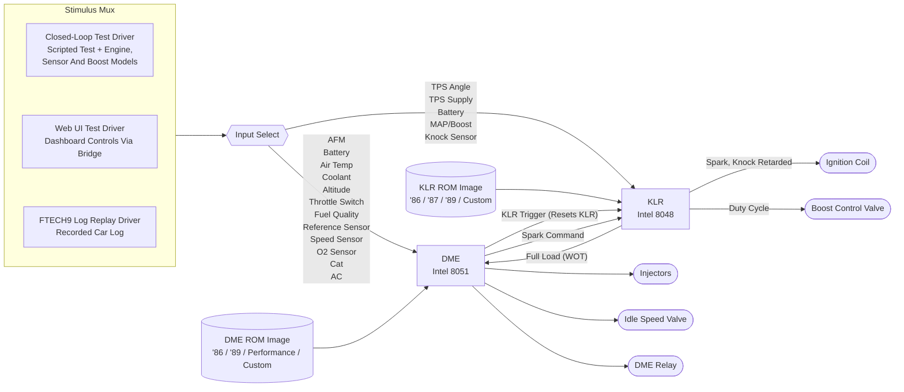

The KLR's ignition output drives the coil: the DME computes the spark and
the KLR retards it when it hears knock. In closed-loop tests the outputs
close the loop: the injected fuel, idle air and boost feed back into the
closed-loop driver's engine model, which sets RPM and the sensor readings for
the next revolution.

Contents

- [Introduction](#introduction)
1. [Install](#1-install)
2. [Setting up](#2-setting-up)
3. [The screen](#3-the-screen)
4. [Log review](#4-log-review)
5. [Live simulation](#5-live-simulation)
6. [The code debugger](#6-the-code-debugger)
7. [Debugging a log at a chosen time](#7-debugging-a-log-at-a-chosen-time)
8. [Snapshots](#8-snapshots)
9. [Charts, Timeline and Maps in detail](#9-charts-timeline-and-maps-in-detail)
10. [ROM images](#10-rom-images)
11. [Reference](#11-reference)
12. [Credits](#12-credits)
- [Appendix A. Regression tests](#appendix-a-regression-tests)
- [Appendix B. iverilog and Verilator](#appendix-b-iverilog-and-verilator)
- [Appendix C. How the closed-loop models work](#appendix-c-how-the-closed-loop-models-work)

---

## 1. Install

Scripts in `install/` set up everything this repo needs on a fresh
machine (macOS, Arch Linux or Windows): the C++ compiler, Verilator, Icarus
Verilog, GTKWave, Node.js and Python with its packages. Run the one for your
system from the top of the checkout. Each is safe to run again; what is
already installed is left alone. Each finishes by running two short simulations to show the install
works (see [Checking an install](#checking-an-install)); that takes a few
minutes, and `--skip-tests` leaves it out.

The checkout can be anywhere and have any name: every script finds the repo
from its own location. Where the build output and logs go is one setting,
`DMEKLR_TMP`; see [Install location and output folder](#install-location-and-output-folder).

To use the live simulator and debugger without building anything, there is
also a [lite package](#the-lite-package-no-verilog-source).

### Getting the code

The developer install works from a clone of this repository (git comes
with the Command Line Tools on macOS, `pacman -S git` on Arch, and Git for
Windows or MSYS2 on Windows):

```sh
git clone https://github.com/whalenlg/944turbo_dme_klr.git
cd 944turbo_dme_klr
```

The install scripts' `--with-dashboard` also clones the dashboard
(whalenlg/dme-dashboard) into `dashboard/`, for working on it; it isn't
needed to use it (it is published at https://whalenlg.github.io/dme-dashboard/).
`git pull` later brings the checkout up to date.

### Before installing

Run the check script first. It changes nothing; it lists each tool the repo
needs, with the version you already have, and marks what is missing or too
old:

```sh
install/check_toolchain.sh
```

To see exactly what an install script would do without running anything,
add `--dry-run` (`install/install_macos.sh --dry-run`,
`install/install_arch.sh --dry-run`). On Arch the install runs a full
system upgrade (`pacman -Syu`), so expect that.

### macOS (Homebrew)

```sh
git clone https://github.com/whalenlg/944turbo_dme_klr.git
cd 944turbo_dme_klr
install/install_macos.sh
source setup                     # in every new terminal, before the scripts
```

It installs, in order:

1. The **Xcode Command Line Tools** (`clang++`, `make`, `git`). If they are
   missing it opens Apple's installer and stops; run the script again when
   that finishes.
2. **Homebrew**, if `brew` isn't found (it asks first; `--yes` skips the
   question).
3. The Homebrew formulae `verilator`, `icarus-verilog`, `node` and
   `python`.
4. **GTKWave**, built from source into `gtkwave/` in the repo (see
   [GTKWave on macOS](#gtkwave-on-macos) below). `--no-gtkwave` skips it.
5. A Python virtual environment at `944venv/` in the repo, with the packages
   in `install/requirements.txt`. You must activate it in each new terminal;
   see [The Python venv](#the-python-venv-944venv) below.
6. `install/check_toolchain.sh`, then the **smoke tests**: the KLR
   regression on Icarus Verilog and `warm_idle_5s` on Verilator (see
   [Checking an install](#checking-an-install)).

| Option | Effect |
|---|---|
| `--upgrade` | `brew upgrade` the formulae that are already installed |
| `--with-dashboard` | Also clone `whalenlg/dme-dashboard` into `dashboard/` (git-ignored) and run `npm install` there |
| `--no-gtkwave` | Skip GTKWave |
| `--rebuild-gtkwave` | Build GTKWave again even if it is already there |
| `--skip-tests` | Don't run the smoke tests at the end |
| `-y`, `--yes` | Don't ask before installing Homebrew |
| `-n`, `--dry-run` | Print the commands without running them |

Apple Silicon and Intel Macs both work.

#### GTKWave on macOS

Homebrew no longer has GTKWave: `brew install gtkwave` finds neither a
formula nor a cask, and the old `gtkwave.app` from SourceForge doesn't run
on current macOS. So `install_macos.sh` builds it from source, the same way
GTKWave's own macOS build does:

1. `brew install meson ninja pkg-config gtk+3 gtk4 gtk-mac-integration
   json-glib desktop-file-utils shared-mime-info librsvg` (flex and gperf
   come with the Command Line Tools).
2. Clone `https://github.com/gtkwave/gtkwave` into `gtkwave/src/` and check
   out a pinned commit of GTKWave 4, the version under active development
   and the one its macOS build supports.
3. `meson setup`, `meson compile` and `meson install` with the prefix
   `gtkwave/` in the checkout, so it needs no `sudo` and nothing outside
   the repo changes. `gtkwave/` is git-ignored.

That takes about five minutes. It installs `gtkwave` and the converters the
repo's scripts use (`vcd2fst`, `fst2vcd`) into `gtkwave/bin/`, which
`source setup` puts on `PATH`. Open a waveform from the terminal:

```sh
source setup
gtkwave "$DMEKLR_TMP/klr/fst/i8048_regression_tb.fst"
```

GTKWave is optional, so if the build fails the installer prints a warning
and carries on. Run `install/install_macos.sh --rebuild-gtkwave` to try
again, or to rebuild after deleting `gtkwave/`. To build a different
GTKWave commit or tag, set `GTKWAVE_REF`
(`GTKWAVE_REF=<commit> install/install_macos.sh --rebuild-gtkwave`). If
`gtkwave` is already on your `PATH` from somewhere else, the installer
leaves it alone.

### Arch Linux (pacman)

```sh
git clone https://github.com/whalenlg/944turbo_dme_klr.git
cd 944turbo_dme_klr
install/install_arch.sh
```

It runs one `sudo pacman -Syu --needed` with `base-devel`, `git`,
`verilator`, `iverilog`, `gtkwave`, `nodejs`, `npm`, `python`,
`python-openpyxl`, `python-pandas`, `python-matplotlib` and
`python-numpy`, all from the official repositories. `-Syu` upgrades the
rest of the system too, because Arch doesn't support partial upgrades. The
Python packages come from pacman, so there is no venv to activate. Then it
runs `install/check_toolchain.sh` and the same smoke tests as on macOS.

| Option | Effect |
|---|---|
| `--venv` | Install the Python packages with pip into `944venv/` instead of from pacman (then `source 944venv/bin/activate` as on macOS) |
| `--with-dashboard` | Also clone `whalenlg/dme-dashboard` into `dashboard/` and run `npm install` there |
| `--no-gtkwave` | Skip GTKWave |
| `--skip-tests` | Don't run the smoke tests at the end |
| `-y`, `--yes` | Pass `--noconfirm` to pacman |
| `-n`, `--dry-run` | Print the commands without running them |

### Windows (MSYS2)

On Windows the toolchain comes from [MSYS2](https://www.msys2.org/), which
has native Windows builds of Verilator, Icarus Verilog, GTKWave, gcc,
Node.js and Python with numpy, pandas, matplotlib and openpyxl, installed
with its own `pacman`. Nothing is compiled from source. In PowerShell:

```powershell
# No checkout yet: installs MSYS2, clones the repo into C:\dmeklr\944turbo_dme_klr, installs
powershell -ExecutionPolicy Bypass -File install_windows.ps1 -Clone C:\dmeklr\944turbo_dme_klr

# Or from a checkout you already have
cd C:\dmeklr\944turbo_dme_klr
powershell -ExecutionPolicy Bypass -File install\install_windows.ps1
```

(For the first form, download `install/install_windows.ps1` from GitHub
on its own.) `install_windows.ps1` installs MSYS2 into `C:\msys64` if it
isn't there (`-MsysRoot` picks another folder), then runs
`install/install_msys2.sh` in MSYS2's **UCRT64** environment. That runs one
`pacman -Syu --needed` with `git`, `make`, `perl` and the
`mingw-w64-ucrt-x86_64-` packages `gcc`, `verilator`, `iverilog`,
`gtkwave`, `nodejs`, `python`, `python-openpyxl`, `python-pandas`,
`python-matplotlib` and `python-numpy`, then `check_toolchain.sh` and the
same smoke tests as on macOS and Arch. If you already use MSYS2, you can
run `install/install_msys2.sh` yourself from a UCRT64 terminal.

Afterwards, work in the **MSYS2 UCRT64** terminal (Start menu, or
`C:\msys64\ucrt64.exe`): it is a bash shell, and every command in this
manual works there as written, starting with `source setup`. Your `C:`
drive is `/c` in it, so `cd /c/dmeklr/944turbo_dme_klr`. The live bridge
(`node bridge.mjs`) listens on 127.0.0.1 as on the other systems, so the
dashboard in any Windows browser connects to it the same way.

| Option | Effect |
|---|---|
| `-MsysRoot DIR` | Where MSYS2 is, or goes (default `C:\msys64`) |
| `-Clone DIR` | Clone the repo into `DIR` first and install from there |
| `-Venv` | Also make `944venv/`, a venv that sees the pacman packages (`--venv` for `install_msys2.sh`) |
| `-WithDashboard` | Also clone `whalenlg/dme-dashboard` into `dashboard/` and run `npm install` there |
| `-NoGtkwave` | Skip GTKWave |
| `-SkipTests` | Don't run the smoke tests at the end |
| `-Yes` | Don't ask pacman to confirm |

Things to know on Windows:

- **No spaces in the checkout's path.** Verilator's generated makefiles
  can't build in a folder like `C:\Users\Jane Doe\...`; the installers warn
  about it. A short path such as `C:\dmeklr` is safest.
- **Line ends.** The repo's `.gitattributes` checks every text file out
  with LF line ends, also with Git for Windows (whose default is CRLF), so
  the bash scripts run. A checkout made before that file existed can be
  fixed with `git rm --cached -r -q . && git reset --hard` (commit or
  stash your changes first: the reset discards them).
- **Paths.** Under MSYS2, `source setup` sets `DMEKLR_REPO` and
  `DMEKLR_TMP` as `C:/...` paths, which both bash and the native Windows
  tools understand.
- **WSL instead.** On Windows 10/11 with WSL2 you can also run the Arch
  installer inside an Arch Linux WSL distribution, as on a Linux PC. That
  path isn't tested here; the MSYS2 one is.

### The lite package (no Verilog source)

The lite package is for people who want the dashboard's live mode and the
code debugger without the developer install. It is a download with the
simulator already built, and holds no Verilog, testbenches or simulator
build scripts. Verilator, iverilog, GTKWave and a C++ compiler are not
needed.

| | Lite package | Developer install (this repo) |
|---|---|---|
| Live mode, code debugger, snapshots, ROM swapping | yes | yes |
| Disassembly workbooks; edited workbooks rebuild the listing | yes | yes |
| Regression tests (`run_tests.py`), TEST LOAD from a test's warning | yes | yes |
| Runs with no internet connection (dashboard included) | yes | with the dashboard built locally |
| Changing the model (Verilog) | no | yes |
| Needs | Node.js 18+; Python with `requirements.txt` (pandas, openpyxl, matplotlib, numpy); bash to rebuild listings | everything in [Dependencies](#dependencies) |

**Getting it.** There are three ways, for macOS (Apple Silicon), Linux
x86_64 (glibc 2.35 or newer: Ubuntu 22.04, Arch, ...) and Windows x86_64.
Each package is one archive, `dmeklr-lite-<version>-<platform>.tar.gz`
(`.zip` for Windows).

1. **A release** (when there is one): the repository's
   [Releases page](https://github.com/whalenlg/944turbo_dme_klr/releases)
   lists each version with the three archives under *Assets*. Pushing a
   `v*` tag (for example `git tag v1.0 && git push origin v1.0`) makes a
   release: the `Lite package` workflow builds, tests and attaches the
   archives to it. No release has been made yet.
2. **The latest build**, without a release: on GitHub, open the
   repository's **Actions** tab, pick the **Lite package** workflow, open
   its latest successful run on `main`, and download `lite-macOS`,
   `lite-Linux` or `lite-Windows` under *Artifacts* (you need to be signed
   in to GitHub; artifacts are kept 90 days). The download is a `.zip`
   holding the package archive; unzip it first (macOS's Finder may do
   that by itself).
3. **Build it yourself** from the developer install: see *Building it
   yourself* below.

**Using it.** Unpack `dmeklr-lite-<version>-<platform>.tar.gz` (`.zip` on
Windows) anywhere, install Node.js 18 or newer (https://nodejs.org), and
work in the folder it unpacks to, where `requirements.txt` and
`run_lite.sh` are:

```sh
tar -xzf dmeklr-lite-<version>-<platform>.tar.gz   # macOS may leave a .tar: tar -xf
cd dmeklr-lite-<version>-<platform>
python3 -m venv .venv && .venv/bin/pip install -r requirements.txt   # once
./run_lite.sh                                        # Windows: run_lite.cmd
```

On Windows the venv line is `py -m venv .venv` then
`.venv\Scripts\pip install -r requirements.txt`. `run_lite.sh` and
`run_lite.cmd` use `.venv` by themselves when it is in the package folder.
On Debian / Ubuntu, if venv says *ensurepip is not available*, install
`python3-venv` first. The package's README.txt has the same steps.

and open **http://127.0.0.1:8951/?live**: the bridge serves the
dashboard that comes with the package, already in live mode, so no
internet connection is needed (the hosted dashboard works too: press
**LIVE**, as in [section 5](#5-live-simulation)). `python3 run_tests.py`
runs the regression tests on the packaged testbench (see the package's
README.txt); a test that warns adds a TEST row that TEST LOAD runs.
Snapshots and the map-graph cache go to `data/` in the package folder
(`DMEKLR_TMP` moves them). On macOS, `run_lite.sh` clears the
downloaded-file flag on the package folder so the unsigned simulator can
run. Without bash (Windows with no Git Bash or MSYS2), or without pandas
and openpyxl, the bridge uses the listings that came with the package, so
an edited workbook doesn't change the listing until bash and those packages
are available.

**How the downloads are made.** The `Lite package` GitHub Actions
workflow (`.github/workflows/lite-package.yml`) builds the package on each
platform for every push to `main` that touches the simulator, the lite
scripts or the ROMs (and for pull requests, a `v*` tag, or by hand from the
Actions tab: *Run workflow*), tests each one with `lite/test_lite.sh` there
and again on a clean machine, and keeps the archives as workflow
artifacts. For a `v*` tag it also attaches them to that tag's release.

**Building it yourself** (developer install):

```sh
lite/make_lite.sh                 # -> $DMEKLR_TMP/lite/dmeklr-lite-<version>-<platform>.tar.gz
lite/test_lite.sh "$DMEKLR_TMP"/lite/dmeklr-lite-*.tar.gz
```

`test_lite.sh` takes a package folder or archive (`.tar.gz`, `.tar` or
`.zip`); run with none in a folder that holds one package (as
`~/lite-test` in the macOS VM test does), it finds it there:
`./test_lite.sh`.

`make_lite.sh` makes the disassembly tables for every ROM that has a
workbook, builds the simulator with `dme_klr/live/build_live.sh
--relocatable` (in `obj/lite/`; every file path in it is relative, so it
runs wherever the package is unpacked), and copies in the bridge, the ROM
images, the workbooks and the scripts that make tables from them. It also
fetches the dashboard from GitHub (whalenlg/dme-dashboard, `main`, or
`--dashboard-ref <branch or tag>`), builds it with `npm run build:lite`
and puts it in the package's `dashboard/`, so it needs git, Node.js and
the network. It stops if any Verilog or C++ source ends up in the package.

### The Python venv (`944venv`)

The repo's Python scripts need four packages beyond the standard library:
openpyxl, pandas, matplotlib and numpy (`install/requirements.txt`). On
macOS these are installed into a Python virtual environment, a private
copy of Python with its own packages, in the folder `944venv/` at the top
of the checkout. It is required on macOS because Homebrew's Python refuses
`pip install` into the system Python.

**Activate it in every new terminal** before running any of the repo's
scripts. `source setup` at the top of the checkout does that (and sets the
output folder, see below); `source 944venv/bin/activate` activates just the
venv:

```sh
cd 944turbo_dme_klr
source setup                    # the prompt now starts with (944venv)
```

Why this matters: the test scripts, `build_live.sh` and the live bridge
(`node bridge.mjs`, which runs the map-graph scripts) all call plain
`python3`. Until the venv is active, `python3` is Homebrew's or Apple's,
which doesn't have the packages, and you get errors such as
`ModuleNotFoundError: No module named 'pandas'` or a MAPS tab with no
graphs. Only `asm_select.sh` finds `944venv/bin/python` on its own.
Start the bridge from a terminal where the venv is active.

Other things to know:

| Task | Command |
|---|---|
| Leave the venv | `deactivate` |
| Activate it automatically | Add `source /path/to/your/checkout/setup` to `~/.zshrc` (or `~/.bashrc`) |
| Check it | `install/check_toolchain.sh` reports `944venv not active in this shell` when it exists but isn't active |
| Rebuild it (after a Homebrew Python upgrade breaks it) | `rm -rf 944venv && install/install_macos.sh` |
| Use it on Arch | `install/install_arch.sh --venv` (by default Arch uses pacman's packages and needs no venv) |

The folder is git-ignored. You don't need it at all if your `python3`
already has the four packages, for example installed some other way: the
check script tells you.

### Install location and output folder

**The checkout.** Clone it wherever you like, under any folder name. The
scripts, the testbenches and the bridge all work out where the repo is from
their own location; nothing in the repo names a fixed path. (The run
scripts pass the repo's path to the Verilog as `-DDMEKLR_REPO`, so the
testbenches find the ROM images and disassembly tables wherever the
checkout is.)

**The output folder, `DMEKLR_TMP`.** Builds, logs, snapshots and caches are
kept out of the checkout, in one folder. By default it is `tmp/` **beside**
the checkout, i.e. `<checkout>/../tmp`: for a checkout at
`~/work/944turbo_dme_klr` that is `~/work/tmp`. It is created when first
needed. To put it somewhere else, set `DMEKLR_TMP` to an absolute path
before running anything, for example in `~/.zshrc`:

```sh
export DMEKLR_TMP="$HOME/dmeklr-output"
```

Every script honours it: the shell scripts through `paths.sh`, the Python
tools through `dme_klr/dmeklr_paths.py`, and the bridge (`node bridge.mjs`)
from its environment.

The dashboard tests and replays write in a folder of the ROM pair they ran
on, `dme_klr/<rom>/` (`DMEKLR_LOGS` in `paths.sh`), so runs on different
images never overwrite each other's logs. `<rom>` comes from `DME_ROM_FILE` /
`KLR_ROM_FILE`: **89** for the default 1989 pair (`run89.sh`), **86** for
`run86.sh`'s, **carpokes** for `run_carpokes.sh`'s, and for any other pair
the DME image's name without its extension, e.g. `28PIN_DME_PERFORMANCE`
(two such runs with one DME image and different KLR images share it). The builds are shared, as they take the
images when a test runs. Logs from before the per-ROM folders stay in
`dme_klr/dash_logs/` and `dme_klr/v_dash_logs/`; LOAD LOG still lists them.

| Under `$DMEKLR_TMP` | Written by |
|---|---|
| `dme_klr/<rom>/dash_logs/` | `run_dashboard_tests.sh` (iverilog) |
| `dme_klr/<rom>/v_dash_logs/` | `v_run_dashboard_tests.sh` (Verilator) |
| `dme_klr/<rom>/replay/{v_,}dash_logs/` | `replay/run_replay.sh` |
| `dme_klr/<rom>/iverilog_vvp/`, `dme_klr/<rom>/verilator_obj/` | a test built on its own (debug switches, `--per-test-build`), in its ROM pair's folder so pairs running at once never share one |
| `dme_klr/<rom>/run_all/` | `run_all.sh`'s step logs for that pair (the suites, the comparison, `compare_detail.log`, the FQS analysis) |
| `dme_klr/runtime/`, `dme_klr/runtime_iv/` | `run_dashboard_parallel.sh`: the one testbench build per simulator every test and ROM pair runs on (the images are loaded when a test runs) |
| `dme_klr/rom_diff_{v_,}dash_logs.log` | `compare_rom_variants.sh`: the verdicts of each ROM pair's folder side by side, then each test's `.dash.log` values compared with the first pair's (`compare_rom_dash.py`: the fields that differ most and by how much) |
| `dme_klr/snapshots/`, `dme_klr/map_graphs/` | the live bridge (`--snapdir` / `--mapcache` override each) |
| `klr/`, `dme/` | the i8048 and i8051 CPU regressions |
| `run_all/` | `run_all.sh`'s logs of the CPU regressions and the macOS VM test |

The Python analysis tools (`fqs_analysis.py`, `check_memory_location.py`,
`compare_sim_logs.py`, …) read their default log folders from the same place.
If you change `DMEKLR_TMP`, existing logs stay where they were: move them
across or point the tools at them with their directory arguments.

**`setup`.** `source setup` in a terminal sets `DMEKLR_REPO` and
`DMEKLR_TMP`, activates `944venv/` when it exists, puts a locally built
Icarus Verilog in `/opt/iverilog` and a GTKWave in `<checkout>/gtkwave/bin/`
(where `install_macos.sh` builds it) or `<checkout>/gtkwave/` ahead of the
system ones when they are there, and adds the checkout to
`PATH`. It works from bash and zsh.

### Checking an install

Each install script finishes by running `install/check_toolchain.sh`, which you can
also run on its own at any time. It prints each tool with its version and
exits non-zero if anything required is missing or too old:

```
  ok       c++          Apple clang version 17.0.0
  ok       make         GNU Make 3.81
  ok       verilator    5.040
  ok       iverilog     12.0 (stable)
  ok       gtkwave      /Users/you/944turbo_dme_klr/gtkwave/bin/gtkwave
  ok       node         24.4.0
  ...
```

Then it runs `install/smoke_test.sh`, which sources `setup` (as a
new terminal would) and runs two simulations that exercise the whole
toolchain:

| Test | What it runs | Passes when |
|---|---|---|
| `klr` | `klr/run_klr_regression`: the KLR i8048 CPU regression on Icarus Verilog, with the Python table converters | every check prints `PASS`, none `FAIL` |
| `warm_idle_5s` | `dme_klr/v_run_dashboard_tests.sh warm_idle_5s`: the full DME+KLR model compiled with Verilator and run for 5 simulated seconds | it compiles and runs, and the dashboard log has its `[DS]` snapshots |

It ends with a PASS/FAIL line for each:

```
Smoke tests
  PASS  iverilog: KLR regression  (… checks passed, 20s)
  PASS  verilator: warm_idle_5s  (… dashboard snapshots in …/warm_idle_5s.dash.log, 180s)
```

Most of the time is the Verilator compile. Each test's full output is in
`$DMEKLR_TMP/install_smoke/<test>.log`, and the `warm_idle_5s` dashboard
log is left in `$DMEKLR_TMP/dme_klr/89/v_dash_logs/`, ready to open in the
dashboard. If a test fails, the install script stops with an error after
printing the end of that test's log; the tools are installed by then, so
once the cause is fixed, run just the tests again:

```sh
install/smoke_test.sh                 # both
install/smoke_test.sh warm_idle_5s    # or one: klr, warm_idle_5s
```

### Testing the macOS install on a clean Mac

`install/test_macos_vm.sh` checks `install_macos.sh` from scratch, without
touching your own setup. It needs an Apple Silicon Mac with Tart
(`brew tap openai/tools && brew install openai/tools/tart`). It clones a
fresh macOS VM without Homebrew, copies the checkout in (the committed `HEAD`,
or `--worktree` for your uncommitted changes too), removes the Command Line
Tools if the image has them, checks the installer stops and asks for them,
installs them, runs the installer (with its smoke tests) and checks the
smoke tests' logs, then, in a new zsh terminal, sources `setup` and runs
`check_toolchain.sh`, the live simulator build (run to 200 ms) and a GTKWave launch on
the KLR waveform. It prints PASS or FAIL for each step, saves the logs in
`$DMEKLR_TMP/macos_vm_test/<date-time>/` and deletes the VM (`--keep` leaves
it running). The first run downloads the macOS image, about 25 GB; a run
takes about 20 to 40 minutes. See `install/test_macos_vm.sh --help`.
`run_all.sh` runs it as step 6 only when asked (`--macos-test install`,
`lite` or `both`; the RUN REGRESSIONS panel's **MACOS INSTALL TEST**), and
skips it by default.

`install/test_regress_hosts.sh` checks RUN REGRESSIONS' regression hosts
across two machines: this install and a macOS VM on this Mac (made with
`test_macos_vm.sh --keep`) running the lite package built here, or, with
`--dev`, a developer install (slower, adds the iverilog suite and its
waveforms). It checks that the host has the same software and refuses a
missing or wrong token and different software; that a Verilator run (and
with `--dev` an iverilog one) sends tests to the host and gets every test's
logs (and waveforms) back here to be validated, with nothing left in the
host's `remote_jobs`; and that when the host's bridge stops mid-run its
tests are requeued and the run completes. `--host <url> --token <t>` tests
against any machine already running `bridge.mjs --listen` instead of a VM,
`--keep` leaves the VM and its bridge running, `--reuse` uses that VM again.
It prints PASS / FAIL for each check. See `install/test_regress_hosts.sh --help`.
The RUN REGRESSIONS panel runs it too: **TEST THE NETWORK RUN** under
REGRESSION HOSTS, with the second machine (a lite or developer VM, or a host
from the list, whose saved token it uses), `--keep`, `--reuse`, the host's
threads and the tests, and shows its steps and checks as they come (not while
a regression run is going).

To test `install_arch.sh` itself on a clean system, `install/test_arch_install.sh`
runs it in a fresh `archlinux:latest` container (Docker or Podman),
including its smoke tests, then `source setup` and `check_toolchain.sh` in a
new login shell, checks the smoke tests' output, builds and runs the live
simulator and launches GTKWave on the KLR waveform (under Xvfb), and prints a
PASS/FAIL line for each (`--venv` tests `install_arch.sh --venv`). The
"Arch install test" GitHub workflow runs the same steps on pull requests
that touch `install/`.

The "Windows install test" GitHub workflow does the same for Windows on a
clean `windows-latest` runner: it runs `install_windows.ps1`, which
installs MSYS2 from scratch into a new folder and then the toolchain with its
smoke tests, then `install/test_windows_install.sh` in a UCRT64 shell:
`source setup` and `check_toolchain.sh`, the smoke tests' output, the live
simulator build (run to 200 ms), the live bridge (a client on `/events`
sees the simulator pause at 200 ms after `POST /cmd`) and GTKWave opening
the KLR waveform. With `--browser` (the workflow passes it) it also opens
the published dashboard in Edge, live on a bridge on the runner, through
`install/dashboard_e2e.mjs`: the page must connect, show a pause sent to the
bridge, and drive the simulator with its own ▶ RUN and ⏸ PAUSE buttons. Its
screenshots are in the workflow's uploaded logs. It runs with and without `-Venv`, on pull requests that
touch `install/`, and by hand from the Actions tab. You can run
`install/test_windows_install.sh` on your own Windows install too, after
the installer.

### Dependencies

Everything the repo uses outside the standard tools every Unix system has
(bash, awk, sed, grep, gzip, …):

| Dependency | Version | Used for | macOS | Arch |
|---|---|---|---|---|
| C++ compiler with C++20 | Apple clang 14+ or GCC 10+ | Compiling the Verilator models; `--timing` needs C++20 coroutines | Xcode Command Line Tools | `base-devel` (gcc) |
| make | any (macOS's 3.81 is fine) | Verilator's generated build | Xcode Command Line Tools | `base-devel` |
| git | any | Cloning; `run_all.sh` pulls `main` first | Xcode Command Line Tools | `git` |
| Verilator | **5.038 or newer** | `v_run_dashboard_tests.sh`, `run_dashboard_parallel.sh --verilator`, `replay/run_replay.sh`, the live simulator (`live/build_live.sh`) | `verilator` | `verilator` |
| Icarus Verilog (`iverilog`, `vvp`) | 12 or newer | `run_dashboard_tests.sh`, the i8048 and i8051 CPU regressions (`klr/run_klr_regression`, `dme/run_dme_regression`), the replay's reference run | `icarus-verilog` | `iverilog` |
| GTKWave | any (optional) | Viewing the `.vcd` / `.fst` waveforms the testbenches can dump; its `vcd2fst` / `fst2vcd` convert them (`--vcd` runs, the replay, `extract_table_access.py`) | built from source into `gtkwave/` ([GTKWave on macOS](#gtkwave-on-macos)) | `gtkwave` |
| Node.js | **18 or newer** | The live-sim bridge, `dme_klr/live/bridge.mjs` (standard library only, no `npm install` needed) | `node` | `nodejs` |
| npm | comes with Node | Running the dashboard from a checkout of `dme-dashboard` | `node` | `npm` |
| Python | 3.9 or newer | All the `.py` tools: disassembly tables, log validation and comparison, replay, map graphs | `python` | `python` |
| openpyxl | 3.1+ | Reading and writing the disassembly workbooks (`*.xlsx`), replay stimulus | pip (venv) | `python-openpyxl` |
| pandas | 2.0+ | Turning disassembly workbooks into the hex tables the testbenches load (`dme/disassemble/xlsx*.py`, run by the KLR regression and `asm_select.sh`), `live/asm_full.py` | pip (venv) | `python-pandas` |
| matplotlib | 3.7+ | The ROM map graphs on the dashboard's MAPS tabs (`live/map_graphs.py`, `live/klr_map_graphs.py`), `compare_sim_logs.py --plot` | pip (venv) | `python-matplotlib` |
| numpy | 1.24+ | The 3-D map graphs | pip (venv) | `python-numpy` |

The Python packages are listed in `install/requirements.txt` for anyone
installing them another way (`pip install -r install/requirements.txt`).

The dashboard itself needs nothing installed: use the published page (see
[section 2](#2-setting-up)). Only running it from a local checkout needs
npm, and `--with-dashboard` sets that up.

### Notes

- **Where the output goes.** In `$DMEKLR_TMP`, by default `tmp/` beside the
  checkout; see [Install location and output folder](#install-location-and-output-folder).
- **Older Verilator.** The live simulator and the Verilator tests need
  5.038 or newer. Homebrew and Arch both ship newer releases; on another
  Linux whose package is older, build it from source
  (https://verilator.org/guide/latest/install.html).
- **Windows.** The Dependencies table's Arch package names, with the
  `mingw-w64-ucrt-x86_64-` prefix, are the MSYS2 ones; see
  [Windows (MSYS2)](#windows-msys2).
- **Other Linux distributions.** Install the same things with your package
  manager (the table above has what each is for), then run
  `install/check_toolchain.sh`.

---

## 2. Setting up

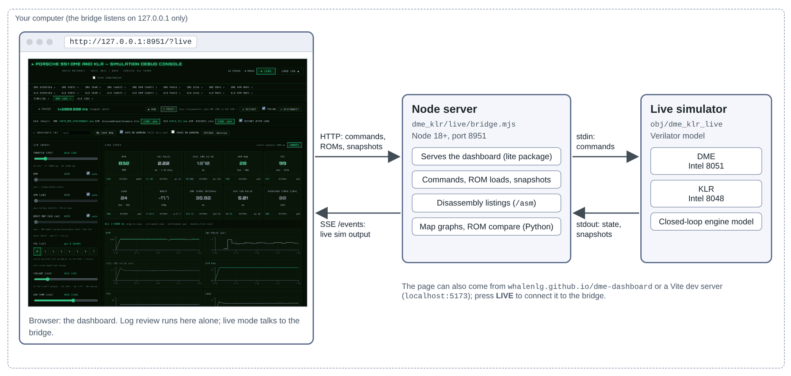

Live mode has three parts, all on your computer. The **browser** shows the
dashboard. The **Node server** (`bridge.mjs`) passes the dashboard's commands,
ROM loads and snapshot requests to the simulator, streams everything the
simulator prints back to the page, and serves the disassembly listings and map
graphs. The **live simulator** (`obj/dme_klr_live`) is the Verilator model of
the DME and KLR with the closed-loop engine model. Log review needs only the
browser.

### The dashboard

Use the published page at **https://whalenlg.github.io/dme-dashboard/**, or
run it from a checkout of `dme-dashboard`:

```sh
npm install
npm run dev          # http://localhost:5173/dme-dashboard/
```

Log review needs nothing else. Everything the page does with a log happens in
the browser.

### The live simulator (for live mode and code debugging)

> **Note:** This mode is not yet supported for end user installation.

From `dme_klr/live/` in this repo:

```sh
./build_live.sh      # Verilator >= 5.038; builds obj/dme_klr_live (a few minutes)
node bridge.mjs      # Node 18+; starts the sim and serves http://127.0.0.1:8951
```

(Section 1 installs all of these.)

Leave `bridge.mjs` running, then press **LIVE** in the dashboard. The bridge
listens only on 127.0.0.1 and only answers pages from `whalenlg.github.io`,
`localhost` or `127.0.0.1` (`--allow-origin <origin>` adds another).

The ROM graphs on the MAPS tabs need matplotlib, and regenerating
full-length operands after editing a disassembly workbook
(`python3 dme_klr/live/asm_full.py`) needs pandas and openpyxl. The install
scripts in [section 1](#1-install) put all three in place.

Rebuild with `./build_live.sh` after any change to the Verilog, the testbench
or `sim_main.cpp`. After a Verilator upgrade (`brew upgrade verilator`)
`build_live.sh` and `replay/run_replay.sh` notice the different version and
clear the old build first, since its make dependencies name the old
version's include files. See `dme_klr/live/README.md` for the build details.

### Making logs to review

| Script (in `dme_klr/`) | Writes | Notes |
|---|---|---|
| `./run_dashboard_tests.sh <test>` | `$DMEKLR_TMP/dme_klr/<rom>/dash_logs/<test>.dash.log` | Icarus Verilog. With no test name it runs them all; an unknown name prints the list |
| `./v_run_dashboard_tests.sh <test>` | `$DMEKLR_TMP/dme_klr/<rom>/v_dash_logs/<test>.dash.log` | Verilator, the same tests. Best for logs you plan to debug in the simulator (section 7) |
| `./run_dashboard_parallel.sh <jobs> [group]` | the same folders | Several tests at once, plus validation |
| `replay/run_replay.sh` | `$DMEKLR_TMP/dme_klr/<rom>/replay/{v_,}dash_logs/` | Replays a recorded car log, see `dme_klr/replay/README.md` |
| `./run_all.sh [options] [workers]` | the same folders, and `$DMEKLR_TMP/run_all/` | The whole check: both CPU regressions, both dashboard suites, the comparison and FQS analysis, the macOS VM test (step 6, only with `--macos-test install\|lite\|both`; the default is `none`). See `--help`. `--tests "..."` runs only some dashboard tests, `--no-pull` skips the `git checkout main` / `git pull`, `--no-plot` skips step 5's difference plots, `--roms "89 86 carpokes"` runs steps 3-5 for each of those ROM pairs (see RUN REGRESSIONS) |
| `python3 rom_variant_diff.py <rom> <rom> [...]` | prints | Two or more ROM folders' tests side by side: verdicts, and each DME / KLR `[STATUS]` field whose settled mean differs from the first folder's (`--sim`, `--test`, `--all`, `--json`) |
| `./validate_all.sh [--verilator] [test ...]` | prints | Validates the logs already in the ROM pair's folder (`validate_dash_log.py` on each test). For a run on another image, set the same `DME_ROM_FILE` (`DME_ROM_FILE=my_edit.mem ./validate_all.sh --verilator`): it picks that image's log folder and its expected values. An image saved from the code windows' byte editor (with a `<image>.base`) is checked against its base image's expected values, as is a log whose `[ROM]` line names such an image |
| `./iv_disk_usage.sh [options]` | `$DMEKLR_TMP/iv_disk_usage/` | Measures the disk space and time of the iverilog tests under each combination of the debug flags (5 FQS tests by default, each configuration in its own folder) and estimates the whole suite. `--sim-s 1` for a quick measurement, `--save-rates` to update `iv_disk_rates.json`, which the RUN REGRESSIONS panel's estimates come from (`--help`) |

`DASH_INTERVAL_MS` (default 100) sets how often the testbench dumps RAM. A
smaller value gives finer playback and larger logs.

**From the dashboard.** The **RUN REGRESSIONS ▸** button in the header (and in the **LOAD LOG** window that opens at start, beside **LIVE SIM**
and **BROWSE…**) opens a panel
that runs `run_all.sh` through the bridge (`node dme_klr/live/bridge.mjs`
must be running; `live/runall.mjs`). It has every `run_all.sh` option
(Verilator, iverilog or both, workers, per-test build, the macOS VM test
(**MACOS INSTALL TEST**: none by default, or install, lite or both),
update first or `--no-pull`, **Plot Differences** or `--no-plot`), the snapshot interval and
the ROM images every test runs on (the 1989 pair by default, the `run86.sh`
and `run_carpokes.sh` pairs, or any DME and KLR image in `bin_images/` or
uploaded, passed as `DME_ROM_FILE` / `KLR_ROM_FILE`; the run's logs go in
that pair's folder, `$DMEKLR_TMP/dme_klr/89`, `86`, `carpokes` or
the DME image's name, shown under the ROM pickers). **ROM pairs** ticks the
named pairs, **89**, **86** and **carpokes** (only 89 by default): with more
than one, each test runs once per pair and simulator (up to six runs:
`run_all.sh --roms`), and each pair keeps everything apart while they run, its
logs, hex dumps, per-test builds, snapshots and step logs all in its own
folder; only the one testbench build per simulator is shared, built before the
pairs start. Every pair's suites run at the same time and share the workers
(below). The
CPU regressions and the macOS VM test run once. The progress shows a bar for
each suite of each pair (**Verilator · 86**, **iverilog · carpokes**), and
each test a line for each. The panel then lists the tests
in the groups of [Appendix A](#appendix-a-regression-tests), where you pick
whole groups or single tests. Each test's line also has its iverilog debug
switches (DME, DME deep and KLR debug, `--test-debug=<test>:DME_DEBUG+KLR_DEBUG`
to `run_all.sh`): only the tests you tick get the debug output, since it
makes large dumps; each of those is built on its own and always runs on this
machine, and keeps its full log uncompressed (`dash_logs/<test>.log`, not
`.log.gz` as other tests do) so you can open and grep it as it is. Each test with a switch on shows about how much disk its output takes
(in decimal GB, as Finder and Explorer count them),
and the group headers and the run line add them up (from
`dme_klr/iv_disk_rates.json`, measured by `iv_disk_usage.sh`). While it runs, a bar for each test shows its
simulated time against its length, with its PASS / WARN / FAIL when it is
checked, and bars for each group, each simulator's suite and the full run
(simulated seconds done of the total, with the time left estimated from
the rate so far); the six steps show which one is running. When more than one
suite runs (both simulators, or several ROM pairs), `run_all.sh` runs them all
at the same time (steps 3 and 4 together), sharing the workers and the
regression hosts' threads: whenever a test ends, its thread starts the next
waiting test of any suite, so no thread sits idle while a suite's last long
tests finish and other suites still have tests waiting. Each suite still
starts its own tests longest first. The run goes on
when the panel is closed (the button shows its %) and stops with **STOP RUN**
or when the bridge stops. With **Plot Differences** ticked (the default),
step 5 plots each test whose iverilog and Verilator logs differ
(`compare_sim_logs.py --plot`: `<test>_DME_diff.jpg` and `<test>_KLR_diff.jpg`
in the run's iverilog `dash_logs`, one subplot per field that differs, iverilog
against Verilator over simulated time), and the test's iverilog line gets a
**◪ DME** / **◪ KLR** icon that opens its plot in a new tab (the bridge's
`GET /runall/diff?rom=<rom>&test=<test>&ecu=DME`). Only this run's plots get an icon;
step 5 deletes a test's older plot before it makes a new one. Unticked, step 5
still writes its per-test comparison report (`$DMEKLR_TMP/dme_klr/<rom>/run_all/compare_detail.log`)
but no plots. The plots need matplotlib. **FQS ANALYSIS** runs `fqs_analysis.py` (step 5's
FQS analysis) on the iverilog and Verilator dash logs of the ROM pair picked
in the panel as they are now and shows its report in the panel, with
**REFRESH** to run it again. Its
**vs base** column is each test's fuel against the same test with no FQS
override (`cl_ramp_to_6000` / `ramp_to_6000`), and **VL-IV** is Verilator
against iverilog for the same test (0 when they agree). The groups come from
`dme_klr/live/test_groups.json`, made from this appendix:
`python3 dme_klr/live/test_groups.py check` says when the two differ.

**Changing a run as it goes.** While a run is going, the run line has a
**THREADS** row: **−** / **+** beside *here* and beside each regression host
the run uses change how many tests run at a time there (here 1 up to 8 or
the CPU count, whichever is more; a host 0 to 64, where 0 sends it no more
tests). With several suites at once the counts are what they all share. The
**CANCEL QUEUED** buttons stop tests that haven't started from ever starting:
all of the Verilator suite's, all of the iverilog suite's, one suite's (on its
bar, with several ROM pairs), or one test group's (on the group's line, in
every suite), and a single test's **✕ CANCEL** on its line while it waits
(that suite only; press again to confirm). A cancelled test shows *cancelled*, isn't in the suite's
verdicts or total (`parallel_summary.log` lists it under `Cancelled`), and
the run goes on with the rest. Neither change stops a test that is already
running: it ends as it would have. The panel writes both into
`$DMEKLR_TMP/run_all/control/` (`$DMEKLR_RUN_CONTROL`), which
`run_dashboard_parallel.sh` and `run_tests.py` read before starting each test.
A run started by a bridge from before these controls shows a note instead:
pull and restart `bridge.mjs` (restarting it stops that run).

**ROM VARIANTS** compares the ROM pairs whose runs left logs (each pair's
folder, `$DMEKLR_TMP/dme_klr/<rom>`): tick two or more folders (the first is
the reference), pick Verilator, iverilog or both, and press **COMPARE**. For
each test that ran on more than one of them it shows the verdicts side by
side, and how many DME and KLR `[STATUS]` fields differ from the reference;
click a test for the validator's detail line per pair, an **OPEN** link to
each pair's log, and the fields that differ most (settled mean over the second
half of the run, last values, and the difference). **matching tests too**
lists the tests that are the same everywhere as well. To compare two pairs,
run the same tests on each first (pick the pair under the ROM pickers and
**START RUN**). It runs `rom_variant_diff.py` on the bridge
(`GET /runall/romdiff`); from the command line, `compare_rom_variants.sh`
runs the variants and compares them (`compare_rom_dash.py`).

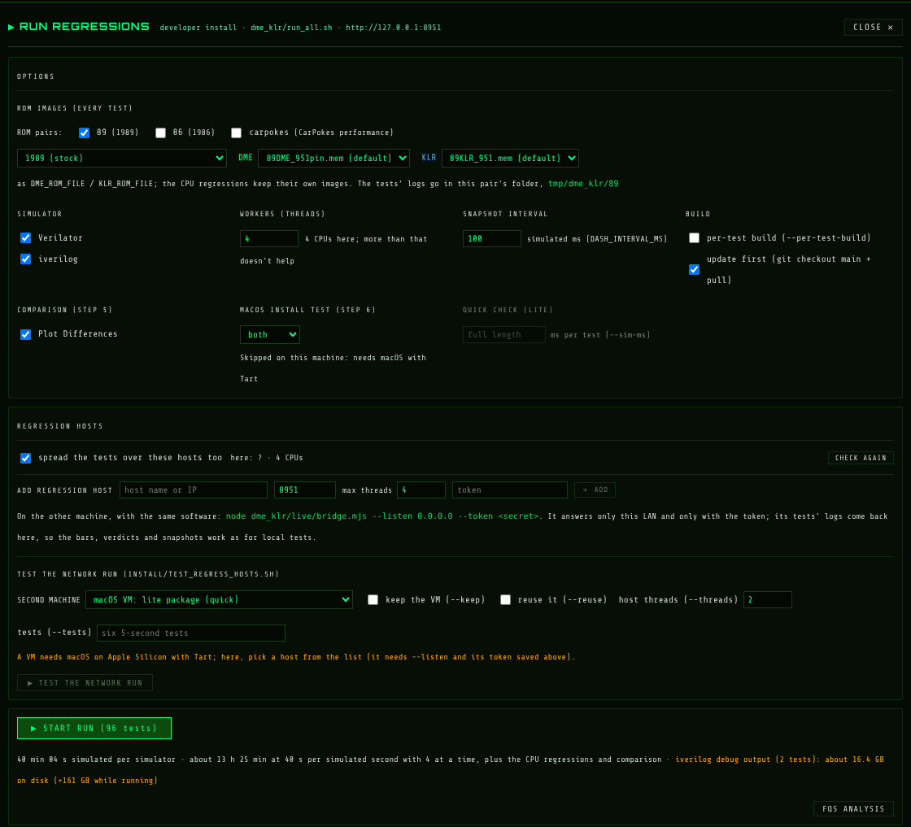

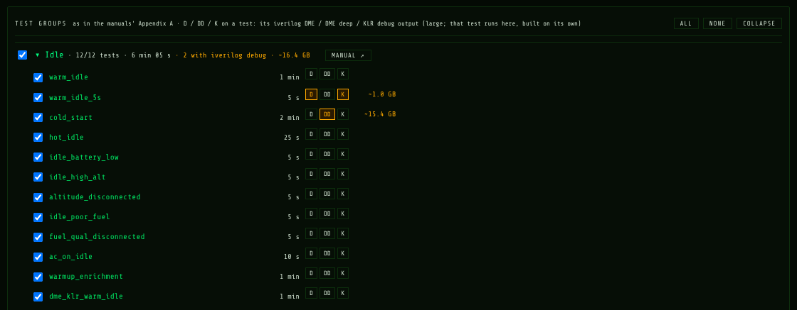

**Regression hosts.** Other machines on the same LAN can take some of the
tests. On each one, with the same software (the same commit and the same
local changes in `dme`, `klr`, `dme_klr`, `bin_images` and `paths.sh`, a
lite package made from them counts too), start the bridge with
`node dme_klr/live/bridge.mjs --listen 0.0.0.0 --token <secret>`. Then, in
the panel's **REGRESSION HOSTS** box, add it with **ADD REGRESSION HOST**:
its host name or IP address, port (8951), the most tests it may run at once,
and the token. The panel shows each host as ✓ (same software, with its
version, its CPUs and simulators) or ✗ and why, and this machine's version
beside *here* (hover it for the srchash). "Same software" is the software
each bridge is running, as it was when the bridge started, not the files on
disk: after a `git pull` without a restart a host shows ✗ *its bridge is out of date: it runs … but its
files are … (pulled, not restarted): restart its bridge* and refuses tests (409), and the box warns
**⚠ this bridge still runs <version>: restart it** for this machine's bridge
(`GET /runall/hosts`: `local.restart`; a host's `/regress/info` has
`restart` and `ondisk`). Each bridge prints its version and srchash when it
starts listening. The run spreads its dashboard tests over this
machine's workers and every ✓ host's threads (**spread the tests over these
hosts too** turns that off for a run). A host's tests write their progress
and logs back here, so the bars, verdicts, snapshots and summary are the same
as for local ones, and each test shows the host it ran on. "Same software" doesn't cover the
Verilator or Icarus version each machine has (the panel shows the host's), so
results can differ slightly between hosts with different versions. A host
whose Python packages (pandas, openpyxl, numpy) don't import shows ✗ and gets
no tests, and a test that a host can't run (no `dash.log`) runs elsewhere. On the host, each test runs in its own folder,
`$DMEKLR_TMP/dme_klr/remote_jobs/<id>`, deleted once its logs have been
fetched, so the host's own logs are never overwritten. The logs come back in
64 KB pieces (`Range` requests, which the host answers with 206), each on a
new connection; a piece that receives nothing for 15 s
(`DMEKLR_REMOTE_STALL_MS`) is asked for again, up to 5 times, and the
runner log says how far each stalled try got. If every try fails,
`remote_test.mjs` exits 76: the test is requeued and the host keeps getting
tests until that has happened 3 times (exit 75, the host couldn't take the
test or dropped, stops using it at once). An iverilog test's waveform
(`fst/<test>.fst`) comes back too, into this machine's `dash_logs/fst/`. If a host stops
answering (15 s when its bridge has stopped, 90 s otherwise), its test goes
back in the queue and the host gets no more tests that run; one without
iverilog drops out of the iverilog suite only. The hosts are remembered in
`$DMEKLR_TMP/dme_klr/regress_hosts.json`, tokens included (readable only by
you). A bridge started with `--listen` answers other machines only on the
regression endpoints, only from private LAN addresses (10/8, 172.16/12,
192.168/16, link-local) and only with the token; it is not meant for the
internet. The CPU regressions, the comparison and the macOS VM test still run
here, and debug flags or `VCD_ENABLE=1` keep every test here. Under the hood
`run_dashboard_parallel.sh` reads the hosts from `$DMEKLR_REGRESS_HOSTS` and
runs each remote test through `live/remote_test.mjs`
(`live/regress_host.mjs` is the host side).

Each `.dash.log` starts with the ROM images the run used (`DME: [ROM] <file>
sha=<hash>`). The dashboard shows them in the header and uses them to fetch
the right map graphs.

---

## 3. The screen

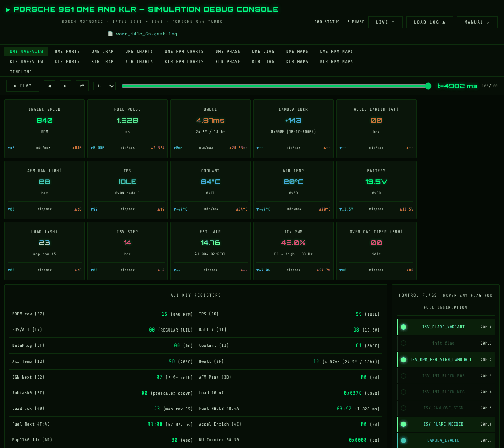

* **Header.** The file name, the ROM images the log names, the count of
  STATUS and PHASE records, the **LIVE** button (connect to or leave the
  simulator), **RUN REGRESSIONS ▸** (run the regression suite, section 2),
  **LOAD LOG** and **MANUAL ↗**, which opens this manual in a new tab.
* **Tab rows.** Row 1 holds the DME tabs, row 2 the KLR tabs, and row 3 holds
  **TIMELINE** (DME and KLR together). In live mode it also holds **DME CODE**
  and **KLR CODE**.
* **Scrubber** (log review). It sits under the tabs and stays at the top as
  you scroll. DME tabs step through the DME snapshots. KLR tabs (OVERVIEW,
  PORTS, IRAM, CHARTS, RPM CHARTS, PHASE, DIAG) have their own blue KLR
  scrubber that steps through KLR events. KLR MAPS and KLR RPM MAPS follow the
  DME scrubber.

### The tabs

| Tab | Shows |
|---|---|
| **DME OVERVIEW** | Tiles for engine speed, fuel pulse, dwell, lambda correction, accel enrichment, AFM, TPS state, coolant, air temp, battery, load index, ISV step, estimated AFR, ICV PWM and the overload timer, each with the run's min and max. Below them are all the key registers and the control flags (hover a flag for its description) |
| **DME PORTS** | P1, P2 and P3 pin by pin |
| **DME IRAM** | All 128 bytes of internal RAM, colour-coded by group, with sub-tabs (ADC, fuel/load, ignition, lambda, flags, RPM/crank, enrich/ISV, system, work area). Hover a byte for its name and meaning |
| **DME CHARTS** | RPM, load index, AFM, TPS, injector pulse, lambda correction, ignition advance and its target, ISV, ICV duty, dwell, coolant, FQS and the overload timer against time |
| **DME RPM CHARTS** | The same series as scatter plots against engine speed |
| **DME PHASE** | The DME's `[PHASE]` events (resets, sync, mode changes) as a list |
| **DME DIAG** | The diagnostic stream the DME would send (`send_diag_p2` pages), as a table and a chart |
| **DME MAPS / DME RPM MAPS** | Every numbered map and directly addressed table lookup the firmware made, against time or against RPM (section 9) |
| **KLR OVERVIEW** | KLR state and the boost-control view (target boost from the map compared with the measured value) |
| **KLR PORTS / KLR IRAM** | The 8048's ports and its 64 bytes of RAM |
| **KLR CHARTS / KLR RPM CHARTS** | Knock retard, coil pulse, knock output and count, boost, full load and more, against time or RPM |
| **KLR PHASE / KLR DIAG** | KLR events and diagnostics |
| **KLR MAPS / KLR RPM MAPS** | The KLR's boost, cycling-valve, PID-gain and RPM tables |
| **TIMELINE** | DME and KLR on one time axis, plus your own picks of any RAM byte, bit or map (section 9) |

---

## 4. Log review

### Opening a log

Press **LOAD LOG ▲**. The dialog opens by itself when no log is loaded. Open
a log in any of three ways; each one loads it straight away:

* **Regression logs list.** With the bridge running (`dme_klr/live/bridge.mjs`),
  the dialog lists every `.dash.log` from the regression runs, from each ROM
  pair's folder (`$DMEKLR_TMP/dme_klr/<rom>/`, see [Install location and output folder](#install-location-and-output-folder)):
  **Verilator** runs (`v_dash_logs`, from `v_run_dashboard_tests.sh`) in blue
  and **iverilog** runs (`dash_logs`, from `run_dashboard_tests.sh`) in
  orange, with the **ROM** folder each came from (**older** for the logs
  from before the per-ROM folders). Click a row to open that log.
  * Type in the **filter** box to narrow the list. Every word must match the
    test name, simulator or ROM folder, so `cl verilator 86` finds the
    Verilator closed-loop runs on the 1986 images.
  * **Include Verilator logs** and **Include iverilog logs** hide either kind.
    Both are checked each time the dialog opens.
  * Click a column heading (**Test**, **Simulator**, **ROM**, **Modified**, **Size**)
    to sort by it, and click it again to reverse. The list starts newest first.
  * Without the bridge, the dialog says how to start it in place of the list.
* **BROWSE…** opens your computer's file dialog. Browsers can't choose the
  folder it starts in. It opens in the last folder you used, so after you
  browse to `v_dash_logs` once it usually opens there again.
* **Drag and drop** a `.dash.log` onto the dialog.

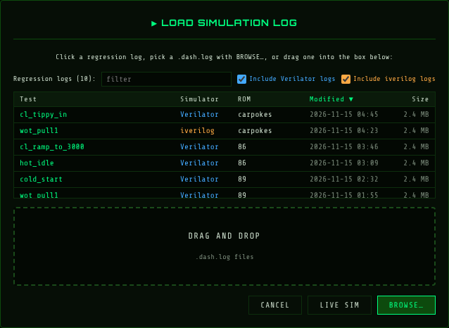

Only `.dash.log` files load from disk. The file dialog can filter only on the
last extension, so it shows every `.log`; any other file you pick or drop is
refused with a red note. The header shows the file name, and for a log from
the list also its folder and simulator, e.g.
`89/v_dash_logs/warm_idle_5s.dash.log (Verilator)`.

The page opens at the **end** of the run, so both scrubbers can go back from
there. Combined DME+KLR logs, DME-only logs and the older formats all load
the same way.

You can also open a log from a URL with `?log=<url>`, for example
`http://localhost:5173/dme-dashboard/?log=/dme-dashboard/dash_logs/warm_idle_5s.dash.log`
when the file sits in the dashboard's `public/dash_logs/` and you run
`npm run dev`. Any URL the browser may fetch works, so a log on another server
needs that server to allow cross-origin requests.

Loading a log while connected to the simulator leaves live mode. The sim is
paused and keeps its state, and **LIVE** reconnects to it.

### Moving through the run

| Control | Does |
|---|---|
| **▶ PLAY / ⏸ PAUSE** | Steps through the snapshots at the chosen speed (0.2× to 10×, or MAX) |
| **◀ / ▶** | One snapshot back or forward |
| **⏮** | Back to the start |
| Slider | Drag to any snapshot |
| `t=… ms` and `n/N` | The time of the snapshot shown and its index |

Every tab shows the run at the scrubber's time. The charts draw a cursor line
there, and **clicking a chart moves the scrubber** to that time. That is the
quickest way to get from "something odd happens here" to the RAM and flags at
that moment.

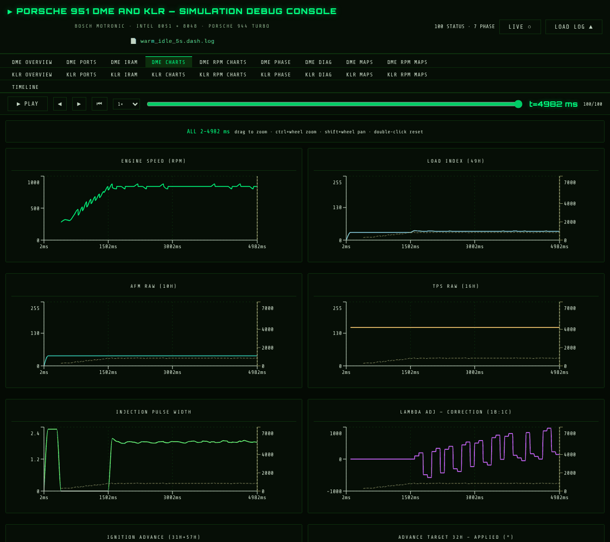

### Finding the moment to debug

Log review is usually the first step of a debug session:

1. Open the log and look at **DME CHARTS**, **KLR CHARTS** or **TIMELINE**.
2. Drag across the region of interest to zoom in (section 9). Click the event
   to put the scrubber on it.
3. Check **DME IRAM** / **KLR IRAM** and the flags there. Note the time from
   the scrubber (`t=… ms`) and the RAM locations involved.
4. To see *which code* produced it, take that time to the simulator
   ([section 7](#7-debugging-a-log-at-a-chosen-time)).

### Replay logs: recorded against simulated

Logs from `replay/run_replay.sh` carry the recorded car log's own outputs
(`REPLAY: [EXPECT]` lines). The dashboard draws them as dashed **LOG
(expected)** traces over the matching DME charts (ignition advance, injector
pulse, dwell, RPM) and KLR charts (retard, coil pulse, knock output and count,
boost, full load). The tooltip shows the logged value next to the simulated
one.

---

## 5. Live simulation

### Connecting

Start `node bridge.mjs` (section 2), then do one of these:

* press **LIVE ○** in the header, or **LIVE SIM** in the load-log dialog
* open the page with `?live`, or `?live=<bridge url>` for a bridge on
  another port

While connected the button reads **● LIVE** and `?live` stays in the address
bar, so a reload reconnects. On connecting, the bridge replays the run so far,
so the charts are complete even if you open the page late. If the bridge isn't
running you see **● OFFLINE** and a red note telling you how to start it.

> **Note:** Page load errors have been observed in this version. Reloading
> the page resolves the issue and updates to the current running state.

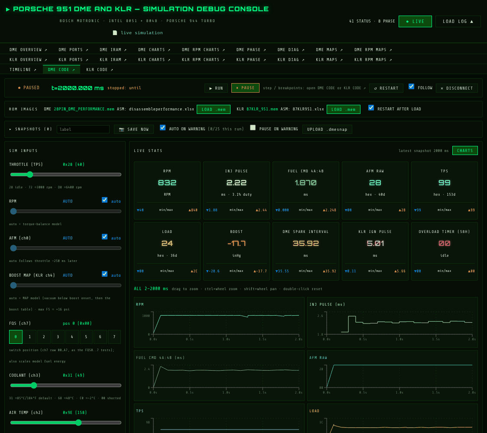

### The main page

**Run bar**

| Control | Does |
|---|---|
| **● RUNNING / PAUSED / OFFLINE**, `t=… ms` | Sim state and simulated time. While running it also shows the speed, about 20 simulated ms per second (roughly 50× slower than real time) |
| `stopped: …` | Why it stopped: `start`, `pause`, `until`, `step`, a breakpoint (with its condition and the value it saw) or a warning |
| **▶ RUN / ⏸ PAUSE** | Free-run and stop |
| **↺ RESTART** | Kill the sim and start again at t=0 on the loaded ROM images |
| **FOLLOW** | Keep every scrubber and chart cursor on the newest data. Untick it to look back while the sim runs on |
| **RESOLUTION** *ms* | Simulated time between the snapshots that make the live stats and charts, 1 to 10000 ms (the build's own, normally 100 ms, until you change it). Type a value and press **Enter** (or click away); **Esc** cancels. Smaller is finer but slows the sim and keeps less history. It stays through restarts and snapshot loads. Greyed out on a simulator built before this setting: rebuild it (`./build_live.sh`) |
| **✕ DISCONNECT** | Leave live mode. The sim keeps running in the bridge |

Step, RUN TO and breakpoints are in the **DME CODE** and **KLR CODE** windows
(section 6).

**ROM IMAGES**: the image in each EPROM and the disassembly workbook its
listing comes from. See [section 10](#10-rom-images).

**SNAPSHOTS**: save, list and reload whole-model snapshots, and open
regression tests at a chosen time. See sections [7](#7-debugging-a-log-at-a-chosen-time)
and [8](#8-snapshots).

**SIM INPUTS**: the engine model's inputs. The engine runs on the closed-loop
model. The throttle is the input, AFM follows it about 250 ms later, and RPM
comes out of the torque balance.

| Input | Drives | Notes |
|---|---|---|
| THROTTLE (TPS) | Throttle command | 0x28 idle, 0x72 ≈ 3000 rpm, 0xD8 ≈ 6400 rpm |
| RPM | Engine speed | **auto** = torque-balance model. Untick to pin a value. Held at 840 until the firmware reports EngineSync |
| AFM (ch0) | DME ADC ch0 | **auto** follows the throttle |
| BOOST MAP (KLR ch4) | KLR MAP ADC | **auto** = MAP model. Pinned values are capped at 0xF5 (≈ +16 psi) because the KLR adds 10 and anything higher wraps to vacuum |
| FQS (ch7) | Fuel-quality switch position 0-7 | Also scales the model's fuel energy, as the FQS tests do |
| COOLANT, AIR TEMP, BATTERY, ALTITUDE | DME ADC ch3, ch2, ch1, ch4 | Raw bytes. The hints give the common values |
| AC (T1) | AC compressor load | The ISV should catch it |
| CAT (T0) | Catalytic converter fitted / not fitted | The firmware reads T0 as its has-cat flag (0 = fitted, the default) |
| O2 SENSOR | DME P1.6/P1.7 (the O2 comparator outputs) | **auto** follows the model's mixture. LEAN, CROSS and RICH pin the sensor there |
| KNOCK (KLR) | KLR knock sensor | **×N REVS** injects knock on the next N crank revolutions (the `TEST_KNOCK_PULSE` drop, 32 teeth after TDC), counting down as it goes. **CONTINUOUS** keeps knocking until **STOP**. The engine has to be turning |

A slider sends its value when you let go. Ticking **auto** hands the input
back to the model.

**SIM WARNINGS**: any `[WARN]`, `WARNING` or `ERROR` line from the model,
newest first. A 📷 beside a warning means a snapshot was saved there. Click it
to restart the sim from that moment. **✕** hides the box until the next
warning.

**LIVE STATS**: tiles for RPM, injector pulse (with duty, `HELD OPEN`,
`CUT`, `REV LIMIT`), fuel command, AFM, TPS, load, boost, DME spark interval,
KLR ignition pulse and the overload timer, each with its min and max. A tile
turns red on a fault condition. **CHARTS** shows or hides a chart of each
one, and the charts zoom like any other (section 9).

### Pop-out windows

In live mode each tab button (marked **↗**) opens that tab in a **window of
its own** instead of below the header. You can arrange the overview, charts,
timeline and both code debuggers across your screens while the sim runs.

* Allow pop-ups for the page. If the browser blocks one, the page tells you.
* The windows share the page's single connection to the bridge, so they all
  show the same run. Each has its own scrubber in the title area. Its title
  says `FOLLOW off` when FOLLOW is unticked.
* Clicking a tab button again brings its window to the front. Closing the main
  page closes them all. A window that hits an error shows it there, with
  **TRY AGAIN**, and the rest keep working.
* Chart windows redraw at most every 2 seconds while the sim runs, so a long
  run stays responsive.
* Live mode keeps about the last ten simulated minutes, and older data is
  dropped as the run goes on.

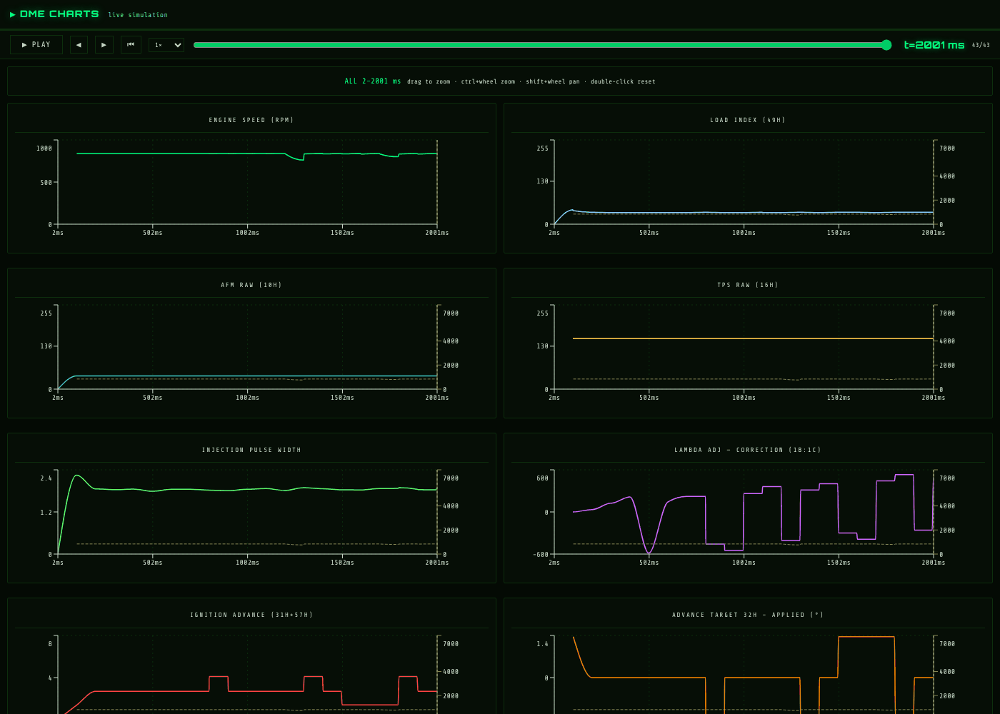

---

## 6. The code debugger

Open **DME CODE ↗** or **KLR CODE ↗** (row 3 of the tabs). Each opens a
window with the run bar, the breakpoints, the stack, the disassembly and the
instruction trace for that CPU.

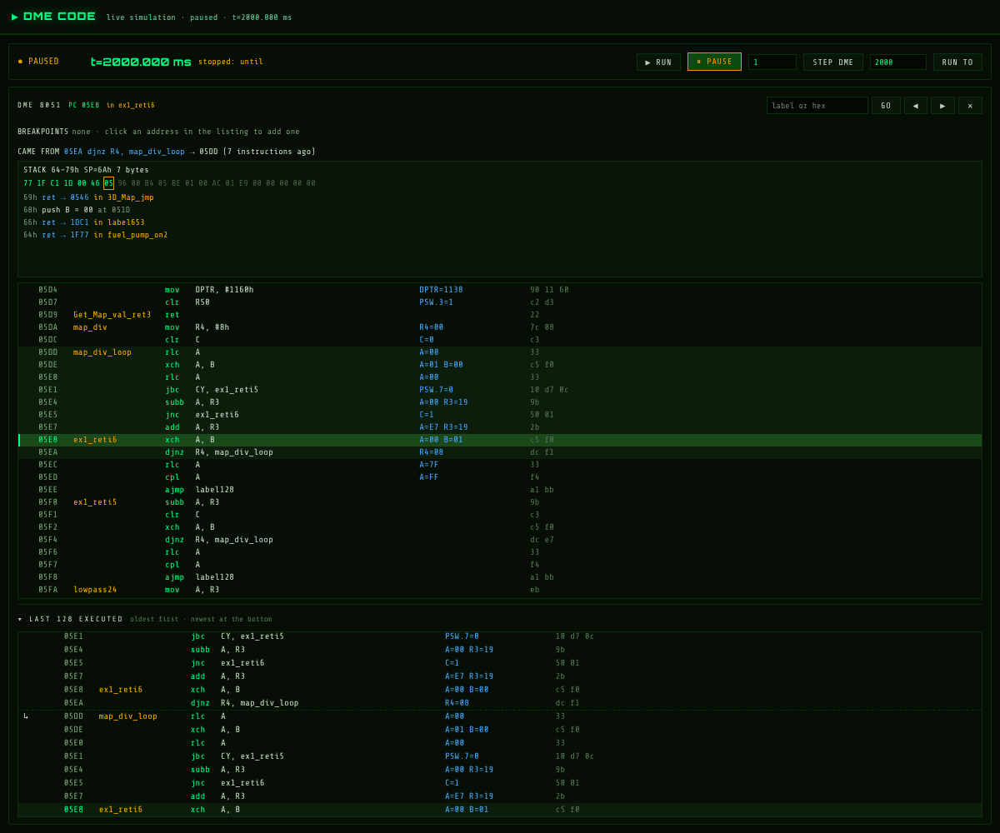

### Run bar

| Control | Does |
|---|---|
| **▶ RUN / ⏸ PAUSE** | As on the main page |
| *N* + **STEP DME** / **STEP KLR** | Run until this CPU has executed *N* instructions, then pause the whole simulation. Both CPUs share one simulated clock, so the other CPU only advances over that same short interval (a few instructions at most) and stops at the same moment |
| *ms* + **RUN TO** (or Enter) | Run until that simulated time, then pause |
| **↺ RESTART** | As on the main page: kill the sim and start again at t=0 on the loaded ROM images (with any byte edits) |

The window title also shows the state and time, so you can tell where the
sim is from any window.

### The listing

The header shows the CPU, the current **PC** and the routine it is **in**
(the nearest label above the PC).

Each row shows, from left to right:

* the breakpoint marker (● red, ● amber when it has a condition, ○ when
  disabled)
* the address and its label
* the instruction and its operands, with full-length names from the
  disassembly workbooks. A code label in the operands (a `call`, `jmp` or
  branch target) is underlined: **click it** to go to the row that defines
  it, with the search box set to that label so **◀ ▶** step through every
  place that uses it
* **values** (blue): the operands as this instruction saw them the last time
  it ran, before it executed, e.g. `A=E7 R3=19`, `DPTR=1138`, `R0=37
  A=@R0[37]=15`. It stays blank for instructions that are not in the recent
  trace
* the instruction bytes

The PC row is highlighted green. Recently executed rows are lightly shaded.
Hover a row for the workbook's description of that line.

**Finding code.** Type in the **label or hex** box:

* Part of a name highlights every row whose label matches, and every row
  whose operands use a matching name (a code label, a RAM or bit name, an
  SFR; not the CPU's own registers such as `A` or `R0`, nor `#` immediates),
  as you type. So `lambda` finds both the rows labelled `lambda…` and every
  instruction that uses a `lambda…` name. **Enter** or **▶** goes to the
  next match and **Shift+Enter** or **◀** to the previous one. The counter
  shows `3/12`.
* A hex address followed by **GO** goes to that address.
* **PC** returns to the program counter. Every stop also returns there.

**Hex / decimal.** The two small boxes beside the search convert between
hex and decimal: type in either and the other follows (`hex h = dec`). A
negative decimal shows as 8-bit (down to −128) or 16-bit two's complement.
Hover them for the binary and, for a byte or word with the top bit set, its
signed value. **×** clears them.

### Editing the ROM bytes

The bytes column on the right of each row can be edited, while the sim is
paused, to change an opcode, an operand or an address in the image the sim
is running:

1. **Click the bytes** of a row (not the rest of the row, which sets a
   breakpoint). They open as a text box.
2. Type the new bytes in hex, with or without spaces (`02 10 08`,
   `021008`). **Enter** writes them, **Esc** cancels. Fewer bytes than the
   instruction has change only its first bytes; more bytes run on over the
   instructions after it (up to 16).
3. The edit applies **live**: the bridge loads the edited image into the
   EPROM in place, so the CPU keeps its PC and RAM and runs the new code from
   its next instruction. Nothing restarts.

The listing is decoded again from the edited instruction, so the mnemonic and
operands follow the new bytes, and when the instruction gets longer or
shorter the rows after it re-flow until the code lines up with the listing
again. Edited rows are marked with an amber **✎**, and their bytes are amber
where they differ from the image as loaded; hover them for the original
bytes. Decoded rows use the workbook's labels and register names where it
has them, and plain addresses (`0x1008`) elsewhere. A KLR `call`/`jmp` is
decoded in the 2K bank it sits in.

Edits add up and stay through **↺ RESTART** (the sim boots on the edited
image). **↶** on an edited row puts that row's original bytes back;
**REVERT ALL** in the listing header puts back the image as it was loaded.
Loading another image (**LOAD .mem**, a setup or a snapshot) drops the edits.

**Modified images.** While an image has edits, its name shows in **red with
(modified)** everywhere an image name appears: the ROM IMAGES row, the code
window header, the snapshot list and its INFO, COMPARE IMAGES, the map graphs
and a log's ROM line. **Click the red name** (or **✎ N bytes edited** in the
code window header) for the list of edits: each changed place with the bytes
and the code before (**was**) and after (**now**). **COPY** puts the list on
the clipboard as plain text, for a text editor. **⬇ .bin** downloads the edited image as a raw
binary, and **⬇ .bin** in the ROM IMAGES row does the same for the image in
either EPROM.

**Saving the edits as an image.** At the bottom of the list of edits:

1. **SAVE AS NEW IMAGE**: type a name and **SAVE**. The image is kept as
   `<name>.mem` with the uploaded images (`obj/roms/<cpu>/`), with the list of
   edits beside it (`<name>.mem.edits.txt`), and as **`<name>.bin`**, the raw
   EPROM contents (8192 bytes DME, 4096 KLR, in address order) for an EPROM
   programmer. **⬇ \<name\>.bin** downloads it. With **run it now** ticked the
   sim switches to it in place (paused). It is then in every image list:
   **LOAD .mem**, **COMPARE IMAGES**, **RUN REGRESSIONS** and setups. Its
   debug listing is the original image's, with the edited places decoded again
   (`<name>.mem.base` names the original; `asm_select.sh` uses its tables).
2. **MAKE A SETUP**: name a DME + KLR pair (the saved image and an image for
   the other CPU) and **SAVE SETUP**.

**Setups.** The **SETUP** picker in the ROM IMAGES row lists the three
developer pairs and the saved setups. **LOAD SETUP** (paused) loads both
images, restarting at t=0 when **RESTART AFTER LOAD** is ticked; **✕** deletes a
saved setup (the images stay). In **RUN REGRESSIONS** a saved setup is in the
ROM pair list as `<name> (setup)`: picking it runs every test on those two
images (`DME_ROM_FILE` / `KLR_ROM_FILE`), with the logs in the DME image's
folder, `tmp/dme_klr/<image name>`. Setups are kept in `obj/roms/setups.json`.

### Breakpoints

* **Click any row** in the listing to set a breakpoint there, and click it
  again to remove it.
* The **BREAKPOINTS** strip lists them: the checkbox enables or disables one
  (a disabled breakpoint keeps its place and condition), clicking the address
  shows it in the listing, **✕** removes it and **CLEAR ALL** removes all of
  them.
* When the sim stops on a breakpoint, the run bar says
  `stopped: bp dme 0003` and the listing centres on it.

### Memory-condition breakpoints

A breakpoint can also carry a memory condition. It then stops only when that
PC is about to run **and** a RAM byte (DME iram / KLR ram, 00h-7Fh), or one
bit of it, compares true.

1. Set the breakpoint, then click **+if** next to it in the strip.
2. Pick the location. Search by name (`rpm`, `ENGINE_RPM_RAW`, `flags`…) or
   type a hex address (`37`). For a single bit write it as `21.3`.
3. Choose `==`, `!=`, `<` or `>`, and type the value in hex (a bit compares
   with 0 or 1).
4. Press **SET** (or Enter). The editor shows the value **now** so you can
   check the condition before you run.

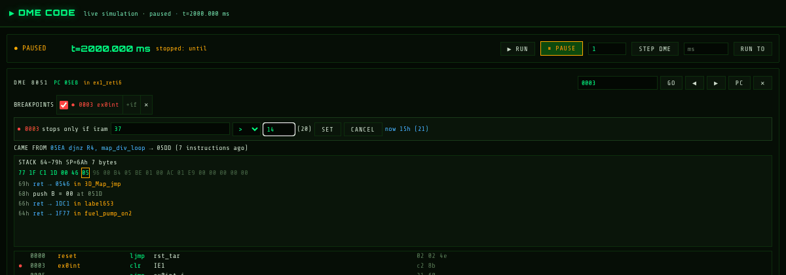

The comparison is unsigned and uses RAM as it is when the instruction is
fetched, before it executes. The strip then shows the condition, e.g. `if 37h
ENGINE_RPM_RAW > 14h`. Hover it to see whether it is true now, or click it to
edit it, or to remove it with **NO CONDITION**. When it stops, the run bar
and the strip show the value it compared:

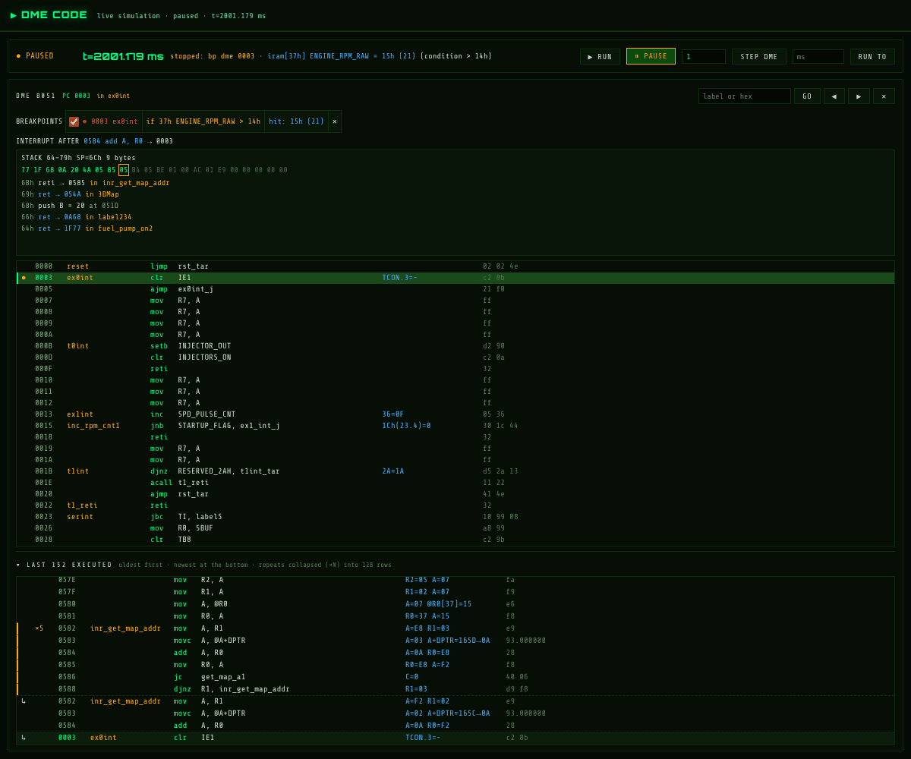

`stopped: bp dme 0003 · iram[37h] ENGINE_RPM_RAW = 15h (21) (condition > 14h)`
and `hit: 15h (21)` beside the breakpoint.

Some useful patterns:

| Breakpoint | Stops |
|---|---|
| `0003` (ex0int) `if 37 > 4B` | In the reference-sensor interrupt, only above 3000 rpm (37h × 40) |
| A routine `if 23.5 == 1` | Only while fuel is cut on overrun (FuelOffCoast, 23h bit 5) |
| A store instruction `if 58 != 0` | Only while the overload timer is running |

Breakpoints and their conditions are saved in snapshots and survive LOAD.

### Where the CPU came from

* **CAME FROM `05EA djnz R4, map_div_loop → 05DD` (7 instructions ago)**
  names the last jump, call, return or branch that led to the current code.
  After an interrupt it reads **INTERRUPT AFTER** with the instruction it
  interrupted. Click the address to see it in the listing.
* **STACK** dumps the stack area (DME 64h-79h; KLR 08h-17h, its 8-level stack) with the
  stack pointer boxed, then decodes it: `ret → 0546 in 3D_Map_jmp`,
  `reti → 0585 in inr_get_map_addr` with the saved PSW, and `push B = 00 at
  051D`. Click an entry to see it in the listing. A red **SP OUTSIDE STACK
  AREA** means the stack has overrun.
* **LAST N EXECUTED** is the instruction trace, oldest at the top and newest
  at the bottom, up to the last 512 instructions. `↳` and a dashed rule mark
  where control arrived by a jump, call, return or interrupt. Repeats of one
  instruction or a short loop collapse into one block with **×N** (the values
  shown are from the last pass). Click a row to show it in the listing. The
  trace is fetched each time the sim stops.

### From a terminal

The same commands work without the page, typed into `obj/dme_klr_live`
directly or posted to the bridge:

```sh
curl -X POST --data 'bp add dme 024E if 37 > 14' http://127.0.0.1:8951/cmd
curl -X POST --data 'until 2500' http://127.0.0.1:8951/cmd
```

The full list is in [section 11](#11-reference).

---

## 7. Debugging a log at a chosen time

A log is a record of a run. To step through the code behind it you need the
simulator to **run the same stimulus up to the same moment and stop there**.
How you do that depends on where the log came from.

| The log came from | Do this |
|---|---|
| A regression test (`run_dashboard_tests.sh`, `v_run_dashboard_tests.sh`, `run_dashboard_parallel.sh`) | **A: open the test at a time** (below) |
| The live simulator | **B: RUN TO, or reload a snapshot** |
| A recorded car log (`replay/run_replay.sh`, `replay_wot_60s`) | Not supported in the debugger yet, see the limits below |

### A. Open a regression test at a time

The regression test is rebuilt with the debugger's hooks (breakpoints,
stepping, the RAM views) but keeps its own scripted stimulus. It is then run
to the time you give and paused. From that point it is the same run as the
log.

**1. Find the time in the log.** Load the test's `.dash.log` (section 4) and
put the scrubber on the event. Note the time and pick a start a little
**before** it, so your breakpoints catch the lead-up. For example, the event
is at 2700 ms, so start at 2500 ms.

**2. Connect to the simulator.** Press **LIVE** with `bridge.mjs` running.

**3. Add the test at that time.** Open the **SNAPSHOTS** list (click its
title). In the **TEST** row type the test's name (as the scripts know it, e.g.
`cl_ramp_to_3000`; [Appendix A](#appendix-a-regression-tests) lists them all) and the time in ms, optionally a label in the label box,
then press **+ ADD**. A purple **TEST** row appears:

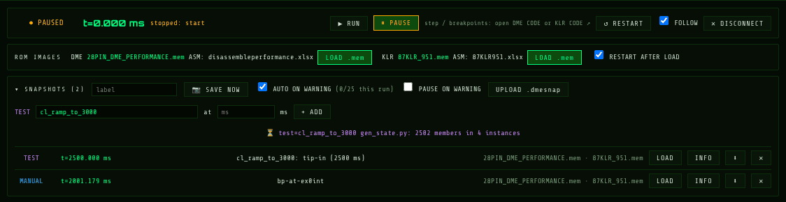

**4. LOAD it.** Press **LOAD** on the TEST row.

* The first time, the bridge builds the test (`build_live.sh --test <name>`,
  into `obj/tests/<name>/`). Progress shows under the list (`⏳ … gen_state.py
  …`). This takes a few minutes. The build is reused next time, and rebuilt
  when the testbench, `sim_main.cpp` or the test's flags or ROMs change.
* Then it runs the test from t=0 to your time. This takes as long as the sim
  needs to get there, at about 20 simulated ms a second, so 2.5 s of engine
  time takes about two minutes. The charts fill in as it goes.
* It stops **paused** at your time (`stopped: until`). The SNAPSHOTS row
  reads `regression test <name>: inputs follow its script`.

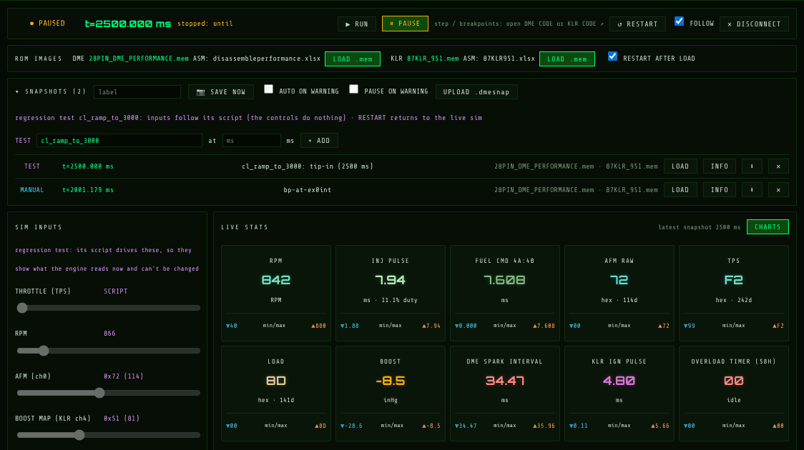

**5. Debug.** Open **DME CODE** / **KLR CODE**. Then:

* set PC breakpoints, with memory conditions on the RAM locations you
  noticed in the log (section 6)
* **RUN** to the first hit, **STEP** through it, read the values column,
  CAME FROM, STACK and trace
* use **RUN TO** to go to a later time
* the chart and IRAM windows show the same moment, for comparison with the
  log

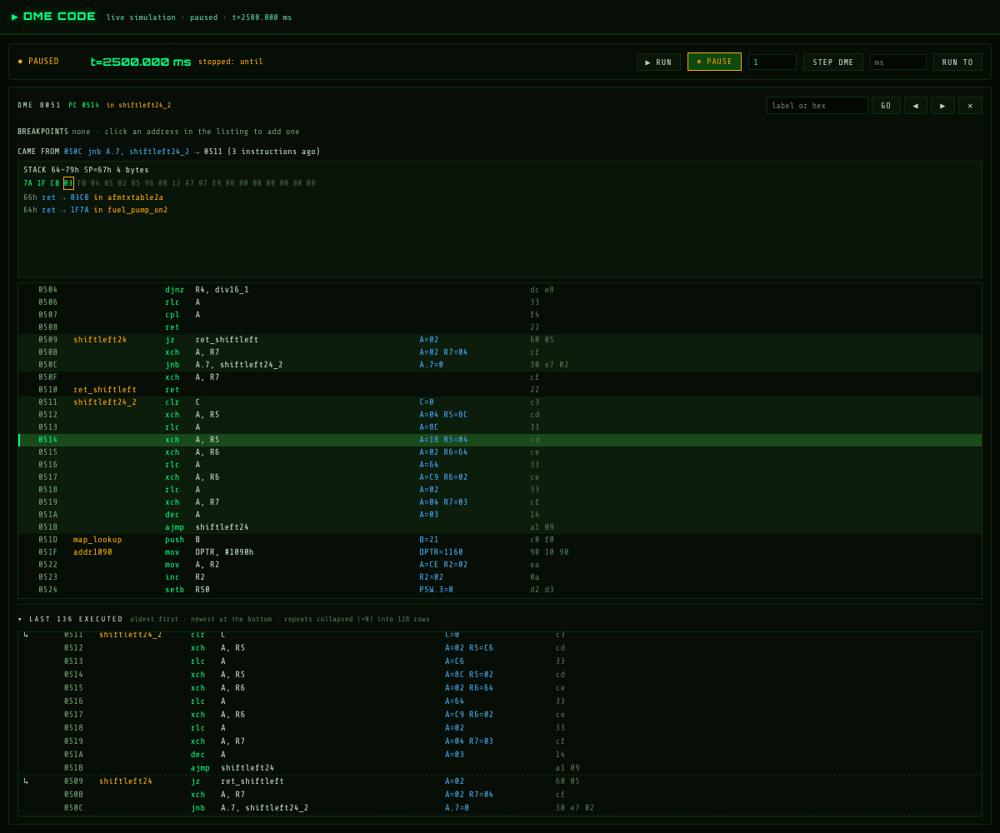

Things to know:

* **The inputs are the test's.** The SIM INPUTS show what the engine reads
  but can't be changed, and **SAVE NOW** can't save a test run.
* **↺ RESTART** leaves the test and goes back to the ordinary live simulator.
* **Breakpoints you set before LOAD are kept.** For a TEST row they take
  effect only from its time on, so the run up to it doesn't stop on them.
* **Warnings make TEST rows for you.** After each regression test,
  `test_snap.py` scans its log, and the first warning or error of each kind
  (at most 5 per test) becomes a TEST row that starts **200 ms before** the
  warning (`DMEKLR_SNAP_LEAD_MS` when the tests run changes this). For a FAIL
  in `run_dashboard_parallel.sh` with no warning, the row is at the end of the
  run. So after a regression run, the SNAPSHOTS list already holds a way into
  every warning. **INFO** on a row shows the test, the trigger line, the time
  it runs to, its flags, ROMs and whether it is built yet.
* **Custom images:** a row added from the page runs on the images loaded in
  the sim at + ADD (load the custom image or its setup in ROM IMAGES first);
  `POST /snapshots/test` also takes `roms: {dme, klr}` by file name.
* **The same from a terminal:** `dme_klr/live/test_snap.py add <test> <ms>
  [label]` adds the row (ROMs from `DME_ROM_DIR`/`DME_ROM_FILE` and the KLR
  ones), and LOAD it in the page.
* **Use Verilator logs when you can.** The debugger runs Verilator. A log
  from `run_dashboard_tests.sh` (Icarus) usually matches, but in the first
  second some tests differ while the KLR branches on uninitialised RAM, which
  Icarus treats as X and Verilator as 0. `v_run_dashboard_tests.sh` gives a
  log that matches the debugger's run.
* **Times line up.** The log's `t=` and the simulator's time are the same
  simulated milliseconds from reset.

### B. A run from the live simulator

The live sim is deterministic for the same inputs, so to get back to a moment:

* **RUN TO** that time from a fresh start (**↺ RESTART**, then enter the time
  in a code window and press **RUN TO**). This works when you didn't move any
  inputs before that time.
* If you changed inputs on the way, or want the moment of a warning, use a
  **snapshot**: one is saved on every warning (📷 in the warnings box), and
  **SAVE NOW** takes one by hand. **LOAD** restarts the sim at that moment,
  paused, with the same model state, inputs, breakpoints and ROMs. Then
  debug as above, with the inputs still yours to change.
* **PAUSE ON WARNING** stops the sim at each warning so you can look at it
  straight away.

### Limits

* **Replays of recorded car logs** in the suite (`replay_wot_60s`) open like
  any other test, but on the live simulator's own build rather than a test
  build: the bridge makes the log's stimulus file once
  (`replay/xlsx_to_stim.py`, kept in `live/obj/replay/`) and the live sim
  plays it row by row (`+stim=`), to the time you asked for. Times are sim
  time, so the first 3000 ms are the replay's warm-up (the log's first row
  held) and log t=0 is at 3000 ms. The expected **LOG (expected)** traces
  are only in the regression run's own `.dash.log`. A replay you start by
  hand with `run_replay.sh` (no suite test name) can't be opened this way.
* A log from somewhere else, with no test or snapshot behind it, can be
  reviewed but not re-run.

---

## 8. Snapshots

A snapshot holds **the whole model**: both CPUs' registers, RAM and pipeline
state, the EPROMs, ADCs, timers, the engine, AFM, O2 and knock models, the
inputs, the breakpoints and the last 512 instructions of each CPU. Loading one
gives the same run as the original from that moment on.

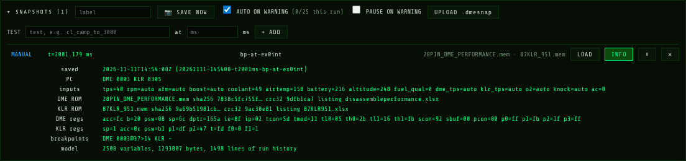

| Control | Does |
|---|---|
| **SNAPSHOTS (n)** | Click to open or close the list. A new snapshot opens it |
| label + **📷 SAVE NOW** | Save now, under that label (taken within a few ns, at the next quiet moment) |
| **AUTO ON WARNING** | Save one on each warning or error. At most once per simulated second per kind of warning, and 25 per run |
| **PAUSE ON WARNING** | Also pause after each warning's snapshot |
| **UPLOAD .dmesnap** | Add a snapshot downloaded earlier |
| **LOAD** | Restart the sim from it, paused (asks first if the sim is running) |
| **INFO** | Saved time, trigger, PCs, inputs, ROM identity (SHA-256, CRC32, listing), CPU registers, breakpoints |
| **⬇** | Download it as one `.dmesnap` file |
| **✕** | Delete it |

The coloured tag on each row tells you its kind: **WARN** / **FAIL** (red),
**MANUAL** (blue), **UPLOAD** (amber) and **TEST** (purple, section 7).

After a LOAD:

* the sim is paused at the snapshot's time, and the stats and IRAM views show
  the restored RAM
* the charts show the run's last 60,000 lines before it, so the lead-up is
  there
* RPM, AFM and boost that were on **auto** are pinned at their values then,
  so the engine holds that operating point while you step. Tick **auto** to
  let the model take over again. The other inputs are restored as they were
* the SNAPSHOTS row shows `running from snapshot <id>`

A snapshot loads only into the **same build** of the simulator. A build from
different Verilog or another Verilator version is refused with a red message.
After a rebuild where only `sim_main.cpp` or the compiler changed, it loads
with each clock's phase approximated (`exact=0`, well under a microsecond). To
share a moment with someone whose build differs, send them the INFO (inputs,
ROMs, time) instead.

Snapshots live in `$DMEKLR_TMP/dme_klr/snapshots/` (by default `tmp/` beside the
checkout, see section 1)
(`node bridge.mjs --snapdir <dir>` to move them).

---

## 9. Charts, Timeline and Maps in detail

### Zoom and navigation (every chart)

| Action | Does |
|---|---|
| Drag across a chart | Zoom to that span |
| Ctrl/⌘ + wheel, or pinch | Zoom in or out around the pointer |
| Shift + wheel | Pan |
| Double-click, or **RESET ZOOM** | Whole run again |
| Click (no drag) | Move the scrubber to that time |
| Hover | Synced tooltip across the charts of the tab |

DME CHARTS, KLR CHARTS, TIMELINE and the MAPS tabs **share one time zoom**:
zoom one and the others follow. The RPM tabs have their own RPM-range zoom.
In live mode a zoomed chart holds its window while the run goes on.

### TIMELINE

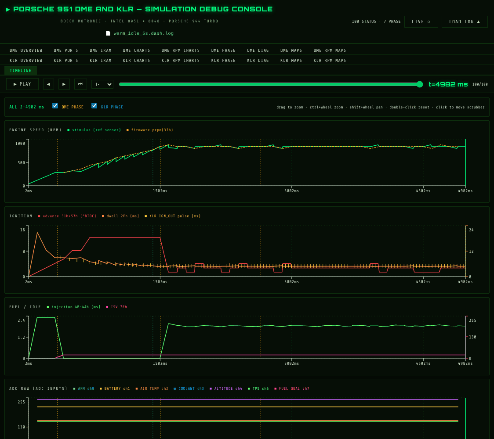

DME and KLR on one time axis: engine speed (stimulus and the firmware's
`prpm`), ignition (advance, dwell, KLR IGN_OUT pulses), fuel/idle, the raw ADC
inputs and the ADC values in DME RAM, the KLR, and **DME PHASE / KLR PHASE**
event markers (toggle them at the top). The tooltip lists phase events within
±60 ms.

**MEMORY PICKER** charts anything you choose against time:

1. Pick the source: **DME iram**, **KLR ram**, **DME map / table** or **KLR
   map / table**.
2. Search by name or hex address (`37`, `rpm`, `lambda`…), or by map number,
   address or name for maps. For a bit, enter it in the **bit** box.
3. **ADD** (or Enter). Each pick gets a coloured chip. Click the chip to hide
   or show it, use the unit selector to change how the tooltip shows the value
   (raw, ADC volts, battery volts, °C, RPM), and **✕** to remove it.

**MEMORY vs RPM** does the same against engine speed. Your picks are
remembered in the browser.

### DME MAPS / KLR MAPS

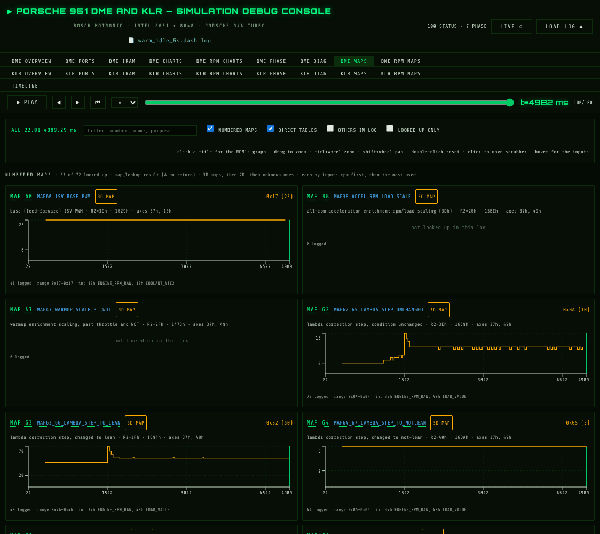

One small chart per map or table, showing the value the firmware got back from
each lookup over time. The header of each gives the map number, its name, 2D or
3D, its purpose, ROM address and input axes. The footer gives how many lookups
were logged, the range and the inputs at the hovered point.

* **filter** by number, name or purpose. **NUMBERED MAPS**, **DIRECT
  TABLES**, **OTHERS IN LOG** and **LOOKED UP ONLY** choose what is listed.
* **Click a chart's title** to see that map as it is in the ROM: a 2D map as
  a curve, a 3D map as a surface beside the raw grid, tables as steps or bars.
  The graphs come from the bridge (`map_graphs.py`), so **the bridge must be
  running even in log mode**. In log mode they are drawn for the ROM the log
  names, by hash, and once per ROM (about 20 s the first time).
* **DME RPM MAPS / KLR RPM MAPS** show only the maps with RPM as an input,
  each lookup a point against engine speed. A 3D map's points are coloured by
  its other input. KLR lookups are placed at the DME's RPM at that time.

### KLR overview and boost control

KLR OVERVIEW includes the boost-control view: the target from the KLR boost
map (by throttle from ram 43h and RPM) against the measured `ram[52h]`, in
psi / inHg.

---

## 10. ROM images

The **ROM IMAGES** row (live mode) shows the `.mem` image in each EPROM and
the workbook its listing comes from (`ASM: disassemble1989.xlsx`).

* **LOAD .mem** (while paused) loads another image into that CPU (a
  `.mem`, `.bin` or `.hex`, see below). With
  **RESTART AFTER LOAD** ticked (the default) the sim restarts at t=0 on it.
  Unticked, the image is swapped in place and the CPU carries on from its PC
  and RAM.
* The bridge takes a `.mem` image, a raw binary (`.bin`) or an Intel HEX
  file (`.hex`). A `.bin` or `.hex` is converted to a `.mem` as it is saved.
  An image larger than the EPROM (8192 bytes for the DME, 4096 for the KLR)
  is refused.
* The listing follows the image. Known images (the '86, '89 and performance
  DME, and the '86, '87 and '89 KLR) are matched by content or file name to
  their workbook.
* An image of your own gets a workbook made for it the first time it loads:
  `dme/disassemble/variants/<name>.xlsx` (KLR: `klr/disassemble/variants/`),
  built from the reference workbook (`disassembleperformance.xlsx`,
  `87KLR951.xlsx`) the same way the '86 and '89 workbooks are. Rows whose
  code is the same as the reference keep all their annotations; the rest
  are disassembled from the new bytes and highlighted. The listing then
  comes from it (`ASM: variants/<name>.xlsx`). Annotate it like any other
  workbook; it is rebuilt only when the reference workbook, its generator
  or the image changes (the old copy is kept as `<name>.prev.xlsx`), so
  copy your notes into the reference workbook if they should survive that.
  The `variants/` workbooks aren't git-ignored, so you can commit them.
  This needs bash and Python with pandas and openpyxl; without them an
  unknown image shows **ASM: no workbook** in amber, and the listing may not
  line up with the code.
* The bytes of the loaded image can be edited in the code windows, live,
  and the edited image downloaded as a `.bin` or saved as a new image
  (section 6, [Editing the ROM bytes](#editing-the-rom-bytes)). An edited
  image's name shows in red with **(modified)**; **⬇ .bin** in this row
  downloads either EPROM's image as a raw binary.
* The bridge refuses a KLR image loaded into the DME.
* Uploaded images are reused on every restart until you load another or
  restart the bridge.

  > **Note:** Reloading the browser page resets the images to the defaults.

To build or run with other images from the start, set `DME_ROM_DIR` /
`DME_ROM_FILE` / `KLR_ROM_DIR` / `KLR_ROM_FILE` for `build_live.sh` or the
test scripts, for example:

```sh
DME_ROM_DIR=~/roms/ DME_ROM_FILE=my_chip.bin ./v_run_dashboard_tests.sh warm_idle_5s
```

The file may be a `.mem`, `.bin` or `.hex`. A `.bin` or `.hex` is converted
to `$DMEKLR_TMP/roms/<cpu>/<name>.mem` first (again whenever the image is
newer), and an image of your own gets its `variants/` workbook as above, so
the tests' instruction traces line up with its code.

To convert an image yourself:

```sh
python3 bin_images/rom2mem.py my_chip.bin [my_chip.mem] [--cpu dme|klr]
```

`--cpu` checks that the image fits that CPU's EPROM.

### From ROM image to assembly view

A dumped EPROM is turned into the `.mem` file the simulator loads, and a
disassembly workbook is matched to it so the debugger can show annotated
assembly next to the running code.

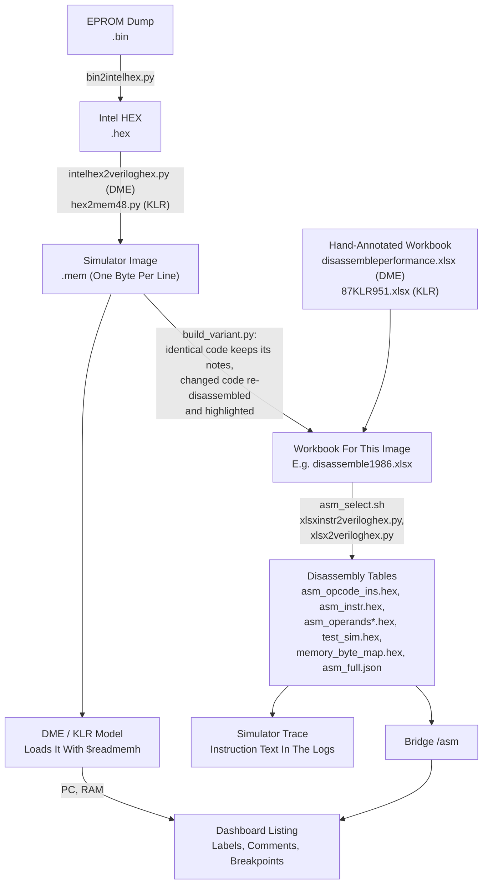

`asm_select.sh` runs automatically from the build and test scripts. It
picks the workbook for the ROM in use and rebuilds the generated workbook and
tables only when their source is newer, or when one of the scripts that write
the tables (`xlsxinstr2veriloghex.py`, `xlsx2veriloghex.py`, `asm_full.py`)
is, so a pull that changes how they write a cell rebuilds them. An image
saved from the code windows' byte editor is listed with its base image's
tables (`<image>.base`). A custom image with no workbook
still runs, but its listing shows **ASM: no workbook** and may not line up
with the code.

---

## 11. Reference

### URL parameters

| Parameter | Does |
|---|---|
| `?log=<url>` | Fetch and open that log |
| `?live` | Connect to the bridge at `http://127.0.0.1:8951` |
| `?live=<url>` | Connect to a bridge elsewhere |

### Simulator commands

> **Note:** These have not been tested in this release.

Typed into `obj/dme_klr_live` or posted to `http://127.0.0.1:8951/cmd`, one
per line:

| Command | Does |
|---|---|
| `run`, `pause` | Free-run, stop |
| `step dme\|klr [N]` | Run N instructions of that CPU |
| `until <ms>` | Run to that simulated time, then pause |
| `set <input> <value\|auto>` | `tps rpm afm boost fuel_qual coolant airtemp battery altitude ac cat o2 knock knock_revs`, plus `dme_tps klr_tps` (terminal only). `knock 1` knocks on every revolution, `knock_revs N` on the next N |
| `bp add\|del dme\|klr <hex>` | PC breakpoint |
| `bp add dme\|klr <hex> if <mem>[.<bit>] <op> <val>` | Conditional breakpoint (`==`, `!=`, `<`, `>`; unsigned; hex) |
| `bp clear` | Clear all breakpoints |
| `trace dme\|klr [N]` | Last N instruction addresses |
| `interval <ms>\|default` | Simulated ms between DS snapshots (the RESOLUTION box), 1 to 10000; `default` goes back to the build's. Answers `SIM: [INTERVAL] ms=<n> default=<n>` |
| `snap` | Dump a RAM snapshot now |
| `rom dme\|klr <path>` | Load a `.mem` image (paused) |
| `save [label]`, `load <dir>` | Save or restore a snapshot |
| `autosnap on\|off\|max <n>`, `breakonwarn on\|off` | Warning snapshots |
| `status`, `quit` | |

### Bridge options

`node bridge.mjs [--port 8951] [--sim obj/dme_klr_live] [--snapdir <dir>]
[--dme-asm <dir>] [--klr-asm <dir>] [--mapcache <dir>] [--allow-origin
<origin>] [--listen <address> --token <secret>]`. `--dme-asm` / `--klr-asm` pin a listing instead of following the
ROM. `--listen <address> --token <secret>` lets other machines on the LAN use this
one as a regression host (see RUN REGRESSIONS); without them the bridge
answers this machine only.

### Troubleshooting

| Symptom | Cause / fix |
|---|---|
| **● OFFLINE** and a red note | The bridge isn't running, or is on another port. Start `node bridge.mjs` in `dme_klr/live`, or use `?live=<url>` |
| Clicking a tab in live mode does nothing | The browser blocked the pop-up. Allow pop-ups for the page |
| `No disassembly from the bridge.` | The bridge couldn't read the asm tables. Check its terminal output |
| **ASM: no workbook** | The ROM image has no matching workbook, so the listing may not line up |
| A map title shows no graph | The bridge isn't running, matplotlib is missing, or the log's ROM isn't in `bin_images/` or the uploaded images |
| Snapshot LOAD refused (red under the list) | It was saved by a different build. Reproduce it from its INFO |
| TEST LOAD fails with a build error | Shown as `SIM: [ERROR] building test …`. Run `./build_live.sh --test <name>` in a terminal to see the whole message |
| Build stops with `No rule to make target …/verilator/<version>/…/verilated.h` | A build from before a Verilator upgrade. Current `build_live.sh` and `run_replay.sh` clear it themselves; with an older checkout, delete the old `obj` folder |
| RESOLUTION greyed out | The simulator was built before the setting. Run `./build_live.sh` and restart the bridge |
| `No map lookups in this log` | The log predates the `[LKUP]` lines. Re-run the test |

---

## 12. Credits

This work is based on multiple public references, including
https://jhnbyrn.github.io
https://sourceforge.net/p/opendme
https://www.carpokes.com

Special thanks to users &#64;tom and &#64;johnb at Carpokes for their
contributions and feedback during development.

---

## Appendix A. Regression tests

> **Note:** The full test suite will be provided in a future release that
> also supports local live mode simulation.

These are the tests in the full regression run (`./run_dashboard_tests.sh`
with no name, or `./v_run_dashboard_tests.sh` for the Verilator build; both
have the same list). Run one by name with `./run_dashboard_tests.sh <name>`.
Each one writes `<name>.dash.log`, which you open in the dashboard as in
[section 4](#4-log-review), and any of them can be opened live at a chosen
time from a SNAPSHOTS **TEST** row ([section 7](#7-debugging-a-log-at-a-chosen-time)).

"Idle" tests ramp the engine from 100 rpm cranking to an 840 rpm warm idle
unless the description says otherwise. "CL" (closed-loop) tests use the
engine model in which the firmware's own fuel and ignition set the RPM, and
include the KLR's boost model; the plain `ramp_to_*` tests drive RPM
directly from the testbench instead. Time is simulated seconds.

### Run times

The **Run time** column in the tables below is the wall-clock time for one
test on its own. The times were measured with the Linux lite package (v1.0)
on a 4-core cloud machine (Intel Xeon, 2.3 GHz), where a test takes about
40 s for each simulated second: about 39 s for the plain tests and 41.5 s
for the closed-loop (`cl_*`) ones, at any RPM. A recent desktop or an Apple
Silicon Mac will usually be faster, but the proportions stay the same.

Tests run side by side don't slow each other down as long as there is one
CPU core for each (measured: the same test took the same time alone and with
four running at once), so `-j N` divides the total by about N.
`run_tests.py` starts the longest tests first, so a run can't finish sooner
than its longest test: `cold_start` (120 simulated seconds) takes about
78 min, `cl_condition_cycle` about 50 min and the 60 s tests about 40 min.
Setting `-j` higher than the number of cores doesn't help.

| Group | Tests | One at a time | 4 at a time (`-j 4`) | 8 at a time (`-j 8`) |
|---|---|---|---|---|
| Idle | 12 | 4.0 h | 78 min | 78 min |
| Closed-loop drive cycles | 14 | 6.5 h | 1.7 h | 52 min |
| Open-loop RPM sweeps, ignition and idle valve | 9 | 2.1 h | 39 min | 39 min |
| Fuel-quality sweeps | 16 | 7.2 h | 1.8 h | 54 min |
| Knock | 6 | 1.9 h | 33 min | 26 min |
| DME sensor faults | 19 | 2.1 h | 31 min | 16 min |
| KLR sensor and wiring faults | 13 | 75 min | 21 min | 11 min |
| Boost | 6 | 77 min | 21 min | 21 min |
| **All 95 tests** | 95 | **26.2 h** | **6.5 h** | **3.3 h** |

The group and suite times are worked out from the single-test times, in the
order `run_tests.py` starts them. The 8-at-a-time column assumes 8 cores of
the same speed; the machine they were measured on has only 4.

These are Verilator times (the lite package and `./v_run_dashboard_tests.sh`).
The iverilog build (`./run_dashboard_tests.sh`) is about 10 times slower
([Appendix B](#appendix-b-iverilog-and-verilator)). `replay_wot_60s` is
not in the lite package; its run time is estimated from its length.

### <a id="tests-idle"></a>Idle

| Test | Time | Run time | What it checks |
|---|---|---|---|
| `warm_idle` | 60 s | 39 min | Baseline warm idle; the reference run the other idle tests are compared with |
| `warm_idle_5s` | 5 s | 3 min | Same warm idle over the same 5 s window as the sensor-fault tests, for side-by-side comparison |
| `cold_start` | 120 s | 78 min | Cold engine start with the lambda warm-up left on |
| `hot_idle` | 25 s | 16 min | Idle with a very hot coolant reading |
| `idle_battery_low` | 5 s | 3 min | Idle with a low battery voltage reading |
| `idle_high_alt` | 5 s | 3 min | Idle with the altitude sensor at the high-altitude end of its range |
| `altitude_disconnected` | 5 s | 3 min | Altitude sensor open circuit (reads 0xFF, an impossible "below sea level" value). No DTC expected |
| `idle_poor_fuel` | 5 s | 3 min | Idle with the worst fuel-quality reading (0xA7, same as FQS7) |
| `fuel_qual_disconnected` | 5 s | 3 min | Fuel-quality sensor open circuit (0xFF). No DTC expected |
| `ac_on_idle` | 10 s | 6 min | Idle with the AC compressor on |
| `warmup_enrichment` | 60 s | 39 min | Cold idle with lambda warm-up, to watch warm-up enrichment taper off |
| `dme_klr_warm_idle` | 60 s | 39 min | Warm idle as a combined DME + KLR check |

### <a id="tests-closed-loop-drive-cycles"></a>Closed-loop drive cycles

| Test | Time | Run time | What it checks |
|---|---|---|---|
| `cl_warm_idle` | 60 s | 42 min | Closed-loop warm idle |
| `cl_cold_start` | 60 s | 42 min | Closed-loop cold start with a real cranking ramp and no lambda warm-up skip |
| `cl_tippy_in` | 20 s | 14 min | A sudden throttle blip at idle, for acceleration enrichment, then back to idle |
| `cl_ramp_to_3000` | 30 s | 21 min | Throttle opens to settle near 3000 rpm |
| `cl_ramp_to_3000_BOOST` | 30 s | 21 min | The same ramp, kept as the boost-model reference |
| `cl_ramp_to_4500` | 35 s | 24 min | Throttle opens to settle near 4500 rpm |
| `cl_ramp_to_6000` | 40 s | 28 min | Throttle opens to settle near 6000 rpm |
| `cl_ramp_to_6000_BOOST` | 40 s | 28 min | The 6000 rpm ramp with a faster throttle opening |
| `cl_ramp_to_redline` | 15 s | 10 min | Throttle to redline, to see the rev limiter |
| `cl_condition_cycle` | 73 s | 50 min | Ramp to 3000 rpm, then six 7 s phases, one at a time: cold air, cold coolant, high altitude, no cat, AC on, low battery |
| `cl_condition_cycle_idle` | 47 s | 33 min | The same six phases at idle |
| `cl_ac_halfway` | 20 s | 14 min | Warm closed-loop idle with the AC switched on halfway through |
| `cl_idle_controlled_by_isv` | 45 s | 31 min | As `cl_ac_halfway`, but with the idle valve's bypass air modelled so the firmware's idle control has to bring RPM back |
| `overrun_cutoff` | 50 s | 35 min | Hold about 2100 rpm, then lift off: the firmware should cut fuel while coasting and bring it back near idle |

### <a id="tests-open-loop-rpm-sweeps-ignition-and-idle-valve"></a>Open-loop RPM sweeps, ignition and idle valve

| Test | Time | Run time | What it checks |
|---|---|---|---|
| `ramp_to_3000` | 10 s | 6 min | RPM ramp to 3000 |
| `ramp_to_6000` | 40 s | 26 min | RPM ramp to 6000 |
| `ramp_to_6300` | 15 s | 10 min | RPM ramp to 6300 |
| `ramp_to_redline` | 10 s | 6 min | RPM ramp to 6500 |
| `ramp_6k_hold` | 15 s | 10 min | Ramp to 6000 rpm and hold there |
| `ignition_timing` | 15 s | 10 min | Ignition advance across a fast ramp to 6000 rpm |
| `dwell_scaling` | 15 s | 10 min | Coil dwell across a slow ramp to 6000 rpm |
| `isv_cold_idle` | 60 s | 39 min | Idle valve opening and closing during a cold idle |
| `isv_load_droop` | 12 s | 8 min | RPM dips to 650 for 0.5 s at 5 s, to see the idle valve respond |

### <a id="tests-fuel-quality-sweeps"></a>Fuel-quality sweeps

| Test | Time | Run time | What it checks |
|---|---|---|---|
| `cl_ramp_to_6000_FQS0` … `FQS7` | 40 s each | 28 min each | `cl_ramp_to_6000` with the fuel-quality input stepped through eight values (0x00 to 0xA7) and the engine model's fuel energy adjusted to match |
| `ramp_to_6000_FQS0` … `FQS7` | 40 s each | 26 min each | `ramp_to_6000` with the same eight fuel-quality values |

### <a id="tests-knock"></a>Knock

| Test | Time | Run time | What it checks |
|---|---|---|---|
| `ramp_to_6000_knock` | 40 s | 26 min | Knock pulses on one cylinder for 10 cycles halfway through, then RPM ramps back down, to see the KLR retard and recover |
| `knock_sensor_defect` | 40 s | 26 min | Broken connection to the knock circuit (noise level forced low), so the KLR should flag a knock sensor fault |
| `knock_sensor_short_to_ground` | 40 s | 26 min | Knock sensor signal shorted to ground |
| `cl_ramp_to_3000_KLR_KNOCK_BLOCKED` | 30 s | 21 min | The broken knock connection during a closed-loop ramp to 3000 rpm |
| `cl_ramp_to_6000_KLR_ADC0_NOISE_HIGH` | 10 s | 7 min | KLR knock noise-level input reading high |
| `cl_ramp_to_6000_KLR_ADC0_NOISE_LOW` | 10 s | 7 min | KLR knock noise-level input stuck at 0x80 |

### <a id="tests-dme-sensor-faults"></a>DME sensor faults

| Test | Time | Run time | What it checks |
|---|---|---|---|
| `afm_open_circuit` | 5 s | 3 min | Air-flow meter signal lost |
| `afm_short_to_ground` | 5 s | 3 min | Air-flow meter wiper shorted to ground (0x00) |
| `battery_disconnected` | 5 s | 3 min | DME battery sense open (0x00), unlike `idle_battery_low` which is only low |
| `coolant_fail` | 5 s | 3 min | Coolant sensor shorted (0x00, reads as very hot) |
| `coolant_open_circuit` | 5 s | 3 min | Coolant sensor open (0xFF) |
| `airtemp_fail` | 5 s | 3 min | Air temperature sensor shorted (0x00) |
| `airtemp_open_circuit` | 5 s | 3 min | Air temperature sensor open (0xFF) |
| `tps_fail` | 5 s | 3 min | DME throttle/idle input held at mid-scale (0x80) |
| `tps_ch6_short_to_ground` | 5 s | 3 min | DME throttle/idle input shorted to ground (0x00) |
| `tps_ch6_open_circuit` | 5 s | 3 min | DME throttle/idle input open (0xFF) |
| `o2_baseline` | 25 s | 16 min | Normal oxygen sensor, the reference for the three below |
| `o2_disconnected` | 25 s | 16 min | Oxygen sensor disconnected (flat signal) |
| `o2_rich_stuck` | 25 s | 16 min | Oxygen sensor stuck reading rich |
| `o2_lean_stuck` | 25 s | 16 min | Oxygen sensor stuck reading lean |
| `ref_sensor_loss` | 8 s | 5 min | Reference (crank position) sensor signal stops at 3.5 s while the engine keeps running |
| `ref_sensor_stuck_low` | 8 s | 5 min | Reference sensor shorted to ground from 3.5 s |
| `ref_sensor_missing_at_start` | 8 s | 5 min | No reference signal from power-on, so the DME has to sync on the speed sensor alone |
| `speed_sensor_loss` | 8 s | 5 min | Speed (flywheel tooth) sensor signal stops at 3.5 s |
| `speed_sensor_stuck_low` | 8 s | 5 min | Speed sensor shorted to ground from 3.5 s |

### <a id="tests-klr-sensor-and-wiring-faults"></a>KLR sensor and wiring faults

Unless shown otherwise these run the `cl_ramp_to_3000` profile, cut short
once the fault has shown up.

| Test | Time | Run time | What it checks |
|---|---|---|---|
| `tps_open_circuit` | 10 s | 6 min | KLR throttle sensor open (0xFF) at idle; expect DTC 4-2 |
| `ramp_to_redline_KLR_TPS_HIGH` | 10 s | 6 min | `ramp_to_redline` with the throttle sensor allowed past its legal maximum; expect DTC 4-2 |
| `cl_ramp_to_3000_TPS0` | 8 s | 6 min | KLR throttle sensor shorted to ground (0x00) |
| `cl_ramp_to_3000_KLR_TPS_SUPPLY_LOW` | 8 s | 6 min | KLR throttle sensor supply voltage low |
| `cl_ramp_to_3000_KLR_TPS_SUPPLY_LOST` | 8 s | 6 min | KLR throttle sensor supply gone (0x00) |
| `cl_ramp_to_3000_KLR_BATT_LOW` | 11 s | 8 min | KLR battery reading low |
| `cl_ramp_to_3000_KLR_BATT_DISCONNECTED` | 11 s | 8 min | KLR battery sense open (reads 0) |
| `cl_ramp_to_3000_KLR_TRIGGER_STUCK_HIGH` | 6 s | 4 min | Crank reference wire to the KLR stuck high from 3 s, holding the KLR in reset |
| `cl_ramp_to_3000_KLR_TRIGGER_STUCK_LOW` | 6 s | 4 min | The same wire stuck low, so the KLR never re-syncs to TDC (not yet confirmed on a real car) |
| `cl_ramp_to_3000_KLR_IGN_IN_STUCK_HIGH` | 6 s | 4 min | DME ignition signal to the KLR stuck high from 3 s |
| `cl_ramp_to_3000_KLR_IGN_IN_STUCK_LOW` | 6 s | 4 min | The same signal stuck low (not yet confirmed on a real car) |
| `cl_ramp_to_3000_KLR_FULL_LOAD_STUCK_HIGH` | 10 s | 7 min | KLR-to-DME full-load wire stuck at the full-throttle level during a part-throttle ramp |
| `cl_ramp_to_6000_KLR_FULL_LOAD_STUCK_LOW` | 10 s | 7 min | The full-load wire stuck low, so the DME never sees full throttle |

### <a id="tests-boost"></a>Boost

| Test | Time | Run time | What it checks |
|---|---|---|---|
| `cl_ramp_to_3000_BOOST_OPEN_CIRCUIT` | 10 s | 7 min | Boost (MAP) sensor open (0xFF) |
| `cl_ramp_to_3000_BOOST_STEP_OVERBOOST` | 30 s | 21 min | Boost held at 4 psi, then raised 1 psi a second, to find where the KLR sets DTC 3-2 (overboost) |
| `cl_ramp_to_3000_BOOST_STEP_DOWN` | 30 s | 21 min | Boost lowered 1 psi a second from 4 psi into vacuum, to find where the KLR sets DTC 3-1 (boost too low) |
| `cl_ramp_to_5000_BOOST_LOW` | 10 s | 7 min | Boost reading lower than normal (a boost leak) on a ramp to 5000 rpm |
| `cl_ramp_to_6000_BOOST_LOW` | 20 s | 14 min | The same low boost on a ramp to 6000 rpm |
| `cl_wot_3000_BOOST_ZERO` | 12 s | 8 min | Boost sensor shorted (0x00) at full throttle with the rev limiter set to 3000 rpm; expect DTC 3-3 at about 9.4 s |

### <a id="tests-log-replay"></a>Log replay (single-test only)

| Test | Time | Run time | What it checks |
|---|---|---|---|
| `replay_wot_60s` | 60 s | about 40 min | Replays a recorded full-throttle run from a real car and compares the simulator's outputs with the logged ones (see [section 4](#replay-logs-recorded-against-simulated)). Not part of the full run, and it can't be opened from a TEST row |


## Appendix B. iverilog and Verilator

The same Verilog model (both CPUs, the ADCs, the engine and sensor models)
is run by two different simulators. Each one is good at something the other
isn't, so the project uses both.

### iverilog (Icarus Verilog): the accuracy reference

`./run_dashboard_tests.sh` runs the regression on iverilog. Logs go to
`$DMEKLR_TMP/dme_klr/<rom>/dash_logs/`.

- **Exact event timing.** iverilog is an event-driven simulator that follows
  the Verilog scheduling rules closely, including `#` delays inside the
  testbench and sensor models. Edge-to-edge timing (ignition, injection,
  sensor pulses, ADC conversion) comes out the way the source describes it.
- **Worst-case start-up states.** iverilog has four-state logic: every
  register and RAM byte starts as **X** (unknown) until something writes it.
  If the firmware reads a location it never initialised and branches on it,
  iverilog shows that, and the KLR core prints a `KLR: [XBRANCH]` line for
  each 100 ms in which it happened (the core takes the not-taken path on an
  X). This is how start-up bugs and reliance on power-on RAM contents are
  found. A real chip's RAM powers up with whatever is in it, so X is the
  honest model of "you can't count on this value".
- **The cost is speed.** It is about 10x slower than Verilator, so the full
  regression takes a long time.

### Verilator: the fast simulator

`./v_run_dashboard_tests.sh` runs the same tests on Verilator. Logs go to
`$DMEKLR_TMP/dme_klr/<rom>/v_dash_logs/`. The live simulator (`dme_klr/live`) is also a
Verilator build.

- **Speed.** Verilator compiles the model to optimised C++, so it runs about
  10x faster than iverilog. That is what makes the live simulator and its
  debugger usable (about 20 simulated ms per wall-clock second while
  tracing) and keeps a full regression run short.
- **Two-state logic.** There is no X: every register and RAM byte starts at
  a known value (zero), so the firmware never sees an "unknown" read. Runs
  are repeatable, but an uninitialised read that iverilog would flag simply
  reads 0 here and goes unnoticed.
- **Slightly different timing.** Verilator orders events within a time
  step in its own way, and because it starts from known values it settles
  sooner than iverilog. In a few tests (`cl_tippy_in`, for example) it
  reaches a fast transient a little earlier and stays about a snapshot
  ahead for the rest of the run. That is a simulator difference, not a
  model one.

### How the two are used together

1. Develop and debug on Verilator: live mode, breakpoints, quick single-test
   reruns.
2. Run the regression on iverilog as the reference for timing and start-up
   behaviour.
3. Compare the two. `v_run_dashboard_tests.sh` compares each test with its
   iverilog log when one exists, and `compare_all_logs.sh` compares a whole
   set. Each test gets a verdict:

| Verdict | Meaning |
|---|---|
| **MATCH** | The two logs agree |
| **NEAR-MATCH** | Only small differences inside the allowed tolerance |
| **NOTE** | The logs differ, but the difference starts within 500 ms of iverilog's last `KLR: [XBRANCH]`: the firmware branched on an uninitialised value (X on iverilog, 0 on Verilator) and the two runs took different paths from there. Expected, not a failure, but worth knowing about |
| **DIFF** | A real difference to look into |
| **ROM-MISMATCH** | The two logs used different ROM images, so they aren't compared |

A DIFF means the two simulators disagree about the model itself, so treat
the iverilog result as the reference and check what Verilator is
simplifying. A NOTE points at firmware that depends on RAM it never set,
which is worth a look in the debugger even though the test passes.


## Appendix C. How the closed-loop models work

In a closed-loop (CL) test the engine responds to the firmware: the DME's
own fuel decides the RPM, the RPM and throttle decide the air, and the
sensors report what the engine is doing. Nothing in the loop is scripted
except the driver (the throttle command) and any fault the test injects.
The plain `ramp_to_*` tests are open loop: there the testbench sets RPM on a
fixed ramp and the firmware's output doesn't change it.

The models live in `dme/bench/verilog/var_interrupt_gen_cl.v` (engine,
crank signals, AFM), `dme/bench/verilog/i8051_dashboard_tb.v` (DME inputs,
O2 sensor) and `klr/bench/verilog/klr_tb.v` / `knock_gen.v` (KLR inputs,
boost, knock). The numbers below are the defaults; most can be changed
with a `-D` define.

### The loop

```
 driver throttle ──► TPS / AFM ──► DME firmware ──► injector pulse (4B:4A)
                        ▲                                   │
                        │                                   ▼
         MAP, O2, KLR ◄─┴──── RPM ◄──── torque balance (once per rev)
```

### Engine (RPM)

Once per crank revolution, on the reference pulse, the model does a
torque balance:

- **Fuel.** It reads the pulse width the firmware just computed
  (iram 4B:4A). If nothing was injected since the last update (fuel cut,
  iram 23h bit 5, or the rev limiter skipping the injection) the fuel is 0.
- **Combustion** is air-limited. The fuel the cylinder's air could burn at
  stoich is the firmware's own load per stroke (iram 46:47) times 1.025. The
  burned fuel is the smaller of that and the injected fuel, so fuel past
  stoich (full-load enrichment, a rich mixture) adds no torque, and a lean
  mixture loses torque. At altitude the air is scaled down further for the
  thinner air.
- **Friction** is a base value, plus a term that rises with RPM squared,
  plus a cubic term above 4000 rpm, plus extra load when the AC is on. These
  were fitted to three settled operating points (idle, about 2850 rpm and
  about 6650 rpm), which is what makes the engine settle at a speed for a
  given throttle instead of climbing to the limiter.
- **RPM** changes by combustion minus friction, divided by an inertia
  factor, and is clamped between 400 rpm (stall) and 6800 rpm (rev limiter,
  or `CL_RPM_MAX`).

Before the firmware reports engine sync (iram 21h bit 0) RPM is held at
idle. `cl_cold_start` instead ramps from cranking speed up to idle so the
firmware sees a real crank.

### Crank signals

From the current RPM the model generates the two crank inputs the real
car has: the **speed sensor** (flywheel teeth, to DME P3.3/INT1) and the
**reference sensor** (once per rev, to P3.2/INT0). The tooth period follows
RPM, so everything timed off the crank (ignition, injection, dwell) moves
with it. Fault tests stop, short or remove these signals at a set time.

### DME inputs

| Input | How it's modelled |
|---|---|
| **AFM** (ADC ch0) | Ramp tests: the driver's throttle command steps at 2 s and the AFM slews toward it about 250 ms behind the throttle (air takes time to follow). Idle tests: throttle closed, AFM at the idle base plus the idle valve's bypass air. Overrun fuel cut: AFM scales down with the falling RPM and boost |
| **Throttle switch** (ch6) | Closed (0x99, about 3.0 V) when the throttle is at idle; off-idle or full-load levels when it opens. The KLR's full-load line reaches ch6 through the real board's RC filter (about 4.7 ms) |
| **Battery** (ch1) | Fixed at 0xD8 unless a test lowers or disconnects it |
| **Air temp / coolant** (ch2 / ch3) | Fixed raw sensor values for the test (warm: coolant 0x31 ≈ 85 °C, air 0x9E ≈ 20 °C); the firmware linearises them |
| **Altitude** (ch4) | Fixed (0xF8 = sea level). At altitude the AFM reads flow × √(air density), as a flap meter does |
| **Fuel quality** (ch7) | Fixed per test (the FQS0 to FQS7 positions) |
| **O2 sensor** (P1 comparators) | Follows the mixture the firmware actually delivers: injected fuel ÷ load, rich above 1.025. The result passes through 150 ms of exhaust delay and a 30 ms sensor lag between 100 mV (lean) and 850 mV (rich), then the two comparators at 450 and 550 mV. With no injection the exhaust reads lean. This lets the lambda integrator (iram 1Bh) cycle around stoich as on the car |
| **AC, cat** (T1, T0) | On/off per test, or switched at set times in the condition-cycle tests |

### KLR inputs

| Input | How it's modelled |
|---|---|
| **Crank trigger** (`trigger_in`) | The DME's KLR ignition output, which resets the KLR CPU every cycle, as on the car |
| **DME ignition** (`ign_in`) | The DME's tach pulse |
| **Throttle angle** (ch7) | Follows the throttle (the AFM without the idle valve's bypass air), clamped at the sensor's legal maximum 0xDB, and ratiometric to the TPS supply (ch3, normally 0xFF) |
| **Battery** (ch1) | Fixed at 0xD8 unless a test lowers or disconnects it |
| **MAP / boost** (ch4) | Below boost onset it is manifold vacuum from throttle and RPM (about 42 kPa at warm idle, down to about 25 kPa on a closed-throttle overrun, up to 1 bar at onset). Above onset it follows the KLR's own boost target map at the current RPM and throttle. A 500 ms lag stands in for turbo spool; during a fuel cut the turbo spools down faster (150 ms) |
| **Knock** (ch5, ch0) | `knock_sum` (ch5) is the knock comparator: a base sensor level, raised when the KLR's own self-test fires or a knock test injects pulses. `knock_noise` (ch0) is a rolling average of the sensor level, the KLR's noise reference |
| **Full load** (P1.5 out) | The KLR's WOT flag to the DME. It pulses high on every KLR reset, as the real port floats high, and the DME's RC filter averages that out |

### Live mode

The live simulator runs the same closed-loop model. The controls on the
main page override single inputs (throttle, RPM, boost, battery and so on);
an input left on **auto** follows the model. Pinning RPM replaces the torque
balance's result, so the engine holds that speed whatever the fuel is.

### Limits

The models are fitted to a handful of settled operating points, not to a
full engine map. Targets between those points (for example
`cl_ramp_to_4500` and `cl_ramp_to_5000`) were tuned by trial runs, so check
the settled RPM in the log rather than assuming the target. Fuel-quality
positions change the firmware's fuel and timing but not the engine model's
torque, since the 951's fuel-quality plug selects octane rather than energy.


---

Copyright 2026 Michael Whalen. No affiliation with Dr. Ing. h.c. F. Porsche AG or any of its affiliates.
