# DME + KLR Simulation Debug Console: User Manual

The debug console is a web page (the `whalenlg/dme-dashboard` repo) that shows
what the simulated 944 Turbo DME (Intel 8051) and KLR (Intel 8048) are doing.
It works in two ways:

| | **Log review** | **Live simulation** |
|---|---|---|
| What you look at | A finished run: a `.dash.log` from the regression scripts or the log replay | The Verilator model running now, driven through `dme_klr/live/bridge.mjs` |
| What you can do | Scrub and play back through the run, read RAM, ports and flags, chart anything against time or RPM | Everything in log review, plus run / pause / step, PC and memory-condition breakpoints, change the engine inputs, save and reload whole-model snapshots, swap ROM images |
| Needs | Only a browser | The bridge and the live simulator built on your machine |

The two meet in [section 6](#6-debugging-a-log-at-a-chosen-time): you find a
moment of interest in a log, then have the simulator re-run that same test up
to that time and stop, so you can set breakpoints and step through the
firmware from there.

Contents

1. [Setting up](#1-setting-up)
2. [The screen](#2-the-screen)
3. [Log review](#3-log-review)
4. [Live simulation](#4-live-simulation)
5. [The code debugger](#5-the-code-debugger)
6. [Debugging a log at a chosen time](#6-debugging-a-log-at-a-chosen-time)
7. [Snapshots](#7-snapshots)
8. [Charts, Timeline and Maps in detail](#8-charts-timeline-and-maps-in-detail)
9. [ROM images](#9-rom-images)
10. [Reference](#10-reference)

---

## 1. Setting up

### The dashboard

Use the published page at **https://whalenlg.github.io/dme-dashboard/**, or
run it from a checkout of `dme-dashboard`:

```sh
npm install
npm run dev          # http://localhost:5173/dme-dashboard/
```

Log review needs nothing else. Everything the page does with a log happens in
the browser.

### The live simulator (for live mode and code debugging)

From `dme_klr/live/` in this repo:

```sh
./build_live.sh      # Verilator >= 5.038; builds obj/dme_klr_live (a few minutes)
node bridge.mjs      # Node 18+; starts the sim and serves http://127.0.0.1:8951
```

Leave `bridge.mjs` running, then press **LIVE** in the dashboard. The bridge
listens only on 127.0.0.1 and only answers pages from `whalenlg.github.io`,
`localhost` or `127.0.0.1` (`--allow-origin <origin>` adds another).

Optional extras:

| For | Install |
|---|---|
| The ROM graphs on the MAPS tabs | `pip3 install matplotlib` |
| Regenerating full-length operands after editing a disassembly workbook (`python3 dme_klr/live/asm_full.py`) | `pip3 install pandas openpyxl` |

Rebuild with `./build_live.sh` after any change to the Verilog, the testbench
or `sim_main.cpp`. See `dme_klr/live/README.md` for the build details.

### Making logs to review

| Script (in `dme_klr/`) | Writes | Notes |
|---|---|---|
| `./run_dashboard_tests.sh <test>` | `../../tmp/dme_klr/dash_logs/<test>.dash.log` | Icarus Verilog. With no test name it runs them all; an unknown name prints the list |
| `./v_run_dashboard_tests.sh <test>` | `../../tmp/dme_klr/v_dash_logs/<test>.dash.log` | Verilator, the same tests. Best for logs you plan to debug in the simulator (section 6) |
| `./run_dashboard_parallel.sh <jobs> [group]` | the same folders | Several tests at once, plus validation |
| `replay/run_replay.sh` | `../../tmp/dme_klr/replay/{v_,}dash_logs/` | Replays a recorded car log, see `dme_klr/replay/README.md` |

`DASH_INTERVAL_MS` (default 100) sets how often the testbench dumps RAM. A
smaller value gives finer playback and larger logs.

Each `.dash.log` starts with the ROM images the run used (`DME: [ROM] <file>
sha=<hash>`). The dashboard shows them in the header and uses them to fetch
the right map graphs.

---

## 2. The screen

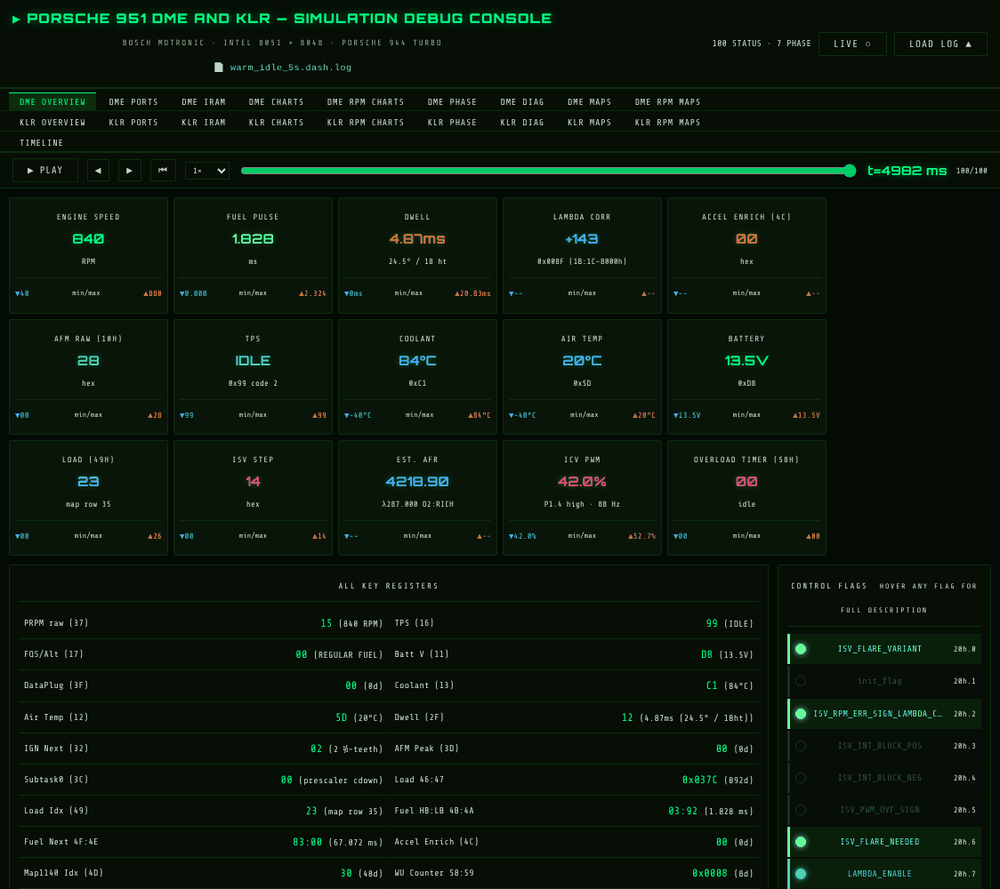

* **Header.** The file name, the ROM images the log names, the count of
  STATUS and PHASE records, the **LIVE** button (connect to or leave the
  simulator) and **LOAD LOG**.
* **Tab rows.** Row 1 holds the DME tabs, row 2 the KLR tabs, and row 3 holds
  **TIMELINE** (DME and KLR together). In live mode it also holds **DME CODE**
  and **KLR CODE**.
* **Scrubber** (log review). It sits under the tabs and stays at the top as
  you scroll. DME tabs step through the DME snapshots. KLR tabs (OVERVIEW,
  PORTS, IRAM, CHARTS, RPM CHARTS, PHASE, DIAG) have their own blue KLR
  scrubber that steps through KLR events. KLR MAPS and KLR RPM MAPS follow the
  DME scrubber.

### The tabs

| Tab | Shows |
|---|---|
| **DME OVERVIEW** | Tiles for engine speed, fuel pulse, dwell, lambda correction, accel enrichment, AFM, TPS state, coolant, air temp, battery, load index, ISV step, estimated AFR, ICV PWM and the overload timer, each with the run's min and max. Below them are all the key registers and the control flags (hover a flag for its description) |
| **DME PORTS** | P1, P2 and P3 pin by pin |
| **DME IRAM** | All 128 bytes of internal RAM, colour-coded by group, with sub-tabs (ADC, fuel/load, ignition, lambda, flags, RPM/crank, enrich/ISV, system, work area). Hover a byte for its name and meaning |
| **DME CHARTS** | RPM, load index, AFM, TPS, injector pulse, lambda correction, ignition advance and its target, ISV, ICV duty, dwell, coolant, FQS and the overload timer against time |
| **DME RPM CHARTS** | The same series as scatter plots against engine speed |
| **DME PHASE** | The DME's `[PHASE]` events (resets, sync, mode changes) as a list |
| **DME DIAG** | The diagnostic stream the DME would send (`send_diag_p2` pages), as a table and a chart |
| **DME MAPS / DME RPM MAPS** | Every numbered map and directly addressed table lookup the firmware made, against time or against RPM (section 8) |
| **KLR OVERVIEW** | KLR state and the boost-control view (target boost from the map compared with the measured value) |
| **KLR PORTS / KLR IRAM** | The 8048's ports and its 64 bytes of RAM |
| **KLR CHARTS / KLR RPM CHARTS** | Knock retard, coil pulse, knock output and count, boost, full load and more, against time or RPM |
| **KLR PHASE / KLR DIAG** | KLR events and diagnostics |
| **KLR MAPS / KLR RPM MAPS** | The KLR's boost, cycling-valve, PID-gain and RPM tables |
| **TIMELINE** | DME and KLR on one time axis, plus your own picks of any RAM byte, bit or map (section 8) |

---

## 3. Log review

### Opening a log

1. Press **LOAD LOG ▲**. The dialog opens by itself when no log is loaded.
2. Drag the `.dash.log` file onto the text box, or paste its text.
3. Press **PARSE & LOAD →**.

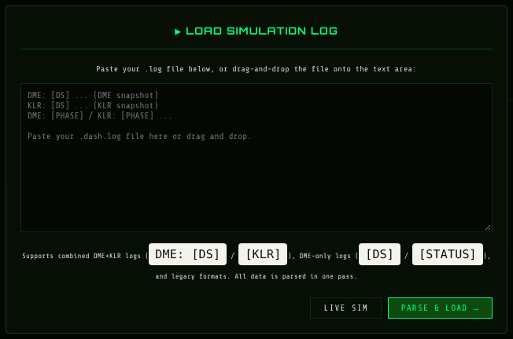

The page opens at the **end** of the run, so both scrubbers can go back from
there. Combined DME+KLR logs, DME-only logs and the older formats all load
the same way.

You can also open a log from a URL with `?log=<url>`, for example
`http://localhost:5173/dme-dashboard/?log=/dme-dashboard/dash_logs/warm_idle_5s.dash.log`
when the file sits in the dashboard's `public/dash_logs/` and you run
`npm run dev`. Any URL the browser may fetch works, so a log on another server
needs that server to allow cross-origin requests.

Loading a log while connected to the simulator leaves live mode. The sim is
paused and keeps its state, and **LIVE** reconnects to it.

### Moving through the run

| Control | Does |
|---|---|
| **▶ PLAY / ⏸ PAUSE** | Steps through the snapshots at the chosen speed (0.2× to 10×, or MAX) |
| **◀ / ▶** | One snapshot back or forward |
| **⏮** | Back to the start |
| Slider | Drag to any snapshot |
| `t=… ms` and `n/N` | The time of the snapshot shown and its index |

Every tab shows the run at the scrubber's time. The charts draw a cursor line
there, and **clicking a chart moves the scrubber** to that time. That is the
quickest way to get from "something odd happens here" to the RAM and flags at
that moment.

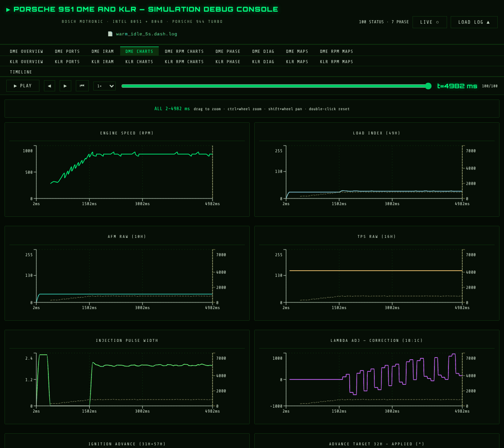

### Finding the moment to debug

Log review is usually the first step of a debug session:

1. Open the log and look at **DME CHARTS**, **KLR CHARTS** or **TIMELINE**.
2. Drag across the region of interest to zoom in (section 8). Click the event
   to put the scrubber on it.
3. Check **DME IRAM** / **KLR IRAM** and the flags there. Note the time from
   the scrubber (`t=… ms`) and the RAM locations involved.
4. To see *which code* produced it, take that time to the simulator
   ([section 6](#6-debugging-a-log-at-a-chosen-time)).

### Replay logs: recorded against simulated

Logs from `replay/run_replay.sh` carry the recorded car log's own outputs
(`REPLAY: [EXPECT]` lines). The dashboard draws them as dashed **LOG
(expected)** traces over the matching DME charts (ignition advance, injector
pulse, dwell, RPM) and KLR charts (retard, coil pulse, knock output and count,
boost, full load). The tooltip shows the logged value next to the simulated
one.

---

## 4. Live simulation

### Connecting

Start `node bridge.mjs` (section 1), then do one of these:

* press **LIVE ○** in the header, or **LIVE SIM** in the load-log dialog
* open the page with `?live`, or `?live=<bridge url>` for a bridge on
  another port

While connected the button reads **● LIVE** and `?live` stays in the address
bar, so a reload reconnects. On connecting, the bridge replays the run so far,
so the charts are complete even if you open the page late. If the bridge isn't
running you see **● OFFLINE** and a red note telling you how to start it.

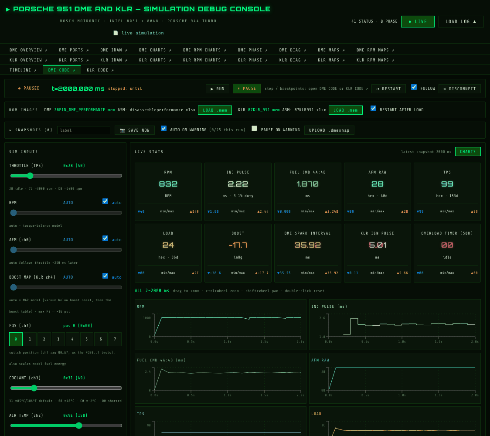

### The main page

**Run bar**

| Control | Does |
|---|---|
| **● RUNNING / PAUSED / OFFLINE**, `t=… ms` | Sim state and simulated time. While running it also shows the speed, about 20 simulated ms per second (roughly 50× slower than real time) |
| `stopped: …` | Why it stopped: `start`, `pause`, `until`, `step`, a breakpoint (with its condition and the value it saw) or a warning |
| **▶ RUN / ⏸ PAUSE** | Free-run and stop |
| **↺ RESTART** | Kill the sim and start again at t=0 on the loaded ROM images |
| **FOLLOW** | Keep every scrubber and chart cursor on the newest data. Untick it to look back while the sim runs on |
| **✕ DISCONNECT** | Leave live mode. The sim keeps running in the bridge |

Step, RUN TO and breakpoints are in the **DME CODE** and **KLR CODE** windows
(section 5).

**ROM IMAGES**: the image in each EPROM and the disassembly workbook its
listing comes from. See [section 9](#9-rom-images).

**SNAPSHOTS**: save, list and reload whole-model snapshots, and open
regression tests at a chosen time. See sections [6](#6-debugging-a-log-at-a-chosen-time)
and [7](#7-snapshots).

**SIM INPUTS**: the engine model's inputs. The engine runs on the closed-loop
model. The throttle is the input, AFM follows it about 250 ms later, and RPM
comes out of the torque balance.

| Input | Drives | Notes |
|---|---|---|
| THROTTLE (TPS) | Throttle command | 0x28 idle, 0x72 ≈ 3000 rpm, 0xD8 ≈ 6400 rpm |
| RPM | Engine speed | **auto** = torque-balance model. Untick to pin a value. Held at 840 until the firmware reports EngineSync |
| AFM (ch0) | DME ADC ch0 | **auto** follows the throttle |
| BOOST MAP (KLR ch4) | KLR MAP ADC | **auto** = MAP model. Pinned values are capped at 0xF5 (≈ +16 psi) because the KLR adds 10 and anything higher wraps to vacuum |
| FQS (ch7) | Fuel-quality switch position 0-7 | Also scales the model's fuel energy, as the FQS tests do |
| COOLANT, AIR TEMP, BATTERY, ALTITUDE | DME ADC ch3, ch2, ch1, ch4 | Raw bytes. The hints give the common values |
| AC (T1) | AC compressor load | The ISV should catch it |

A slider sends its value when you let go. Ticking **auto** hands the input
back to the model.

**SIM WARNINGS**: any `[WARN]`, `WARNING` or `ERROR` line from the model,
newest first. A 📷 beside a warning means a snapshot was saved there. Click it
to restart the sim from that moment. **✕** hides the box until the next
warning.

**LIVE STATS**: tiles for RPM, injector pulse (with duty, `HELD OPEN`,
`CUT`, `REV LIMIT`), fuel command, AFM, TPS, load, boost, DME spark interval,
KLR ignition pulse and the overload timer, each with its min and max. A tile
turns red on a fault condition. **CHARTS** shows or hides a chart of each
one, and the charts zoom like any other (section 8).

### Pop-out windows

In live mode each tab button (marked **↗**) opens that tab in a **window of
its own** instead of below the header. You can arrange the overview, charts,
timeline and both code debuggers across your screens while the sim runs.

* Allow pop-ups for the page. If the browser blocks one, the page tells you.
* The windows share the page's single connection to the bridge, so they all
  show the same run. Each has its own scrubber in the title area. Its title
  says `FOLLOW off` when FOLLOW is unticked.
* Clicking a tab button again brings its window to the front. Closing the main
  page closes them all. A window that hits an error shows it there, with
  **TRY AGAIN**, and the rest keep working.
* Chart windows redraw at most every 2 seconds while the sim runs, so a long
  run stays responsive.
* Live mode keeps about the last ten simulated minutes, and older data is
  dropped as the run goes on.

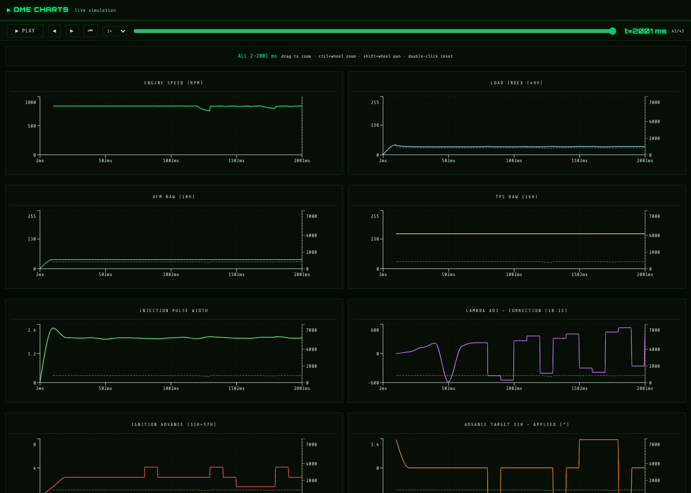

---

## 5. The code debugger

Open **DME CODE ↗** or **KLR CODE ↗** (row 3 of the tabs). Each opens a
window with the run bar, the breakpoints, the stack, the disassembly and the
instruction trace for that CPU.

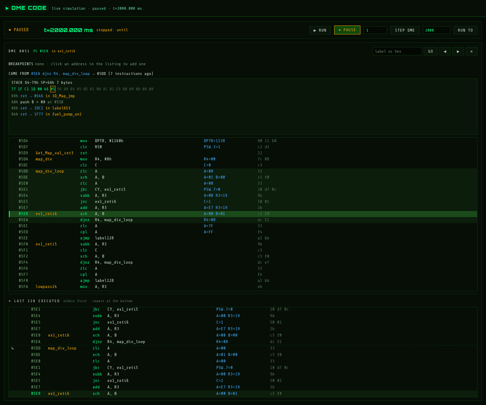

### Run bar

| Control | Does |
|---|---|
| **▶ RUN / ⏸ PAUSE** | As on the main page |
| *N* + **STEP DME** / **STEP KLR** | Run *N* instructions of this CPU, then pause (the other CPU runs alongside) |
| *ms* + **RUN TO** (or Enter) | Run until that simulated time, then pause |

The window title also shows the state and time, so you can tell where the
sim is from any window.

### The listing

The header shows the CPU, the current **PC** and the routine it is **in**
(the nearest label above the PC).

Each row shows, from left to right:

* the breakpoint marker (● red, ● amber when it has a condition, ○ when
  disabled)
* the address and its label
* the instruction and its operands, with full-length names from the
  disassembly workbooks
* **values** (blue): the operands as this instruction saw them the last time
  it ran, before it executed, e.g. `A=E7 R3=19`, `DPTR=1138`, `R0=37
  A=@R0[37]=15`. It stays blank for instructions that are not in the recent
  trace
* the instruction bytes

The PC row is highlighted green. Recently executed rows are lightly shaded.
Hover a row for the workbook's description of that line.

**Finding code.** Type in the **label or hex** box:

* Part of a label highlights every matching label as you type. **Enter** or
  **▶** goes to the next match and **Shift+Enter** or **◀** to the previous
  one. The counter shows `3/12`.
* A hex address followed by **GO** goes to that address.
* **PC** returns to the program counter. Every stop also returns there.

### Breakpoints

* **Click any row** in the listing to set a breakpoint there, and click it
  again to remove it.
* The **BREAKPOINTS** strip lists them: the checkbox enables or disables one
  (a disabled breakpoint keeps its place and condition), clicking the address
  shows it in the listing, **✕** removes it and **CLEAR ALL** removes all of
  them.
* When the sim stops on a breakpoint, the run bar says
  `stopped: bp dme 0003` and the listing centres on it.

### Memory-condition breakpoints

A breakpoint can also carry a memory condition. It then stops only when that
PC is about to run **and** a RAM byte (DME iram / KLR ram, 00h-7Fh), or one
bit of it, compares true.

1. Set the breakpoint, then click **+if** next to it in the strip.
2. Pick the location. Search by name (`rpm`, `ENGINE_RPM_RAW`, `flags`…) or
   type a hex address (`37`). For a single bit write it as `21.3`.
3. Choose `==`, `!=`, `<` or `>`, and type the value in hex (a bit compares
   with 0 or 1).
4. Press **SET** (or Enter). The editor shows the value **now** so you can
   check the condition before you run.

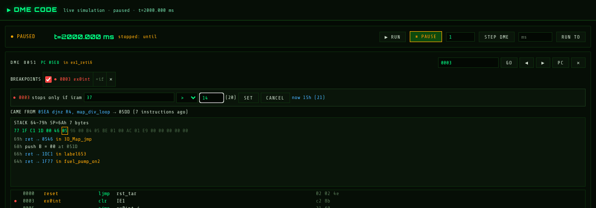

The comparison is unsigned and uses RAM as it is when the instruction is
fetched, before it executes. The strip then shows the condition, e.g. `if 37h
ENGINE_RPM_RAW > 14h`. Hover it to see whether it is true now, or click it to
edit it, or to remove it with **NO CONDITION**. When it stops, the run bar
and the strip show the value it compared:

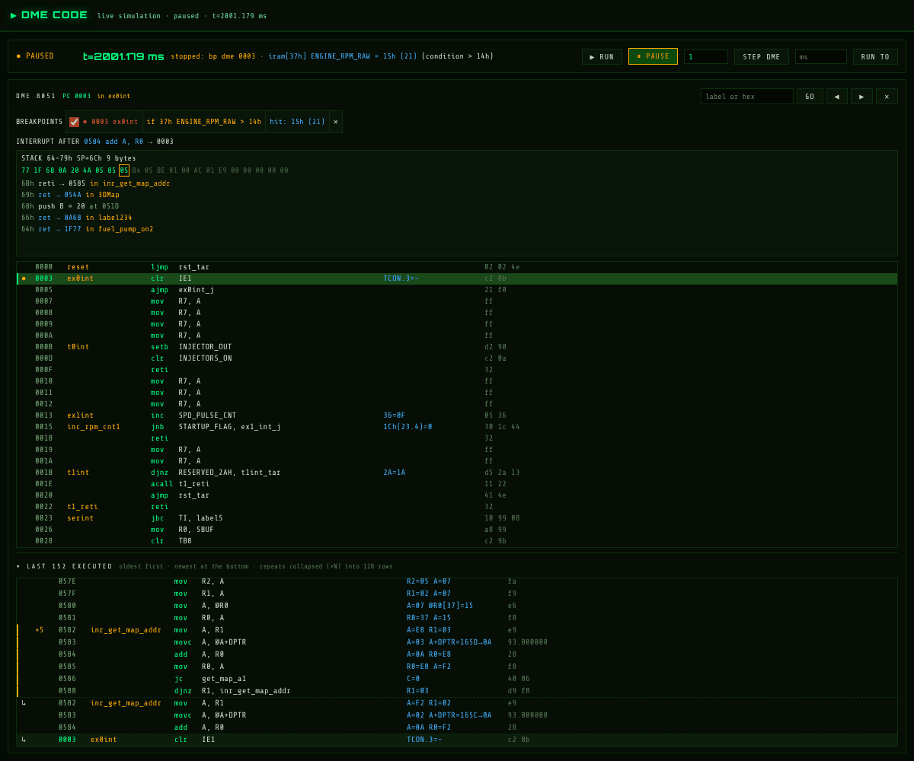

`stopped: bp dme 0003 · iram[37h] ENGINE_RPM_RAW = 15h (21) (condition > 14h)`
and `hit: 15h (21)` beside the breakpoint.

Some useful patterns:

| Breakpoint | Stops |
|---|---|
| `0003` (ex0int) `if 37 > 4B` | In the reference-sensor interrupt, only above 3000 rpm (37h × 40) |
| A routine `if 23.5 == 1` | Only while fuel is cut on overrun (FuelOffCoast, 23h bit 5) |
| A store instruction `if 58 != 0` | Only while the overload timer is running |

Breakpoints and their conditions are saved in snapshots and survive LOAD.

### Where the CPU came from

* **CAME FROM `05EA djnz R4, map_div_loop → 05DD` (7 instructions ago)**
  names the last jump, call, return or branch that led to the current code.
  After an interrupt it reads **INTERRUPT AFTER** with the instruction it
  interrupted. Click the address to see it in the listing.
* **STACK** dumps the stack area (DME 64h-79h; KLR 08h-17h, its 8-level stack) with the
  stack pointer boxed, then decodes it: `ret → 0546 in 3D_Map_jmp`,
  `reti → 0585 in inr_get_map_addr` with the saved PSW, and `push B = 00 at
  051D`. Click an entry to see it in the listing. A red **SP OUTSIDE STACK
  AREA** means the stack has overrun.
* **LAST N EXECUTED** is the instruction trace, oldest at the top and newest
  at the bottom, up to the last 512 instructions. `↳` and a dashed rule mark
  where control arrived by a jump, call, return or interrupt. Repeats of one
  instruction or a short loop collapse into one block with **×N** (the values
  shown are from the last pass). Click a row to show it in the listing. The
  trace is fetched each time the sim stops.

### From a terminal

The same commands work without the page, typed into `obj/dme_klr_live`
directly or posted to the bridge:

```sh
curl -X POST --data 'bp add dme 024E if 37 > 14' http://127.0.0.1:8951/cmd
curl -X POST --data 'until 2500' http://127.0.0.1:8951/cmd
```

The full list is in [section 10](#10-reference).

---

## 6. Debugging a log at a chosen time

A log is a record of a run. To step through the code behind it you need the
simulator to **run the same stimulus up to the same moment and stop there**.
How you do that depends on where the log came from.

| The log came from | Do this |
|---|---|
| A regression test (`run_dashboard_tests.sh`, `v_run_dashboard_tests.sh`, `run_dashboard_parallel.sh`) | **A: open the test at a time** (below) |
| The live simulator | **B: RUN TO, or reload a snapshot** |
| A recorded car log (`replay/run_replay.sh`, `replay_wot_60s`) | Not supported in the debugger yet, see the limits below |

### A. Open a regression test at a time

The regression test is rebuilt with the debugger's hooks (breakpoints,
stepping, the RAM views) but keeps its own scripted stimulus. It is then run
to the time you give and paused. From that point it is the same run as the
log.

**1. Find the time in the log.** Load the test's `.dash.log` (section 3) and
put the scrubber on the event. Note the time and pick a start a little
**before** it, so your breakpoints catch the lead-up. For example, the event
is at 2700 ms, so start at 2500 ms.

**2. Connect to the simulator.** Press **LIVE** with `bridge.mjs` running.

**3. Add the test at that time.** Open the **SNAPSHOTS** list (click its
title). In the **TEST** row type the test's name (as the scripts know it, e.g.
`cl_ramp_to_3000`) and the time in ms, optionally a label in the label box,
then press **+ ADD**. A purple **TEST** row appears:

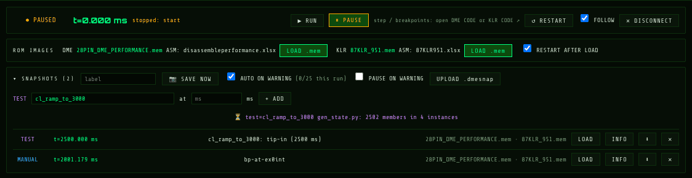

**4. LOAD it.** Press **LOAD** on the TEST row.

* The first time, the bridge builds the test (`build_live.sh --test <name>`,
  into `obj/tests/<name>/`). Progress shows under the list (`⏳ … gen_state.py
  …`). This takes a few minutes. The build is reused next time, and rebuilt
  when the testbench, `sim_main.cpp` or the test's flags or ROMs change.
* Then it runs the test from t=0 to your time. This takes as long as the sim
  needs to get there, at about 20 simulated ms a second, so 2.5 s of engine
  time takes about two minutes. The charts fill in as it goes.
* It stops **paused** at your time (`stopped: until`). The SNAPSHOTS row
  reads `regression test <name>: inputs follow its script`.

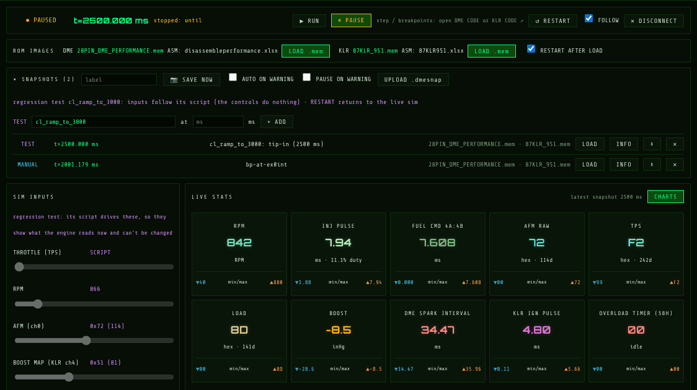

**5. Debug.** Open **DME CODE** / **KLR CODE**. Then:

* set PC breakpoints, with memory conditions on the RAM locations you
  noticed in the log (section 5)
* **RUN** to the first hit, **STEP** through it, read the values column,
  CAME FROM, STACK and trace
* use **RUN TO** to go to a later time
* the chart and IRAM windows show the same moment, for comparison with the
  log

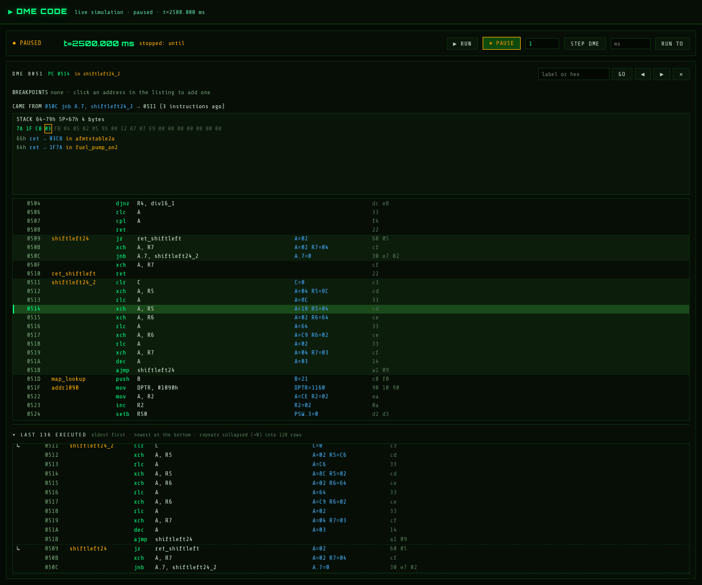

Things to know:

* **The inputs are the test's.** The SIM INPUTS show what the engine reads
  but can't be changed, and **SAVE NOW** can't save a test run.
* **↺ RESTART** leaves the test and goes back to the ordinary live simulator.
* **Breakpoints you set before LOAD are kept.** For a TEST row they take
  effect only from its time on, so the run up to it doesn't stop on them.
* **Warnings make TEST rows for you.** After each regression test,
  `test_snap.py` scans its log, and the first warning or error of each kind
  (at most 5 per test) becomes a TEST row that starts **200 ms before** the
  warning (`DMEKLR_SNAP_LEAD_MS` when the tests run changes this). For a FAIL
  in `run_dashboard_parallel.sh` with no warning, the row is at the end of the
  run. So after a regression run, the SNAPSHOTS list already holds a way into
  every warning. **INFO** on a row shows the test, the trigger line, the time
  it runs to, its flags, ROMs and whether it is built yet.
* **The same from a terminal:** `dme_klr/live/test_snap.py add <test> <ms>
  [label]` adds the row, and LOAD it in the page.
* **Use Verilator logs when you can.** The debugger runs Verilator. A log
  from `run_dashboard_tests.sh` (Icarus) usually matches, but in the first
  second some tests differ while the KLR branches on uninitialised RAM, which
  Icarus treats as X and Verilator as 0. `v_run_dashboard_tests.sh` gives a
  log that matches the debugger's run.
* **Times line up.** The log's `t=` and the simulator's time are the same
  simulated milliseconds from reset.

### B. A run from the live simulator

The live sim is deterministic for the same inputs, so to get back to a moment:

* **RUN TO** that time from a fresh start (**↺ RESTART**, then enter the time
  in a code window and press **RUN TO**). This works when you didn't move any
  inputs before that time.
* If you changed inputs on the way, or want the moment of a warning, use a
  **snapshot**: one is saved on every warning (📷 in the warnings box), and
  **SAVE NOW** takes one by hand. **LOAD** restarts the sim at that moment,
  paused, with the same model state, inputs, breakpoints and ROMs. Then
  debug as above, with the inputs still yours to change.
* **PAUSE ON WARNING** stops the sim at each warning so you can look at it
  straight away.

### Limits

* **Replays of recorded car logs** (`run_replay.sh`, including the suite's
  `replay_wot_60s`) can't be opened at a time in the debugger. `test_snap.py`
  only knows the tests the runner starts with `run_test`, and the replay has
  its own driver. Review those logs in log mode and use the dashed **LOG
  (expected)** traces.
* A log pasted from somewhere else, with no test or snapshot behind it, can be
  reviewed but not re-run.

---

## 7. Snapshots

A snapshot holds **the whole model**: both CPUs' registers, RAM and pipeline
state, the EPROMs, ADCs, timers, the engine, AFM, O2 and knock models, the
inputs, the breakpoints and the last 512 instructions of each CPU. Loading one
gives the same run as the original from that moment on.

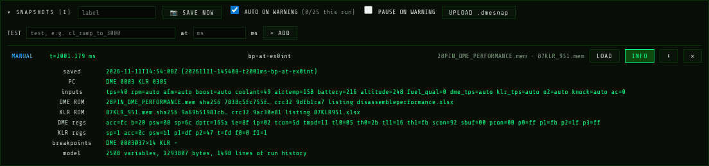

| Control | Does |
|---|---|
| **SNAPSHOTS (n)** | Click to open or close the list. A new snapshot opens it |
| label + **📷 SAVE NOW** | Save now, under that label (taken within a few ns, at the next quiet moment) |
| **AUTO ON WARNING** | Save one on each warning or error. At most once per simulated second per kind of warning, and 25 per run |
| **PAUSE ON WARNING** | Also pause after each warning's snapshot |
| **UPLOAD .dmesnap** | Add a snapshot downloaded earlier |
| **LOAD** | Restart the sim from it, paused (asks first if the sim is running) |
| **INFO** | Saved time, trigger, PCs, inputs, ROM identity (SHA-256, CRC32, listing), CPU registers, breakpoints |
| **⬇** | Download it as one `.dmesnap` file |
| **✕** | Delete it |

The coloured tag on each row tells you its kind: **WARN** / **FAIL** (red),
**MANUAL** (blue), **UPLOAD** (amber) and **TEST** (purple, section 6).

After a LOAD:

* the sim is paused at the snapshot's time, and the stats and IRAM views show
  the restored RAM
* the charts show the run's last 60,000 lines before it, so the lead-up is
  there
* RPM, AFM and boost that were on **auto** are pinned at their values then,
  so the engine holds that operating point while you step. Tick **auto** to
  let the model take over again. The other inputs are restored as they were
* the SNAPSHOTS row shows `running from snapshot <id>`

A snapshot loads only into the **same build** of the simulator. A build from
different Verilog or another Verilator version is refused with a red message.
After a rebuild where only `sim_main.cpp` or the compiler changed, it loads
with each clock's phase approximated (`exact=0`, well under a microsecond). To
share a moment with someone whose build differs, send them the INFO (inputs,
ROMs, time) instead.

Snapshots live in `../tmp/dme_klr/snapshots/` beside the checkout
(`node bridge.mjs --snapdir <dir>` to move them).

---

## 8. Charts, Timeline and Maps in detail

### Zoom and navigation (every chart)

| Action | Does |
|---|---|
| Drag across a chart | Zoom to that span |
| Ctrl/⌘ + wheel, or pinch | Zoom in or out around the pointer |
| Shift + wheel | Pan |
| Double-click, or **RESET ZOOM** | Whole run again |
| Click (no drag) | Move the scrubber to that time |
| Hover | Synced tooltip across the charts of the tab |

DME CHARTS, KLR CHARTS, TIMELINE and the MAPS tabs **share one time zoom**:
zoom one and the others follow. The RPM tabs have their own RPM-range zoom.
In live mode a zoomed chart holds its window while the run goes on.

### TIMELINE

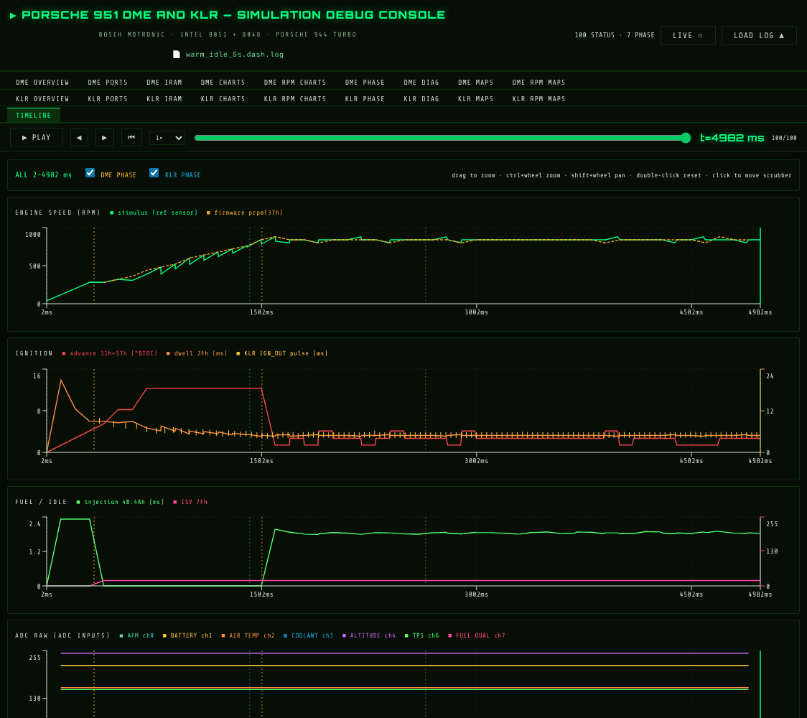

DME and KLR on one time axis: engine speed (stimulus and the firmware's
`prpm`), ignition (advance, dwell, KLR IGN_OUT pulses), fuel/idle, the raw ADC
inputs and the ADC values in DME RAM, the KLR, and **DME PHASE / KLR PHASE**
event markers (toggle them at the top). The tooltip lists phase events within
±60 ms.

**MEMORY PICKER** charts anything you choose against time:

1. Pick the source: **DME iram**, **KLR ram**, **DME map / table** or **KLR
   map / table**.
2. Search by name or hex address (`37`, `rpm`, `lambda`…), or by map number,
   address or name for maps. For a bit, enter it in the **bit** box.
3. **ADD** (or Enter). Each pick gets a coloured chip. Click the chip to hide
   or show it, use the unit selector to change how the tooltip shows the value
   (raw, ADC volts, battery volts, °C, RPM), and **✕** to remove it.

**MEMORY vs RPM** does the same against engine speed. Your picks are
remembered in the browser.

### DME MAPS / KLR MAPS

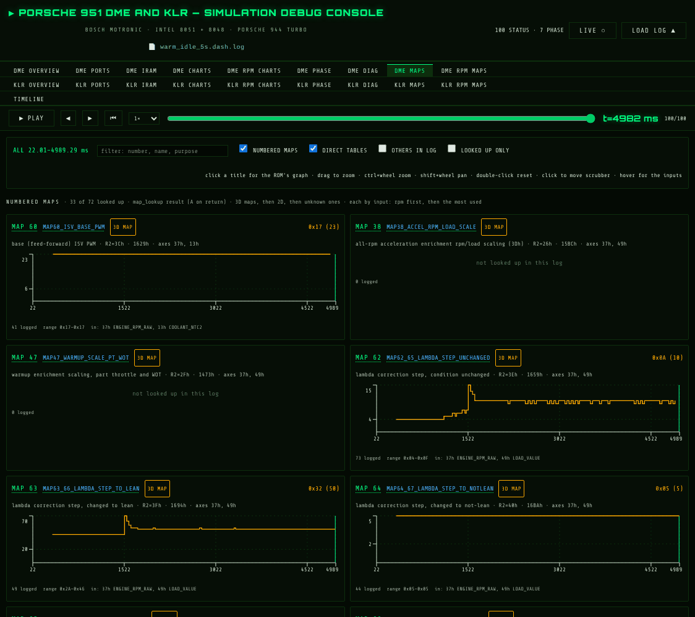

One small chart per map or table, showing the value the firmware got back from
each lookup over time. The header of each gives the map number, its name, 2D or
3D, its purpose, ROM address and input axes. The footer gives how many lookups
were logged, the range and the inputs at the hovered point.

* **filter** by number, name or purpose. **NUMBERED MAPS**, **DIRECT
  TABLES**, **OTHERS IN LOG** and **LOOKED UP ONLY** choose what is listed.
* **Click a chart's title** to see that map as it is in the ROM: a 2D map as
  a curve, a 3D map as a surface beside the raw grid, tables as steps or bars.
  The graphs come from the bridge (`map_graphs.py`), so **the bridge must be
  running even in log mode**. In log mode they are drawn for the ROM the log
  names, by hash, and once per ROM (about 20 s the first time).
* **DME RPM MAPS / KLR RPM MAPS** show only the maps with RPM as an input,
  each lookup a point against engine speed. A 3D map's points are coloured by
  its other input. KLR lookups are placed at the DME's RPM at that time.

### KLR overview and boost control

KLR OVERVIEW includes the boost-control view: the target from the KLR boost
map (by throttle from ram 43h and RPM) against the measured `ram[52h]`, in
psi / inHg.

---

## 9. ROM images

The **ROM IMAGES** row (live mode) shows the `.mem` image in each EPROM and
the workbook its listing comes from (`ASM: disassembleperformance.xlsx`).

* **LOAD .mem** (while paused) loads another image into that CPU. With
  **RESTART AFTER LOAD** ticked (the default) the sim restarts at t=0 on it.
  Unticked, the image is swapped in place and the CPU carries on from its PC
  and RAM.
* The listing follows the image. Known images (the '86, '89 and performance
  DME, and the '86, '87 and '89 KLR) are matched by content or file name to
  their workbook. An unknown one shows **ASM: no workbook** in amber, and the
  listing may not line up with the code.
* The bridge refuses a KLR image loaded into the DME.
* Uploaded images are reused on every restart until you load another or
  restart the bridge.

To build or run with other images from the start, set `DME_ROM_DIR` /
`DME_ROM_FILE` / `KLR_ROM_DIR` / `KLR_ROM_FILE` for `build_live.sh` or the
test scripts.

---

## 10. Reference

### URL parameters

| Parameter | Does |
|---|---|
| `?log=<url>` | Fetch and open that log |
| `?live` | Connect to the bridge at `http://127.0.0.1:8951` |
| `?live=<url>` | Connect to a bridge elsewhere |

### Simulator commands

Typed into `obj/dme_klr_live` or posted to `http://127.0.0.1:8951/cmd`, one
per line:

| Command | Does |
|---|---|
| `run`, `pause` | Free-run, stop |
| `step dme\|klr [N]` | Run N instructions of that CPU |
| `until <ms>` | Run to that simulated time, then pause |
| `set <input> <value\|auto>` | `tps rpm afm boost fuel_qual coolant airtemp battery altitude ac`, plus `o2 dme_tps klr_tps knock` (terminal only) |
| `bp add\|del dme\|klr <hex>` | PC breakpoint |
| `bp add dme\|klr <hex> if <mem>[.<bit>] <op> <val>` | Conditional breakpoint (`==`, `!=`, `<`, `>`; unsigned; hex) |
| `bp clear` | Clear all breakpoints |
| `trace dme\|klr [N]` | Last N instruction addresses |
| `snap` | Dump a RAM snapshot now |
| `rom dme\|klr <path>` | Load a `.mem` image (paused) |
| `save [label]`, `load <dir>` | Save or restore a snapshot |
| `autosnap on\|off\|max <n>`, `breakonwarn on\|off` | Warning snapshots |
| `status`, `quit` | |

### Bridge options

`node bridge.mjs [--port 8951] [--sim obj/dme_klr_live] [--snapdir <dir>]
[--dme-asm <dir>] [--klr-asm <dir>] [--mapcache <dir>] [--allow-origin
<origin>]`. `--dme-asm` / `--klr-asm` pin a listing instead of following the
ROM.

### Troubleshooting

| Symptom | Cause / fix |
|---|---|
| **● OFFLINE** and a red note | The bridge isn't running, or is on another port. Start `node bridge.mjs` in `dme_klr/live`, or use `?live=<url>` |
| Clicking a tab in live mode does nothing | The browser blocked the pop-up. Allow pop-ups for the page |
| `No disassembly from the bridge.` | The bridge couldn't read the asm tables. Check its terminal output |
| **ASM: no workbook** | The ROM image has no matching workbook, so the listing may not line up |
| A map title shows no graph | The bridge isn't running, matplotlib is missing, or the log's ROM isn't in `bin_images/` or the uploaded images |
| Snapshot LOAD refused (red under the list) | It was saved by a different build. Reproduce it from its INFO |
| TEST LOAD fails with a build error | Shown as `SIM: [ERROR] building test …`. Run `./build_live.sh --test <name>` in a terminal to see the whole message |
| `No map lookups in this log` | The log predates the `[LKUP]` lines. Re-run the test |
