# DME + KLR Simulation Debug Console: User Manual

> This manual is for the prebuilt **lite package**. Building from source, the
> developer install, CI and the regression tooling are in the
> [Developer Manual](DEVELOPER_MANUAL.md).

## Introduction

The 951 Debugger was created to allow analysis of the Porsche 951 DME and KLR
systems in a 100% software environment. It also includes nearly 100 separate
functionality tests that simulate real-world driving scenarios and many
failure conditions (TPS stuck at 0 V, for example). A closed-loop model
simulates external behavior such as AFM air flow, turbo boost and
engine/transmission inertia to mimic real-world behavior, while letting you
override these models and explore any combination of RPM, TPS, AFM airflow,
turbo boost, battery voltage, altitude, FQS switches, AC on/off and more.

The system provides three standard DME ROM images: from a 1986 951, a 1989
951, and the Carpokes Performance DME created in 2025. There are also KLR
images from 1986, 1987 and 1989. You can also create, import, validate and
debug custom tuned images, and compare their performance with the standard
images.

### How it works

The debug console is a web page (the `whalenlg/dme-dashboard` repo) that shows
what the simulated 944 Turbo DME (Intel 8051) and KLR (Intel 8048) are doing.
It works in two ways:

| | **Log review** | **Live simulation** |
|---|---|---|
| What you look at | A finished run: a `.dash.log` from the regression tests (`run_tests.py`) | The simulator running now, started by `run_lite.sh` |
| What you can do | Scrub and play back through the run, read RAM, ports and flags, chart anything against time or RPM | Everything in log review, plus run / pause / step, PC and memory-condition breakpoints, change the engine inputs, save and reload whole-model snapshots, swap ROM images |
| Needs | Only a browser | The lite package running on your computer |

The two meet in [section 7](#7-debugging-a-log-at-a-chosen-time): you find a
moment of interest in a log, then have the simulator re-run that same test up
to that time and stop, so you can set breakpoints and step through the
firmware from there.

### System block diagram

Both ROM images run on cycle-level models of the real CPUs, wired together as
on the car. Their inputs come from one of three stimulus drivers, chosen at
run time by going live or by selecting an available test:

- **Closed-loop test driver**: a regression test's scripted driver and fault
  injection, plus the engine, sensor and boost models of
  [Appendix C](#appendix-b-how-the-closed-loop-models-work).
- **Web UI test driver**: the live dashboard's controls, sent through the
  bridge. An input left on **auto** follows the closed-loop model.
- **FTECH9 log replay driver**: every input taken row by row from a recorded
  car log (`dme_klr/replay`), with no engine model in the loop.

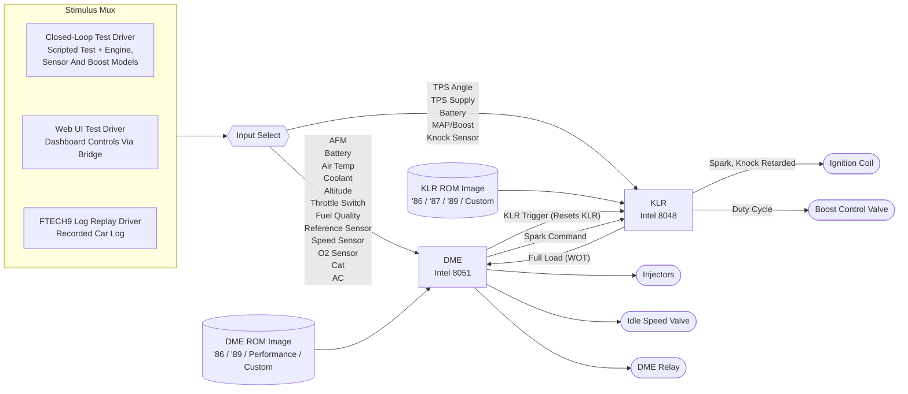

The KLR's ignition output drives the coil: the DME computes the spark and
the KLR retards it when it hears knock. In closed-loop tests the outputs
close the loop: the injected fuel, idle air and boost feed back into the
closed-loop driver's engine model, which sets RPM and the sensor readings for
the next revolution.

Contents

- [Introduction](#introduction)
1. [Install](#1-install)
2. [Setting up](#2-setting-up)
3. [The screen](#3-the-screen)
4. [Log review](#4-log-review)
5. [Live simulation](#5-live-simulation)
6. [The code debugger](#6-the-code-debugger)
7. [Debugging a log at a chosen time](#7-debugging-a-log-at-a-chosen-time)
8. [Snapshots](#8-snapshots)
9. [Charts, Timeline and Maps in detail](#9-charts-timeline-and-maps-in-detail)
10. [ROM images](#10-rom-images)
11. [Reference](#11-reference)
12. [Credits](#12-credits)
- [Appendix A. Regression tests](#appendix-a-regression-tests)
- [Appendix B. How the closed-loop models work](#appendix-b-how-the-closed-loop-models-work)

---

## 1. Install

The lite package is the simulator already built, with its own copy of the
dashboard, so it runs with no internet connection. It gives you live mode,
the code debugger, snapshots, ROM swapping, the disassembly workbooks and the
regression tests. Verilator, iverilog, GTKWave and a C++ compiler are not
needed.

### Getting the package

There are packages for macOS (Apple Silicon), Linux x86_64 (glibc 2.35 or
newer: Ubuntu 22.04, Arch, ...) and Windows x86_64. Each is one archive,
`dmeklr-lite-<version>-<platform>.tar.gz` (`.zip` for Windows).

* **A release:** the repository's
  [Releases page](https://github.com/whalenlg/944turbo_dme_klr/releases)
  lists each version with the archives under *Assets*. You can also
  download from the command line (below).
* **The latest build:** on GitHub, open the repository's **Actions** tab,
  pick the **Lite package** workflow, open its latest successful run on
  `main`, and download `lite-macOS`, `lite-Linux` or `lite-Windows` under
  *Artifacts* (you need to be signed in to GitHub; artifacts are kept 90
  days). The download is a `.zip` holding the package archive; unzip it
  first (macOS's Finder may do that by itself).

#### Downloading a release from the command line

The release archives are public, so no GitHub login is needed. The examples
use release `v1.0.1`; for another release, change only the `V` line at the top of the block (the
[Releases page](https://github.com/whalenlg/944turbo_dme_klr/releases) lists
them).

Install **Node.js 18 or newer** (https://nodejs.org) first; see
[What you need](#what-you-need). Each block below then downloads, unpacks,
installs the Python packages into a virtual environment (`.venv`) in the
package folder, and starts the simulator in one go. After the
first time, only the last line (from the package folder) is needed.

| Platform | Archive |
|---|---|
| macOS (Apple Silicon) | `dmeklr-lite-v1.0.1-macos-arm64.tar.gz` |
| Linux x86_64 | `dmeklr-lite-v1.0.1-linux-x86_64.tar.gz` |
| Windows x86_64 | `dmeklr-lite-v1.0.1-windows-x86_64.zip` |

**macOS** (Terminal):

```sh
V=v1.0.1
curl -LO https://github.com/whalenlg/944turbo_dme_klr/releases/download/$V/dmeklr-lite-$V-macos-arm64.tar.gz
tar -xzf dmeklr-lite-$V-macos-arm64.tar.gz
cd dmeklr-lite-$V-macos-arm64
python3 -m venv .venv && .venv/bin/pip install -r requirements.txt
./run_lite.sh
```

**Linux:**

```sh
V=v1.0.1
curl -LO https://github.com/whalenlg/944turbo_dme_klr/releases/download/$V/dmeklr-lite-$V-linux-x86_64.tar.gz
tar -xzf dmeklr-lite-$V-linux-x86_64.tar.gz
cd dmeklr-lite-$V-linux-x86_64
python3 -m venv .venv && .venv/bin/pip install -r requirements.txt
./run_lite.sh
```

**Windows** (PowerShell):

```powershell
$V = "v1.0.1"
Invoke-WebRequest https://github.com/whalenlg/944turbo_dme_klr/releases/download/$V/dmeklr-lite-$V-windows-x86_64.zip -OutFile dmeklr-lite-$V-windows-x86_64.zip
Expand-Archive dmeklr-lite-$V-windows-x86_64.zip -DestinationPath .
cd dmeklr-lite-$V-windows-x86_64
py -m venv .venv; .venv\Scripts\pip install -r requirements.txt
.\run_lite.cmd
```

With the [GitHub CLI](https://cli.github.com) (`gh`) installed, this
downloads the latest release's archive for one platform on any system
(`linux-x86_64` or `windows-x86_64` in place of `macos-arm64` for the
others; put a tag such as `v1.0.1` after `download` for a particular one):

```sh
gh release download -R whalenlg/944turbo_dme_klr -p '*macos-arm64*'
```

Then open **http://127.0.0.1:8951/?live** in a browser
([Starting it](#starting-it)).

Notes:

* **Downloaded in the browser** (Releases page or Actions): unpack the
  archive (on Windows right-click the `.zip`, *Extract All*; macOS may leave
  a `.tar`, so use `tar -xf`), then run the `cd`, venv and `run_lite` lines
  of your platform's block.
* `run_lite.sh` and `run_lite.cmd` use `.venv` by themselves when it is in
  the package folder; there is nothing to activate.
* **Debian / Ubuntu:** if `python3 -m venv` says *ensurepip is not
  available*, run `sudo apt install python3-venv` and repeat the line.

### What you need

* **Node.js 18 or newer** from https://nodejs.org (the installer).
* **Python 3** with pandas, openpyxl, matplotlib and numpy, for the graphs
  on the MAPS tabs and for listings from edited workbooks (installed into
  `.venv` by the line above).
* **bash**, only to rebuild listings from edited workbooks (on Windows, Git
  Bash or MSYS2). Without it the listings that come with the package are used.

### Starting it

From the package folder:

```sh
./run_lite.sh          # Windows: run_lite.cmd (or double-click it)
```

Then open **http://127.0.0.1:8951/?live** in a browser. The dashboard comes
from the package and connects in live mode. **Ctrl+C** in the terminal stops
it. On macOS, `run_lite.sh` clears the downloaded-file flag on the package
folder so the unsigned simulator can run.

Snapshots and the map-graph cache go to `data/` in the package folder
(`DMEKLR_TMP` moves them). The package's `README.txt` has the same steps.

---

## 2. Setting up

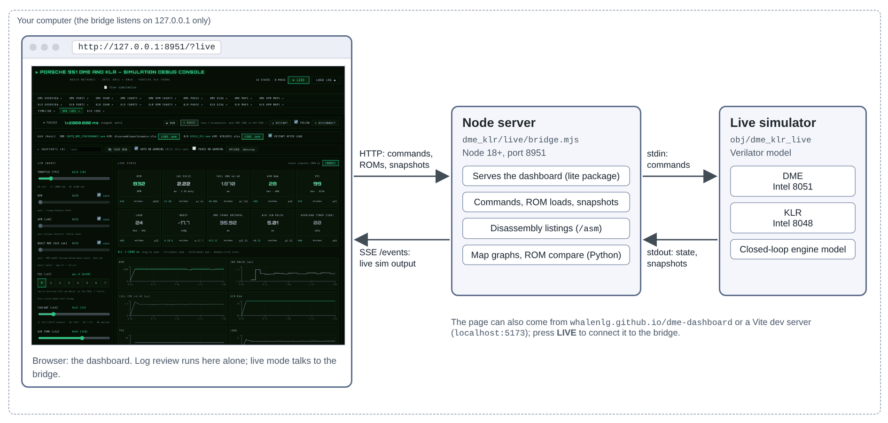

Live mode has three parts, all on your computer. The **browser** shows the
dashboard. The **Node server** (`bridge.mjs`) passes the dashboard's commands,
ROM loads and snapshot requests to the simulator, streams everything the
simulator prints back to the page, and serves the disassembly listings and map
graphs. The **live simulator** (`dme_klr_live`) is the Verilator model of
the DME and KLR with the closed-loop engine model. Log review needs only the
browser.

### The dashboard

With `run_lite.sh` running, **http://127.0.0.1:8951/?live** is all you
need. The published page at **https://whalenlg.github.io/dme-dashboard/**
also works: press **LIVE** to connect it to the package's bridge. Log review
on its own needs only a browser; everything the page does with a log happens
in the browser.

The bridge listens only on 127.0.0.1 and only answers pages from
`whalenlg.github.io`, `localhost` or `127.0.0.1`.

### Making logs to review

The package runs the regression tests ([Appendix A](#appendix-a-regression-tests))
on its prebuilt testbench. From the package folder:

```sh
python3 run_tests.py                  # all of them (--help, --list)
python3 run_tests.py -j 4 cl_ramp_*   # some, 4 at a time
```

Each test is checked (PASS / WARN / FAIL) and writes
`data/dme_klr/89/v_dash_logs/<test>.dash.log`; open it in the dashboard.
`89` is the folder of the default 1989 images; a run on other images writes
in that pair's own folder (`86` for the 1986 pair, `carpokes` for the
CarPokes one, otherwise the DME image's name, e.g. `28PIN_DME_PERFORMANCE`), so
runs on different DME images never overwrite each other's logs (two such runs
with one DME image and different KLR images share a folder). Each
kind of warning a run prints (a PASS's too), and a WARN or FAIL verdict, also
adds a TEST row to the live page's SNAPSHOTS list
([section 7](#7-debugging-a-log-at-a-chosen-time)). The package ships one
row already: `ramp_to_6000_knock` 200 ms before its first knock pulse
(20009 ms), ready to LOAD without running the test.

**From the dashboard.** With `run_lite.sh` running, the **RUN REGRESSIONS ▸**
button in the header opens a panel that runs `run_tests.py` for you. Pick
the ROM images every test runs on (the 1989 pair by default, another pair,
or any DME and KLR image in `bin_images/` or uploaded), and
the tests by the groups of [Appendix A](#appendix-a-regression-tests) (whole
groups or single tests), how many run at a time, the snapshot interval and,
for a quick check, a length to stop each test at. iverilog and the other
developer-install options are greyed out: the package has only the Verilator
simulators. While it runs, a bar for each test shows its simulated time
against its length, with its PASS / WARN / FAIL when it is checked, and bars
for each group and the full run (simulated seconds done of the total, with
the time left estimated from the rate so far). The run goes on when the panel
is closed (the button shows its %) and stops with **STOP RUN** or when the
bridge stops.

**Changing a run as it goes.** While a run is going, **−** / **+** on the
**THREADS** row change how many tests run at a time here and on each
regression host (a host can go down to 0: no more tests there), and the
**CANCEL QUEUED** buttons (all of them, or one test group's, on the group's
line) stop tests that haven't started from ever starting; a cancelled test
isn't in the verdicts. A test already running ends as it would have.

**Regression hosts.** Other machines on the same LAN can take some of the
tests. On each one, unpack the same lite package (or a developer install of
the same software) and start it with
`./run_lite.sh --listen 0.0.0.0 --token <secret>` (Windows:
`run_lite.cmd --listen 0.0.0.0 --token <secret>`). Then, in the panel's
**REGRESSION HOSTS** box, add it with **ADD REGRESSION HOST**: its host name
or IP address, port (8951), the most tests it may run at once, and the
token. The panel shows each host as ✓ (same software, its CPUs) or ✗ and
why; the software check uses the package's `VERSION.txt`, so a different
package is refused. The run spreads the tests over this machine and every ✓
host (**spread the tests over these hosts too** turns that off for a run).
A host's tests send their progress and logs back here, so the bars,
verdicts, snapshots and summary are the same as for local ones, and each
test shows the host it ran on. On the host, each test runs in its own folder,
`$DMEKLR_TMP/dme_klr/remote_jobs/<id>`, deleted once its logs have been
fetched, so the host's own logs are never overwritten. If a host stops answering, its test goes back
in the queue and the host gets no more tests that run. The hosts and their
tokens are remembered on this machine. A bridge started with `--listen`
answers other machines only for running tests, only from private LAN
addresses and only with the token; it is not meant for the internet.

Each `.dash.log` starts with the ROM images the run used (`DME: [ROM] <file>
sha=<hash>`). The dashboard shows them in the header and uses them to fetch
the right map graphs.

---

## 3. The screen

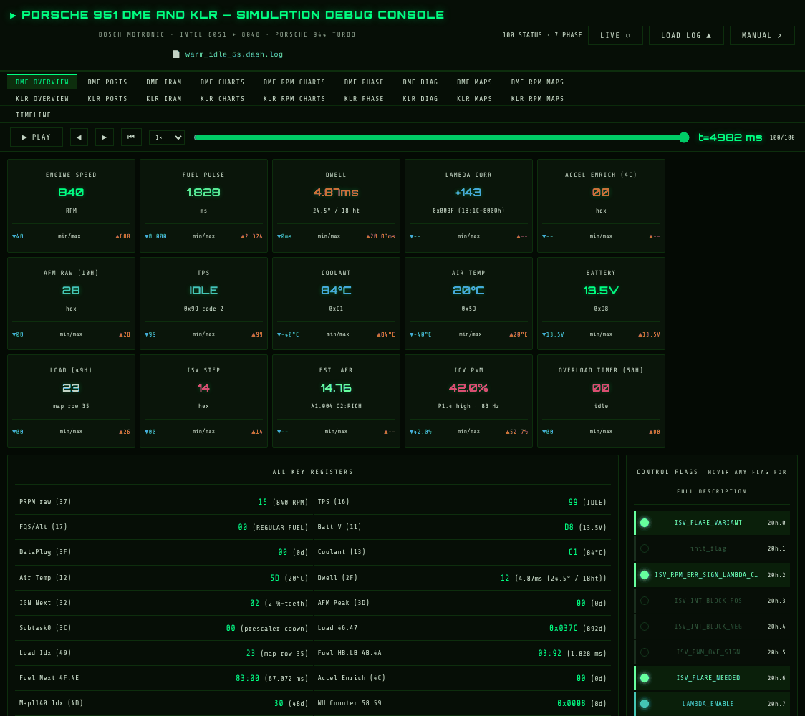

* **Header.** The file name, the ROM images the log names, the count of
  STATUS and PHASE records, the **LIVE** button (connect to or leave the
  simulator), **RUN REGRESSIONS ▸** (run the regression tests, section 2),
  **LOAD LOG** and **MANUAL ↗**, which opens this manual in
  a new tab.
* **Tab rows.** Row 1 holds the DME tabs, row 2 the KLR tabs, and row 3 holds
  **TIMELINE** (DME and KLR together). In live mode it also holds **DME CODE**
  and **KLR CODE**.
* **Scrubber** (log review). It sits under the tabs and stays at the top as
  you scroll. DME tabs step through the DME snapshots. KLR tabs (OVERVIEW,
  PORTS, IRAM, CHARTS, RPM CHARTS, PHASE, DIAG) have their own blue KLR
  scrubber that steps through KLR events. KLR MAPS and KLR RPM MAPS follow the
  DME scrubber.

### The tabs

| Tab | Shows |
|---|---|
| **DME OVERVIEW** | Tiles for engine speed, fuel pulse, dwell, lambda correction, accel enrichment, AFM, TPS state, coolant, air temp, battery, load index, ISV step, estimated AFR, ICV PWM and the overload timer, each with the run's min and max. Below them are all the key registers and the control flags (hover a flag for its description) |
| **DME PORTS** | P1, P2 and P3 pin by pin |
| **DME IRAM** | All 128 bytes of internal RAM, colour-coded by group, with sub-tabs (ADC, fuel/load, ignition, lambda, flags, RPM/crank, enrich/ISV, system, work area). Hover a byte for its name and meaning |
| **DME CHARTS** | RPM, load index, AFM, TPS, injector pulse, lambda correction, ignition advance and its target, ISV, ICV duty, dwell, coolant, FQS and the overload timer against time |
| **DME RPM CHARTS** | The same series as scatter plots against engine speed |
| **DME PHASE** | The DME's `[PHASE]` events (resets, sync, mode changes) as a list |
| **DME DIAG** | The diagnostic stream the DME would send (`send_diag_p2` pages), as a table and a chart |
| **DME MAPS / DME RPM MAPS** | Every numbered map and directly addressed table lookup the firmware made, against time or against RPM (section 9) |
| **KLR OVERVIEW** | KLR state and the boost-control view (target boost from the map compared with the measured value) |
| **KLR PORTS / KLR IRAM** | The 8048's ports and its 64 bytes of RAM |
| **KLR CHARTS / KLR RPM CHARTS** | Knock retard, coil pulse, knock output and count, boost, full load and more, against time or RPM |
| **KLR PHASE / KLR DIAG** | KLR events and diagnostics |
| **KLR MAPS / KLR RPM MAPS** | The KLR's boost, cycling-valve, PID-gain and RPM tables |
| **TIMELINE** | DME and KLR on one time axis, plus your own picks of any RAM byte, bit or map (section 9) |

---

## 4. Log review

### Opening a log

Press **LOAD LOG ▲**. The dialog opens by itself when no log is loaded. Open
a log in any of three ways; each one loads it straight away:

* **Regression logs list.** With the bridge running (`dme_klr/live/bridge.mjs`),
  the dialog lists every `.dash.log` from the regression runs, from each ROM
  pair's folder (`$DMEKLR_TMP/dme_klr/<rom>/`: `89`, `86`, `carpokes`, …):
  **Verilator** runs (`v_dash_logs`, from `v_run_dashboard_tests.sh` or
  `run_tests.py`) in blue and **iverilog** runs (`dash_logs`, from
  `run_dashboard_tests.sh`) in orange, with the **ROM** folder each came
  from (**older** for logs from before the per-ROM folders). Click a row to
  open that log.
  * Type in the **filter** box to narrow the list. Every word must match the
    test name, simulator or ROM folder, so `cl verilator 86` finds the
    Verilator closed-loop runs on the 1986 images.
  * **Include Verilator logs** and **Include iverilog logs** hide either kind.
    Both are checked each time the dialog opens.
  * Click a column heading (**Test**, **Simulator**, **ROM**, **Modified**, **Size**)
    to sort by it, and click it again to reverse. The list starts newest first.
  * Without the bridge, the dialog says how to start it in place of the list.
* **BROWSE…** opens your computer's file dialog. Browsers can't choose the
  folder it starts in. It opens in the last folder you used, so after you
  browse to `v_dash_logs` once it usually opens there again.
* **Drag and drop** a `.dash.log` onto the dialog.

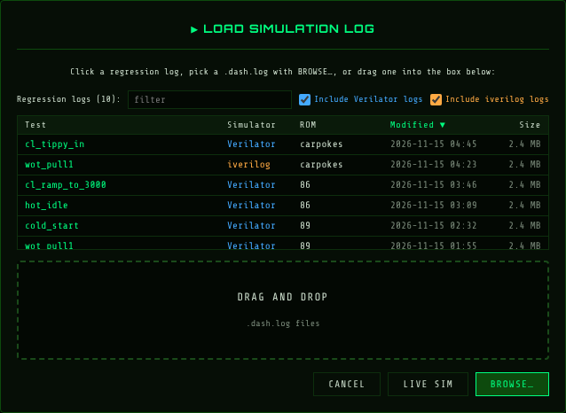

Only `.dash.log` files load from disk. The file dialog can filter only on the
last extension, so it shows every `.log`; any other file you pick or drop is
refused with a red note. The header shows the file name, and for a log from
the list also its folder and simulator, e.g.
`89/v_dash_logs/warm_idle_5s.dash.log (Verilator)`.

The page opens at the **end** of the run, so both scrubbers can go back from
there. Combined DME+KLR logs, DME-only logs and the older formats all load
the same way.

You can also open a log from a URL with `?log=<url>`, for example
`http://localhost:5173/dme-dashboard/?log=/dme-dashboard/dash_logs/warm_idle_5s.dash.log`
when the file sits in the dashboard's `public/dash_logs/` and you run
`npm run dev`. Any URL the browser may fetch works, so a log on another server
needs that server to allow cross-origin requests.

Loading a log while connected to the simulator leaves live mode. The sim is
paused and keeps its state, and **LIVE** reconnects to it.

### Moving through the run

| Control | Does |
|---|---|
| **▶ PLAY / ⏸ PAUSE** | Steps through the snapshots at the chosen speed (0.2× to 10×, or MAX) |
| **◀ / ▶** | One snapshot back or forward |
| **⏮** | Back to the start |
| Slider | Drag to any snapshot |
| `t=… ms` and `n/N` | The time of the snapshot shown and its index |

Every tab shows the run at the scrubber's time. The charts draw a cursor line
there, and **clicking a chart moves the scrubber** to that time. That is the
quickest way to get from "something odd happens here" to the RAM and flags at
that moment.

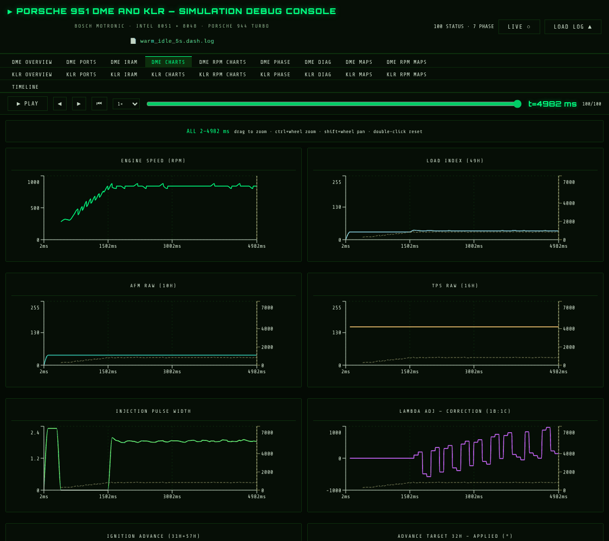

### Finding the moment to debug

Log review is usually the first step of a debug session:

1. Open the log and look at **DME CHARTS**, **KLR CHARTS** or **TIMELINE**.
2. Drag across the region of interest to zoom in (section 9). Click the event
   to put the scrubber on it.
3. Check **DME IRAM** / **KLR IRAM** and the flags there. Note the time from
   the scrubber (`t=… ms`) and the RAM locations involved.
4. To see *which code* produced it, take that time to the simulator
   ([section 7](#7-debugging-a-log-at-a-chosen-time)).

---

## 5. Live simulation

### Connecting

Start `run_lite.sh` (section 1), then do one of these:

* press **LIVE ○** in the header, or **LIVE SIM** in the load-log dialog
* open the page with `?live`, or `?live=<bridge url>` for a bridge on
  another port

While connected the button reads **● LIVE** and `?live` stays in the address
bar, so a reload reconnects. On connecting, the bridge replays the run so far,
so the charts are complete even if you open the page late. If the bridge isn't
running you see **● OFFLINE** and a red note telling you how to start it.

> **Note:** Page load errors have been observed in this version. Reloading
> the page resolves the issue and updates to the current running state.

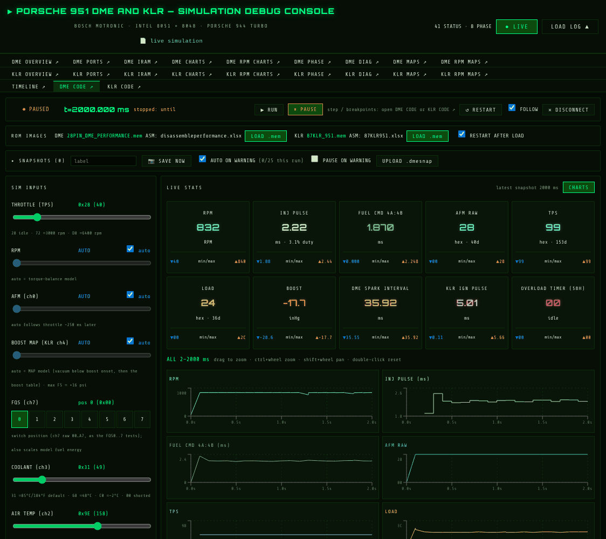

### The main page

**Run bar**

| Control | Does |
|---|---|
| **● RUNNING / PAUSED / OFFLINE**, `t=… ms` | Sim state and simulated time. While running it also shows the speed, about 20 simulated ms per second (roughly 50× slower than real time) |
| `stopped: …` | Why it stopped: `start`, `pause`, `until`, `step`, a breakpoint (with its condition and the value it saw) or a warning |
| **▶ RUN / ⏸ PAUSE** | Free-run and stop |
| **↺ RESTART** | Kill the sim and start again at t=0 on the loaded ROM images |
| **FOLLOW** | Keep every scrubber and chart cursor on the newest data. Untick it to look back while the sim runs on |
| **✕ DISCONNECT** | Leave live mode. The sim keeps running in the bridge |

Step, RUN TO and breakpoints are in the **DME CODE** and **KLR CODE** windows
(section 6).

**ROM IMAGES**: the image in each EPROM and the disassembly workbook its
listing comes from. See [section 10](#10-rom-images).

**SNAPSHOTS**: save, list and reload whole-model snapshots, and open
regression tests at a chosen time. See sections [7](#7-debugging-a-log-at-a-chosen-time)
and [8](#8-snapshots).

**SIM INPUTS**: the engine model's inputs. The engine runs on the closed-loop
model. The throttle is the input, AFM follows it about 250 ms later, and RPM
comes out of the torque balance.

| Input | Drives | Notes |
|---|---|---|
| THROTTLE (TPS) | Throttle command | 0x28 idle, 0x72 ≈ 3000 rpm, 0xD8 ≈ 6400 rpm |
| RPM | Engine speed | **auto** = torque-balance model. Untick to pin a value. Held at 840 until the firmware reports EngineSync |
| AFM (ch0) | DME ADC ch0 | **auto** follows the throttle |
| BOOST MAP (KLR ch4) | KLR MAP ADC | **auto** = MAP model. Pinned values are capped at 0xF5 (≈ +16 psi) because the KLR adds 10 and anything higher wraps to vacuum |
| FQS (ch7) | Fuel-quality switch position 0-7 | Also scales the model's fuel energy, as the FQS tests do |
| COOLANT, AIR TEMP, BATTERY, ALTITUDE | DME ADC ch3, ch2, ch1, ch4 | Raw bytes. The hints give the common values |
| AC (T1) | AC compressor load | The ISV should catch it |
| CAT (T0) | Catalytic converter fitted / not fitted | The firmware reads T0 as its has-cat flag (0 = fitted, the default) |
| O2 SENSOR | DME P1.6/P1.7 (the O2 comparator outputs) | **auto** follows the model's mixture. LEAN, CROSS and RICH pin the sensor there |
| KNOCK (KLR) | KLR knock sensor | **×N REVS** injects knock on the next N crank revolutions (the `TEST_KNOCK_PULSE` drop, 32 teeth after TDC), counting down as it goes. **CONTINUOUS** keeps knocking until **STOP**. The engine has to be turning |

A slider sends its value when you let go. Ticking **auto** hands the input
back to the model.

**SIM WARNINGS**: any `[WARN]`, `WARNING` or `ERROR` line from the model,
newest first. A 📷 beside a warning means a snapshot was saved there. Click it
to restart the sim from that moment. **✕** hides the box until the next
warning.

**LIVE STATS**: tiles for RPM, injector pulse (with duty, `HELD OPEN`,
`CUT`, `REV LIMIT`), fuel command, AFM, TPS, load, boost, DME spark interval,
KLR ignition pulse and the overload timer, each with its min and max. A tile
turns red on a fault condition. **CHARTS** shows or hides a chart of each
one, and the charts zoom like any other (section 9).

### Pop-out windows

In live mode each tab button (marked **↗**) opens that tab in a **window of
its own** instead of below the header. You can arrange the overview, charts,
timeline and both code debuggers across your screens while the sim runs.

* Allow pop-ups for the page. If the browser blocks one, the page tells you.
* The windows share the page's single connection to the bridge, so they all
  show the same run. Each has its own scrubber in the title area. Its title
  says `FOLLOW off` when FOLLOW is unticked.
* Clicking a tab button again brings its window to the front. Closing the main
  page closes them all. A window that hits an error shows it there, with
  **TRY AGAIN**, and the rest keep working.
* Chart windows redraw at most every 2 seconds while the sim runs, so a long
  run stays responsive.
* Live mode keeps about the last ten simulated minutes, and older data is
  dropped as the run goes on.

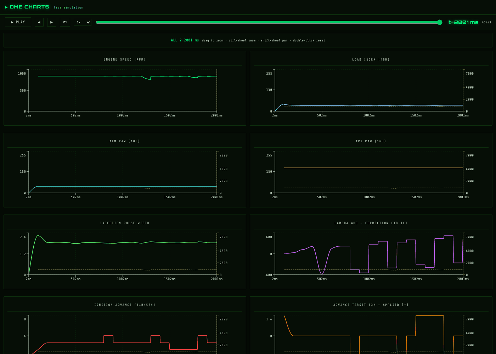

---

## 6. The code debugger

Open **DME CODE ↗** or **KLR CODE ↗** (row 3 of the tabs). Each opens a
window with the run bar, the breakpoints, the stack, the disassembly and the
instruction trace for that CPU.

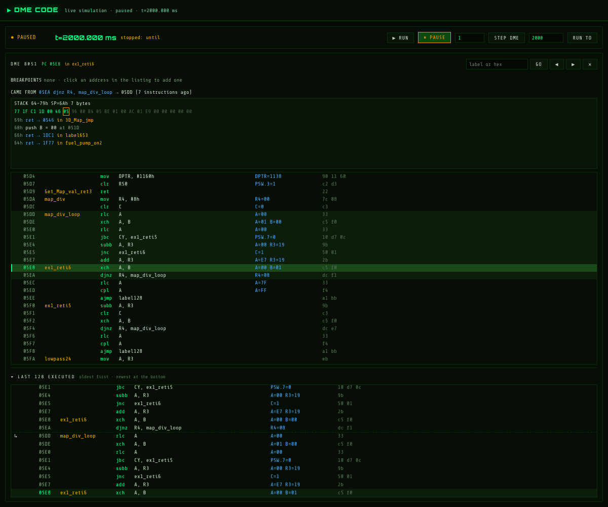

### Run bar

| Control | Does |
|---|---|
| **▶ RUN / ⏸ PAUSE** | As on the main page |
| *N* + **STEP DME** / **STEP KLR** | Run until this CPU has executed *N* instructions, then pause the whole simulation. Both CPUs share one simulated clock, so the other CPU only advances over that same short interval (a few instructions at most) and stops at the same moment |
| *ms* + **RUN TO** (or Enter) | Run until that simulated time, then pause |

The window title also shows the state and time, so you can tell where the
sim is from any window.

### The listing

The header shows the CPU, the current **PC** and the routine it is **in**
(the nearest label above the PC).

Each row shows, from left to right:

* the breakpoint marker (● red, ● amber when it has a condition, ○ when
  disabled)
* the address and its label
* the instruction and its operands, with full-length names from the
  disassembly workbooks
* **values** (blue): the operands as this instruction saw them the last time
  it ran, before it executed, e.g. `A=E7 R3=19`, `DPTR=1138`, `R0=37
  A=@R0[37]=15`. It stays blank for instructions that are not in the recent
  trace
* the instruction bytes

The PC row is highlighted green. Recently executed rows are lightly shaded.
Hover a row for the workbook's description of that line.

**Finding code.** Type in the **label or hex** box:

* Part of a label highlights every matching label as you type. **Enter** or
  **▶** goes to the next match and **Shift+Enter** or **◀** to the previous
  one. The counter shows `3/12`.
* A hex address followed by **GO** goes to that address.
* **PC** returns to the program counter. Every stop also returns there.

### Breakpoints

* **Click any row** in the listing to set a breakpoint there, and click it
  again to remove it.
* The **BREAKPOINTS** strip lists them: the checkbox enables or disables one
  (a disabled breakpoint keeps its place and condition), clicking the address
  shows it in the listing, **✕** removes it and **CLEAR ALL** removes all of
  them.
* When the sim stops on a breakpoint, the run bar says
  `stopped: bp dme 0003` and the listing centres on it.

### Memory-condition breakpoints

A breakpoint can also carry a memory condition. It then stops only when that
PC is about to run **and** a RAM byte (DME iram / KLR ram, 00h-7Fh), or one
bit of it, compares true.

1. Set the breakpoint, then click **+if** next to it in the strip.
2. Pick the location. Search by name (`rpm`, `ENGINE_RPM_RAW`, `flags`…) or
   type a hex address (`37`). For a single bit write it as `21.3`.
3. Choose `==`, `!=`, `<` or `>`, and type the value in hex (a bit compares
   with 0 or 1).
4. Press **SET** (or Enter). The editor shows the value **now** so you can
   check the condition before you run.

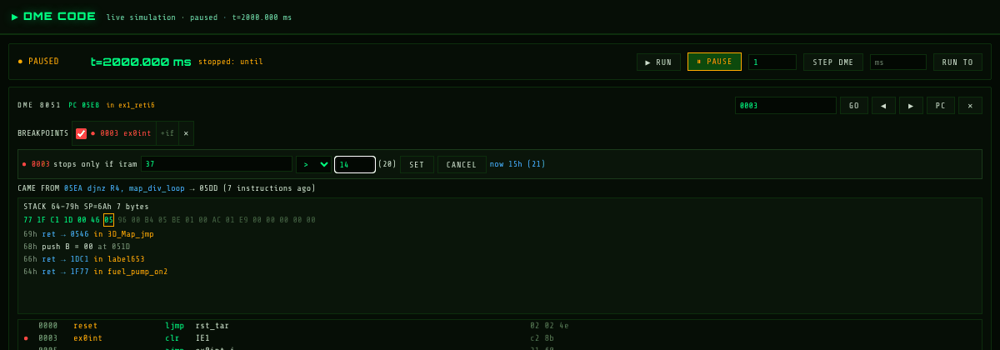

The comparison is unsigned and uses RAM as it is when the instruction is
fetched, before it executes. The strip then shows the condition, e.g. `if 37h
ENGINE_RPM_RAW > 14h`. Hover it to see whether it is true now, or click it to
edit it, or to remove it with **NO CONDITION**. When it stops, the run bar
and the strip show the value it compared:

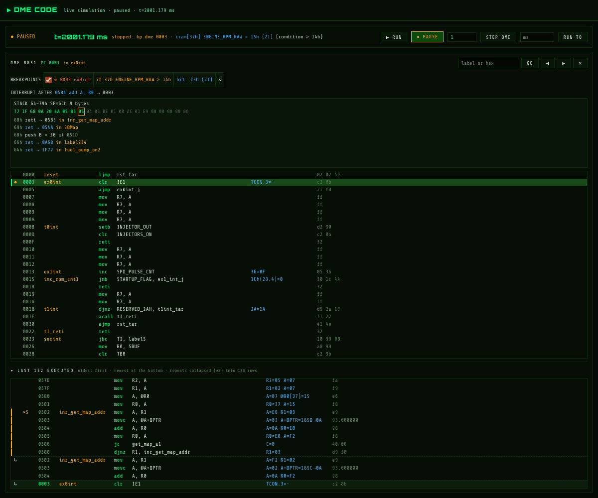

`stopped: bp dme 0003 · iram[37h] ENGINE_RPM_RAW = 15h (21) (condition > 14h)`
and `hit: 15h (21)` beside the breakpoint.

Some useful patterns:

| Breakpoint | Stops |
|---|---|
| `0003` (ex0int) `if 37 > 4B` | In the reference-sensor interrupt, only above 3000 rpm (37h × 40) |
| A routine `if 23.5 == 1` | Only while fuel is cut on overrun (FuelOffCoast, 23h bit 5) |
| A store instruction `if 58 != 0` | Only while the overload timer is running |

Breakpoints and their conditions are saved in snapshots and survive LOAD.

### Where the CPU came from

* **CAME FROM `05EA djnz R4, map_div_loop → 05DD` (7 instructions ago)**
  names the last jump, call, return or branch that led to the current code.
  After an interrupt it reads **INTERRUPT AFTER** with the instruction it
  interrupted. Click the address to see it in the listing.
* **STACK** dumps the stack area (DME 64h-79h; KLR 08h-17h, its 8-level stack) with the
  stack pointer boxed, then decodes it: `ret → 0546 in 3D_Map_jmp`,
  `reti → 0585 in inr_get_map_addr` with the saved PSW, and `push B = 00 at
  051D`. Click an entry to see it in the listing. A red **SP OUTSIDE STACK
  AREA** means the stack has overrun.
* **LAST N EXECUTED** is the instruction trace, oldest at the top and newest
  at the bottom, up to the last 512 instructions. `↳` and a dashed rule mark
  where control arrived by a jump, call, return or interrupt. Repeats of one
  instruction or a short loop collapse into one block with **×N** (the values
  shown are from the last pass). Click a row to show it in the listing. The
  trace is fetched each time the sim stops.

### From a terminal

The same commands work without the page, typed into `obj/dme_klr_live`
directly or posted to the bridge:

```sh
curl -X POST --data 'bp add dme 024E if 37 > 14' http://127.0.0.1:8951/cmd
curl -X POST --data 'until 2500' http://127.0.0.1:8951/cmd
```

The full list is in [section 11](#11-reference).

---

## 7. Debugging a log at a chosen time

A log is a record of a run. To step through the code behind it you need the
simulator to **run the same stimulus up to the same moment and stop there**.
How you do that depends on where the log came from.

| The log came from | Do this |
|---|---|
| A regression test (`run_tests.py`) | **A: open the test at a time** (below) |
| The live simulator | **B: RUN TO, or reload a snapshot** |

### A. Open a regression test at a time

The regression test runs in the package's debugger build (breakpoints,
stepping, the RAM views) with its own scripted stimulus. It is then run
to the time you give and paused. From that point it is the same run as the
log.

**1. Find the time in the log.** Load the test's `.dash.log` (section 4) and
put the scrubber on the event. Note the time and pick a start a little
**before** it, so your breakpoints catch the lead-up. For example, the event
is at 2700 ms, so start at 2500 ms.

**2. Connect to the simulator.** Open the live page with `run_lite.sh` running.

**3. Add the test at that time.** Open the **SNAPSHOTS** list (click its
title). In the **TEST** row type the test's name (as the scripts know it, e.g.
`cl_ramp_to_3000`; [Appendix A](#appendix-a-regression-tests) lists them all) and the time in ms, optionally a label in the label box,
then press **+ ADD**. A purple **TEST** row appears:

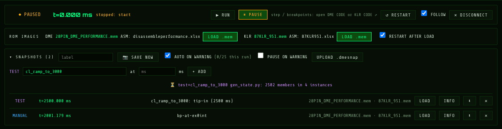

**4. LOAD it.** Press **LOAD** on the TEST row.

* Then it runs the test from t=0 to your time. This takes as long as the sim
  needs to get there, at about 20 simulated ms a second, so 2.5 s of engine
  time takes about two minutes. The charts fill in as it goes.
* It stops **paused** at your time (`stopped: until`). The SNAPSHOTS row
  reads `regression test <name>: inputs follow its script`.

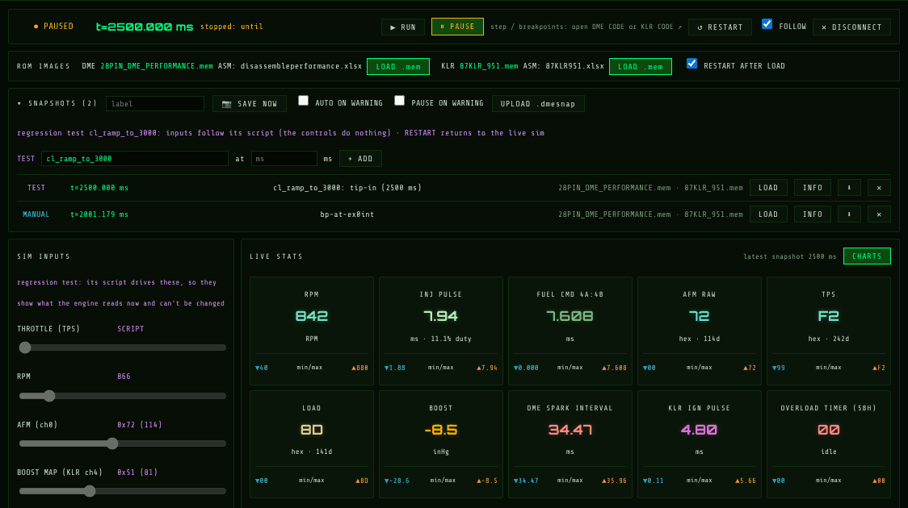

**5. Debug.** Open **DME CODE** / **KLR CODE**. Then:

* set PC breakpoints, with memory conditions on the RAM locations you
  noticed in the log (section 6)
* **RUN** to the first hit, **STEP** through it, read the values column,
  CAME FROM, STACK and trace
* use **RUN TO** to go to a later time
* the chart and IRAM windows show the same moment, for comparison with the
  log

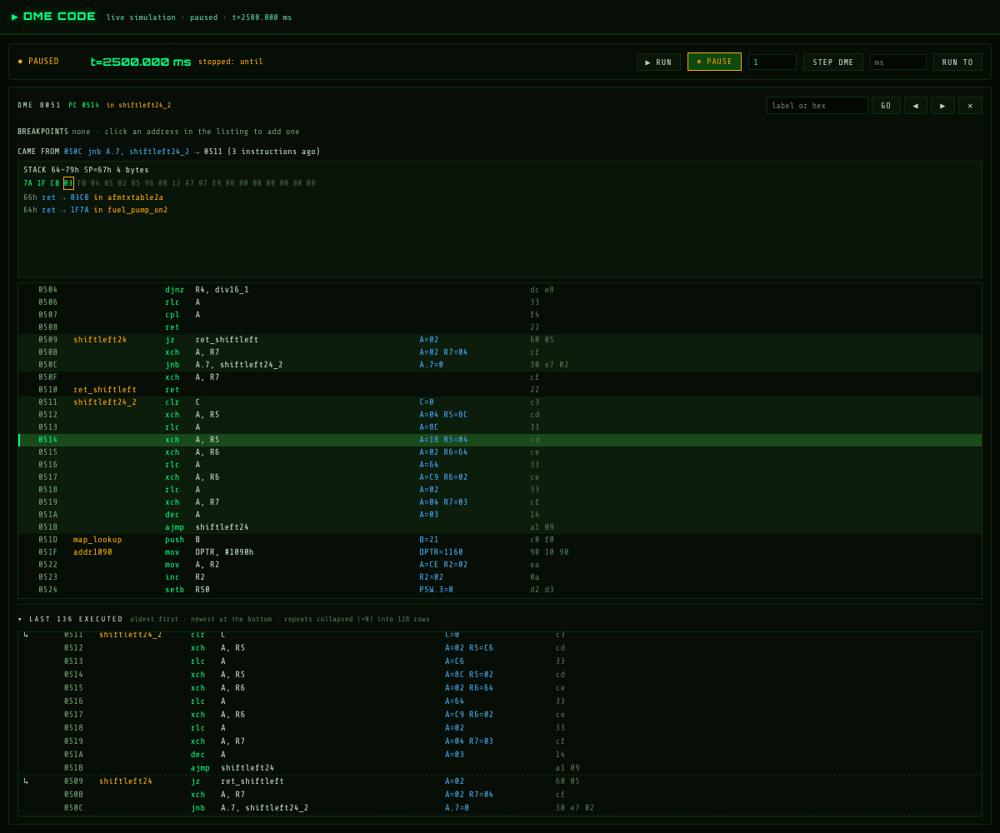

Things to know:

* **The inputs are the test's.** The SIM INPUTS show what the engine reads
  but can't be changed, and **SAVE NOW** can't save a test run.
* **↺ RESTART** leaves the test and goes back to the ordinary live simulator.
* **Breakpoints you set before LOAD are kept.** For a TEST row they take
  effect only from its time on, so the run up to it doesn't stop on them.
* **Warnings make TEST rows for you.** After each test, `run_tests.py`
  scans its log, and the first warning or error of each kind (at most 5 per
  test) becomes a TEST row that starts **200 ms before** the warning. So after
  a regression run, the SNAPSHOTS list already holds a way into every
  warning. **INFO** on a row shows the test, the trigger line, the time it
  runs to, its flags and ROMs.
* **Times line up.** The log's `t=` and the simulator's time are the same
  simulated milliseconds from reset.

### B. A run from the live simulator

The live sim is deterministic for the same inputs, so to get back to a moment:

* **RUN TO** that time from a fresh start (**↺ RESTART**, then enter the time
  in a code window and press **RUN TO**). This works when you didn't move any
  inputs before that time.
* If you changed inputs on the way, or want the moment of a warning, use a
  **snapshot**: one is saved on every warning (📷 in the warnings box), and
  **SAVE NOW** takes one by hand. **LOAD** restarts the sim at that moment,
  paused, with the same model state, inputs, breakpoints and ROMs. Then
  debug as above, with the inputs still yours to change.
* **PAUSE ON WARNING** stops the sim at each warning so you can look at it
  straight away.

### Limits

* A log from somewhere else, with no test or snapshot behind it, can be
  reviewed but not re-run.

---

## 8. Snapshots

A snapshot holds **the whole model**: both CPUs' registers, RAM and pipeline
state, the EPROMs, ADCs, timers, the engine, AFM, O2 and knock models, the
inputs, the breakpoints and the last 512 instructions of each CPU. Loading one
gives the same run as the original from that moment on.

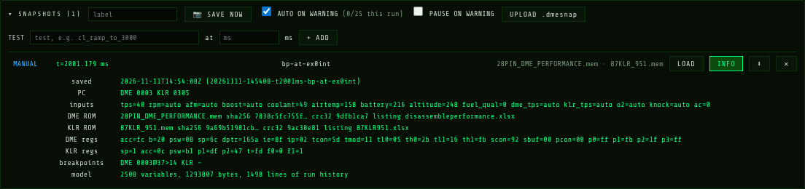

| Control | Does |
|---|---|
| **SNAPSHOTS (n)** | Click to open or close the list. A new snapshot opens it |
| label + **📷 SAVE NOW** | Save now, under that label (taken within a few ns, at the next quiet moment) |
| **AUTO ON WARNING** | Save one on each warning or error. At most once per simulated second per kind of warning, and 25 per run |
| **PAUSE ON WARNING** | Also pause after each warning's snapshot |
| **UPLOAD .dmesnap** | Add a snapshot downloaded earlier |
| **LOAD** | Restart the sim from it, paused (asks first if the sim is running) |
| **INFO** | Saved time, trigger, PCs, inputs, ROM identity (SHA-256, CRC32, listing), CPU registers, breakpoints |
| **⬇** | Download it as one `.dmesnap` file |
| **✕** | Delete it |

The coloured tag on each row tells you its kind: **WARN** / **FAIL** (red),
**MANUAL** (blue), **UPLOAD** (amber) and **TEST** (purple, section 7).

After a LOAD:

* the sim is paused at the snapshot's time, and the stats and IRAM views show
  the restored RAM
* the charts show the run's last 60,000 lines before it, so the lead-up is
  there
* RPM, AFM and boost that were on **auto** are pinned at their values then,
  so the engine holds that operating point while you step. Tick **auto** to
  let the model take over again. The other inputs are restored as they were
* the SNAPSHOTS row shows `running from snapshot <id>`

A snapshot loads only into the **same build** of the simulator, so one from
another package version may be refused with a red message. To share a moment
with someone on a different version, send them the INFO (inputs, ROMs, time)
instead.

Snapshots live in `data/dme_klr/snapshots/` in the package folder
(`DMEKLR_TMP` moves them).

---

## 9. Charts, Timeline and Maps in detail

### Zoom and navigation (every chart)

| Action | Does |
|---|---|
| Drag across a chart | Zoom to that span |
| Ctrl/⌘ + wheel, or pinch | Zoom in or out around the pointer |
| Shift + wheel | Pan |
| Double-click, or **RESET ZOOM** | Whole run again |
| Click (no drag) | Move the scrubber to that time |
| Hover | Synced tooltip across the charts of the tab |

DME CHARTS, KLR CHARTS, TIMELINE and the MAPS tabs **share one time zoom**:
zoom one and the others follow. The RPM tabs have their own RPM-range zoom.
In live mode a zoomed chart holds its window while the run goes on.

### TIMELINE

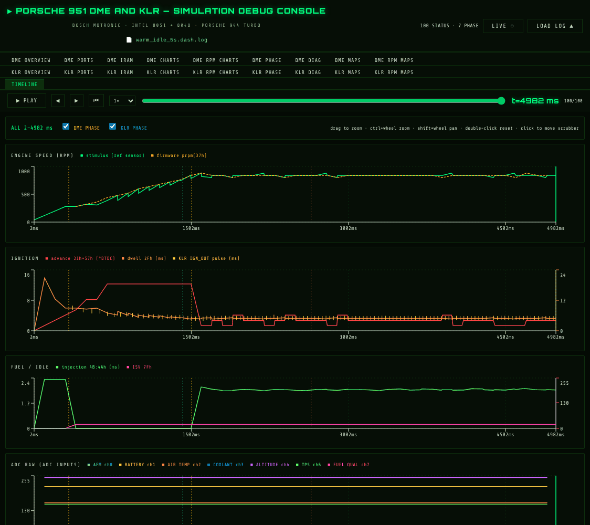

DME and KLR on one time axis: engine speed (stimulus and the firmware's
`prpm`), ignition (advance, dwell, KLR IGN_OUT pulses), fuel/idle, the raw ADC
inputs and the ADC values in DME RAM, the KLR, and **DME PHASE / KLR PHASE**
event markers (toggle them at the top). The tooltip lists phase events within
±60 ms.

**MEMORY PICKER** charts anything you choose against time:

1. Pick the source: **DME iram**, **KLR ram**, **DME map / table** or **KLR
   map / table**.
2. Search by name or hex address (`37`, `rpm`, `lambda`…), or by map number,
   address or name for maps. For a bit, enter it in the **bit** box.
3. **ADD** (or Enter). Each pick gets a coloured chip. Click the chip to hide
   or show it, use the unit selector to change how the tooltip shows the value
   (raw, ADC volts, battery volts, °C, RPM), and **✕** to remove it.

**MEMORY vs RPM** does the same against engine speed. Your picks are
remembered in the browser.

### DME MAPS / KLR MAPS

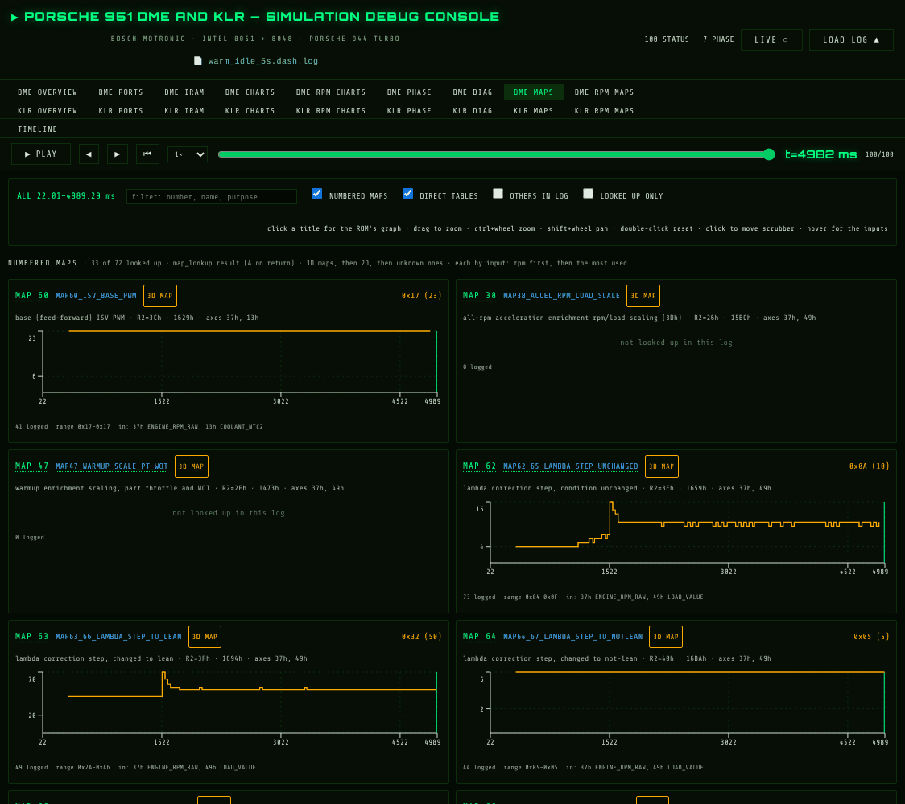

One small chart per map or table, showing the value the firmware got back from
each lookup over time. The header of each gives the map number, its name, 2D or
3D, its purpose, ROM address and input axes. The footer gives how many lookups
were logged, the range and the inputs at the hovered point.

* **filter** by number, name or purpose. **NUMBERED MAPS**, **DIRECT
  TABLES**, **OTHERS IN LOG** and **LOOKED UP ONLY** choose what is listed.
* **Click a chart's title** to see that map as it is in the ROM: a 2D map as
  a curve, a 3D map as a surface beside the raw grid, tables as steps or bars.
  The graphs come from the bridge (`map_graphs.py`), so **the bridge must be
  running even in log mode**. In log mode they are drawn for the ROM the log
  names, by hash, and once per ROM (about 20 s the first time).
* **DME RPM MAPS / KLR RPM MAPS** show only the maps with RPM as an input,
  each lookup a point against engine speed. A 3D map's points are coloured by
  its other input. KLR lookups are placed at the DME's RPM at that time.

### KLR overview and boost control

KLR OVERVIEW includes the boost-control view: the target from the KLR boost
map (by throttle from ram 43h and RPM) against the measured `ram[52h]`, in
psi / inHg.

---

## 10. ROM images

The **ROM IMAGES** row (live mode) shows the `.mem` image in each EPROM and
the workbook its listing comes from (`ASM: disassemble1989.xlsx`).

* **LOAD .mem** (while paused) loads another image into that CPU (a
  `.mem`, `.bin` or `.hex`, see below). With
  **RESTART AFTER LOAD** ticked (the default) the sim restarts at t=0 on it.
  Unticked, the image is swapped in place and the CPU carries on from its PC
  and RAM.
* The bridge takes a `.mem` image, a raw binary (`.bin`) or an Intel HEX
  file (`.hex`). A `.bin` or `.hex` is converted to a `.mem` as it is saved.
  An image larger than the EPROM (8192 bytes for the DME, 4096 for the KLR)
  is refused.
* The listing follows the image. Known images (the '86, '89 and performance
  DME, and the '86, '87 and '89 KLR) are matched by content or file name to
  their workbook.
* An image of your own gets a workbook made for it the first time it loads:
  `dme/disassemble/variants/<name>.xlsx` (KLR: `klr/disassemble/variants/`),
  built from the reference workbook (`disassembleperformance.xlsx`,
  `87KLR951.xlsx`) the same way the '86 and '89 workbooks are. Rows whose
  code is the same as the reference keep all their annotations; the rest
  are disassembled from the new bytes and highlighted. The listing then
  comes from it (`ASM: variants/<name>.xlsx`). Annotate it like any other
  workbook; it is rebuilt only when the reference workbook, its generator
  or the image changes (the old copy is kept as `<name>.prev.xlsx`), so
  copy your notes into the reference workbook if they should survive that.
  The `variants/` workbooks aren't git-ignored, so you can commit them.
  This needs bash and Python with pandas and openpyxl; without them an
  unknown image shows **ASM: no workbook** in amber, and the listing may not
  line up with the code.
* The bridge refuses a KLR image loaded into the DME.
* Uploaded images are reused on every restart until you load another or
  restart the bridge.

  > **Note:** Reloading the browser page resets the images to the defaults.

To start with other images, set `DME_ROM_DIR` / `DME_ROM_FILE` /
`KLR_ROM_DIR` / `KLR_ROM_FILE` for `run_lite.sh` or `run_tests.py`, for
example:

```sh
DME_ROM_DIR=~/roms/ DME_ROM_FILE=my_chip.bin ./run_lite.sh
```

The file may be a `.mem`, `.bin` or `.hex`; a `.bin` or `.hex` is converted
to a `.mem` first.

To convert an image yourself:

```sh
python3 bin_images/rom2mem.py my_chip.bin [my_chip.mem] [--cpu dme|klr]
```

`--cpu` checks that the image fits that CPU's EPROM.

### From ROM image to assembly view

A dumped EPROM is turned into the `.mem` file the simulator loads, and a
disassembly workbook is matched to it so the debugger can show annotated
assembly next to the running code.

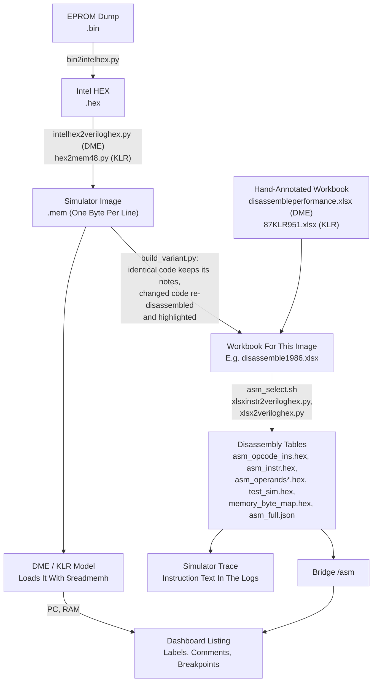

`asm_select.sh` runs automatically when a ROM loads. It
picks the workbook for the ROM in use and rebuilds the generated workbook and
tables only when their source is newer. A custom image with no workbook
still runs, but its listing shows **ASM: no workbook** and may not line up
with the code.

---

## 11. Reference

### URL parameters

| Parameter | Does |
|---|---|
| `?log=<url>` | Fetch and open that log |
| `?live` | Connect to the bridge at `http://127.0.0.1:8951` |
| `?live=<url>` | Connect to a bridge elsewhere |

### Simulator commands

> **Note:** These have not been tested in this release.

Typed into `obj/dme_klr_live` or posted to `http://127.0.0.1:8951/cmd`, one
per line:

| Command | Does |
|---|---|
| `run`, `pause` | Free-run, stop |
| `step dme\|klr [N]` | Run N instructions of that CPU |
| `until <ms>` | Run to that simulated time, then pause |
| `set <input> <value\|auto>` | `tps rpm afm boost fuel_qual coolant airtemp battery altitude ac cat o2 knock knock_revs`, plus `dme_tps klr_tps` (terminal only). `knock 1` knocks on every revolution, `knock_revs N` on the next N |
| `bp add\|del dme\|klr <hex>` | PC breakpoint |
| `bp add dme\|klr <hex> if <mem>[.<bit>] <op> <val>` | Conditional breakpoint (`==`, `!=`, `<`, `>`; unsigned; hex) |
| `bp clear` | Clear all breakpoints |
| `trace dme\|klr [N]` | Last N instruction addresses |
| `snap` | Dump a RAM snapshot now |
| `rom dme\|klr <path>` | Load a `.mem` image (paused) |
| `save [label]`, `load <dir>` | Save or restore a snapshot |
| `autosnap on\|off\|max <n>`, `breakonwarn on\|off` | Warning snapshots |
| `status`, `quit` | |

### Bridge options

`./run_lite.sh` passes its options to the bridge: `[--port 8951] [--sim obj/dme_klr_live] [--snapdir <dir>]
[--dme-asm <dir>] [--klr-asm <dir>] [--mapcache <dir>] [--allow-origin
<origin>] [--listen <address> --token <secret>]`. `--dme-asm` / `--klr-asm` pin a listing instead of following the
ROM. `--listen <address> --token <secret>` lets other machines on the LAN use this
one as a regression host (see RUN REGRESSIONS); without them the bridge
answers this machine only.

### Troubleshooting

| Symptom | Cause / fix |
|---|---|
| **● OFFLINE** and a red note | The bridge isn't running, or is on another port. Start `run_lite.sh`, or use `?live=<url>` |
| Clicking a tab in live mode does nothing | The browser blocked the pop-up. Allow pop-ups for the page |
| `No disassembly from the bridge.` | The bridge couldn't read the asm tables. Check its terminal output |
| **ASM: no workbook** | The ROM image has no matching workbook, so the listing may not line up |
| A map title shows no graph | The bridge isn't running, matplotlib is missing, or the log's ROM isn't in `bin_images/` or the uploaded images |
| Snapshot LOAD refused (red under the list) | It was saved by a different build. Reproduce it from its INFO |
| `No map lookups in this log` | The log predates the `[LKUP]` lines. Re-run the test |

---

## 12. Credits

This work is based on multiple public references, including
https://jhnbyrn.github.io
https://sourceforge.net/p/opendme
https://www.carpokes.com

Special thanks to users &#64;tom and &#64;johnb at Carpokes for their
contributions and feedback during development.

---

## Appendix A. Regression tests

These are the regression tests the package runs. Run them all with
`python3 run_tests.py`, or some by name or pattern
(`python3 run_tests.py warm_idle cl_ramp_*`); `--list` prints them with
their lengths. Each writes `<name>.dash.log`, which you open in the dashboard
as in [section 4](#4-log-review), and any of them can be opened live at a
chosen time from a SNAPSHOTS **TEST** row
([section 7](#7-debugging-a-log-at-a-chosen-time)).

"Idle" tests ramp the engine from 100 rpm cranking to an 840 rpm warm idle
unless the description says otherwise. "CL" (closed-loop) tests use the
engine model in which the firmware's own fuel and ignition set the RPM, and
include the KLR's boost model; the plain `ramp_to_*` tests drive RPM
directly from the testbench instead. Time is simulated seconds.

### Run times

The **Run time** column in the tables below is the wall-clock time for one
test on its own. The times were measured with the Linux lite package (v1.0)
on a 4-core cloud machine (Intel Xeon, 2.3 GHz), where a test takes about
40 s for each simulated second: about 39 s for the plain tests and 41.5 s
for the closed-loop (`cl_*`) ones, at any RPM. A recent desktop or an Apple
Silicon Mac will usually be faster, but the proportions stay the same.

Tests run side by side don't slow each other down as long as there is one
CPU core for each (measured: the same test took the same time alone and with
four running at once), so `-j N` divides the total by about N.
`run_tests.py` starts the longest tests first, so a run can't finish sooner
than its longest test: `cold_start` (120 simulated seconds) takes about
78 min, `cl_condition_cycle` about 50 min and the 60 s tests about 40 min.
Setting `-j` higher than the number of cores doesn't help.

| Group | Tests | One at a time | 4 at a time (`-j 4`) | 8 at a time (`-j 8`) |
|---|---|---|---|---|
| Idle | 12 | 4.0 h | 78 min | 78 min |
| Closed-loop drive cycles | 14 | 6.5 h | 1.7 h | 52 min |
| Open-loop RPM sweeps, ignition and idle valve | 9 | 2.1 h | 39 min | 39 min |
| Fuel-quality sweeps | 16 | 7.2 h | 1.8 h | 54 min |
| Knock | 6 | 1.9 h | 33 min | 26 min |
| DME sensor faults | 19 | 2.1 h | 31 min | 16 min |
| KLR sensor and wiring faults | 13 | 75 min | 21 min | 11 min |
| Boost | 6 | 77 min | 21 min | 21 min |
| **All 95 tests** | 95 | **26.2 h** | **6.5 h** | **3.3 h** |

The group and suite times are worked out from the single-test times, in the
order `run_tests.py` starts them. The 8-at-a-time column assumes 8 cores of
the same speed; the machine they were measured on has only 4.

### <a id="tests-idle"></a>Idle

| Test | Time | Run time | What it checks |
|---|---|---|---|
| `warm_idle` | 60 s | 39 min | Baseline warm idle; the reference run the other idle tests are compared with |
| `warm_idle_5s` | 5 s | 3 min | Same warm idle over the same 5 s window as the sensor-fault tests, for side-by-side comparison |
| `cold_start` | 120 s | 78 min | Cold engine start with the lambda warm-up left on |
| `hot_idle` | 25 s | 16 min | Idle with a very hot coolant reading |
| `idle_battery_low` | 5 s | 3 min | Idle with a low battery voltage reading |
| `idle_high_alt` | 5 s | 3 min | Idle with the altitude sensor at the high-altitude end of its range |
| `altitude_disconnected` | 5 s | 3 min | Altitude sensor open circuit (reads 0xFF, an impossible "below sea level" value). No DTC expected |
| `idle_poor_fuel` | 5 s | 3 min | Idle with the worst fuel-quality reading (0xA7, same as FQS7) |
| `fuel_qual_disconnected` | 5 s | 3 min | Fuel-quality sensor open circuit (0xFF). No DTC expected |
| `ac_on_idle` | 10 s | 6 min | Idle with the AC compressor on |
| `warmup_enrichment` | 60 s | 39 min | Cold idle with lambda warm-up, to watch warm-up enrichment taper off |
| `dme_klr_warm_idle` | 60 s | 39 min | Warm idle as a combined DME + KLR check |

### <a id="tests-closed-loop-drive-cycles"></a>Closed-loop drive cycles

| Test | Time | Run time | What it checks |
|---|---|---|---|
| `cl_warm_idle` | 60 s | 42 min | Closed-loop warm idle |
| `cl_cold_start` | 60 s | 42 min | Closed-loop cold start with a real cranking ramp and no lambda warm-up skip |
| `cl_tippy_in` | 20 s | 14 min | A sudden throttle blip at idle, for acceleration enrichment, then back to idle |
| `cl_ramp_to_3000` | 30 s | 21 min | Throttle opens to settle near 3000 rpm |
| `cl_ramp_to_3000_BOOST` | 30 s | 21 min | The same ramp, kept as the boost-model reference |
| `cl_ramp_to_4500` | 35 s | 24 min | Throttle opens to settle near 4500 rpm |
| `cl_ramp_to_6000` | 40 s | 28 min | Throttle opens to settle near 6000 rpm |
| `cl_ramp_to_6000_BOOST` | 40 s | 28 min | The 6000 rpm ramp with a faster throttle opening |
| `cl_ramp_to_redline` | 15 s | 10 min | Throttle to redline, to see the rev limiter |
| `cl_condition_cycle` | 73 s | 50 min | Ramp to 3000 rpm, then six 7 s phases, one at a time: cold air, cold coolant, high altitude, no cat, AC on, low battery |
| `cl_condition_cycle_idle` | 47 s | 33 min | The same six phases at idle |
| `cl_ac_halfway` | 20 s | 14 min | Warm closed-loop idle with the AC switched on halfway through |
| `cl_idle_controlled_by_isv` | 45 s | 31 min | As `cl_ac_halfway`, but with the idle valve's bypass air modelled so the firmware's idle control has to bring RPM back |
| `overrun_cutoff` | 50 s | 35 min | Hold about 2100 rpm, then lift off: the firmware should cut fuel while coasting and bring it back near idle |

### <a id="tests-open-loop-rpm-sweeps-ignition-and-idle-valve"></a>Open-loop RPM sweeps, ignition and idle valve

| Test | Time | Run time | What it checks |
|---|---|---|---|
| `ramp_to_3000` | 10 s | 6 min | RPM ramp to 3000 |
| `ramp_to_6000` | 40 s | 26 min | RPM ramp to 6000 |
| `ramp_to_6300` | 15 s | 10 min | RPM ramp to 6300 |
| `ramp_to_redline` | 10 s | 6 min | RPM ramp to 6500 |
| `ramp_6k_hold` | 15 s | 10 min | Ramp to 6000 rpm and hold there |
| `ignition_timing` | 15 s | 10 min | Ignition advance across a fast ramp to 6000 rpm |
| `dwell_scaling` | 15 s | 10 min | Coil dwell across a slow ramp to 6000 rpm |
| `isv_cold_idle` | 60 s | 39 min | Idle valve opening and closing during a cold idle |
| `isv_load_droop` | 12 s | 8 min | RPM dips to 650 for 0.5 s at 5 s, to see the idle valve respond |

### <a id="tests-fuel-quality-sweeps"></a>Fuel-quality sweeps

| Test | Time | Run time | What it checks |
|---|---|---|---|
| `cl_ramp_to_6000_FQS0` … `FQS7` | 40 s each | 28 min each | `cl_ramp_to_6000` with the fuel-quality input stepped through eight values (0x00 to 0xA7) and the engine model's fuel energy adjusted to match |
| `ramp_to_6000_FQS0` … `FQS7` | 40 s each | 26 min each | `ramp_to_6000` with the same eight fuel-quality values |

### <a id="tests-knock"></a>Knock

| Test | Time | Run time | What it checks |
|---|---|---|---|
| `ramp_to_6000_knock` | 40 s | 26 min | Knock pulses on one cylinder for 10 cycles halfway through, then RPM ramps back down, to see the KLR retard and recover |
| `knock_sensor_defect` | 40 s | 26 min | Broken connection to the knock circuit (noise level forced low), so the KLR should flag a knock sensor fault |
| `knock_sensor_short_to_ground` | 40 s | 26 min | Knock sensor signal shorted to ground |
| `cl_ramp_to_3000_KLR_KNOCK_BLOCKED` | 30 s | 21 min | The broken knock connection during a closed-loop ramp to 3000 rpm |
| `cl_ramp_to_6000_KLR_ADC0_NOISE_HIGH` | 10 s | 7 min | KLR knock noise-level input reading high |
| `cl_ramp_to_6000_KLR_ADC0_NOISE_LOW` | 10 s | 7 min | KLR knock noise-level input stuck at 0x80 |

### <a id="tests-dme-sensor-faults"></a>DME sensor faults

| Test | Time | Run time | What it checks |
|---|---|---|---|
| `afm_open_circuit` | 5 s | 3 min | Air-flow meter signal lost |
| `afm_short_to_ground` | 5 s | 3 min | Air-flow meter wiper shorted to ground (0x00) |
| `battery_disconnected` | 5 s | 3 min | DME battery sense open (0x00), unlike `idle_battery_low` which is only low |
| `coolant_fail` | 5 s | 3 min | Coolant sensor shorted (0x00, reads as very hot) |
| `coolant_open_circuit` | 5 s | 3 min | Coolant sensor open (0xFF) |
| `airtemp_fail` | 5 s | 3 min | Air temperature sensor shorted (0x00) |
| `airtemp_open_circuit` | 5 s | 3 min | Air temperature sensor open (0xFF) |
| `tps_fail` | 5 s | 3 min | DME throttle/idle input held at mid-scale (0x80) |
| `tps_ch6_short_to_ground` | 5 s | 3 min | DME throttle/idle input shorted to ground (0x00) |
| `tps_ch6_open_circuit` | 5 s | 3 min | DME throttle/idle input open (0xFF) |
| `o2_baseline` | 25 s | 16 min | Normal oxygen sensor, the reference for the three below |
| `o2_disconnected` | 25 s | 16 min | Oxygen sensor disconnected (flat signal) |
| `o2_rich_stuck` | 25 s | 16 min | Oxygen sensor stuck reading rich |
| `o2_lean_stuck` | 25 s | 16 min | Oxygen sensor stuck reading lean |
| `ref_sensor_loss` | 8 s | 5 min | Reference (crank position) sensor signal stops at 3.5 s while the engine keeps running |
| `ref_sensor_stuck_low` | 8 s | 5 min | Reference sensor shorted to ground from 3.5 s |
| `ref_sensor_missing_at_start` | 8 s | 5 min | No reference signal from power-on, so the DME has to sync on the speed sensor alone |
| `speed_sensor_loss` | 8 s | 5 min | Speed (flywheel tooth) sensor signal stops at 3.5 s |
| `speed_sensor_stuck_low` | 8 s | 5 min | Speed sensor shorted to ground from 3.5 s |

### <a id="tests-klr-sensor-and-wiring-faults"></a>KLR sensor and wiring faults

Unless shown otherwise these run the `cl_ramp_to_3000` profile, cut short
once the fault has shown up.

| Test | Time | Run time | What it checks |
|---|---|---|---|
| `tps_open_circuit` | 10 s | 6 min | KLR throttle sensor open (0xFF) at idle; expect DTC 4-2 |
| `ramp_to_redline_KLR_TPS_HIGH` | 10 s | 6 min | `ramp_to_redline` with the throttle sensor allowed past its legal maximum; expect DTC 4-2 |
| `cl_ramp_to_3000_TPS0` | 8 s | 6 min | KLR throttle sensor shorted to ground (0x00) |
| `cl_ramp_to_3000_KLR_TPS_SUPPLY_LOW` | 8 s | 6 min | KLR throttle sensor supply voltage low |
| `cl_ramp_to_3000_KLR_TPS_SUPPLY_LOST` | 8 s | 6 min | KLR throttle sensor supply gone (0x00) |
| `cl_ramp_to_3000_KLR_BATT_LOW` | 11 s | 8 min | KLR battery reading low |
| `cl_ramp_to_3000_KLR_BATT_DISCONNECTED` | 11 s | 8 min | KLR battery sense open (reads 0) |
| `cl_ramp_to_3000_KLR_TRIGGER_STUCK_HIGH` | 6 s | 4 min | Crank reference wire to the KLR stuck high from 3 s, holding the KLR in reset |
| `cl_ramp_to_3000_KLR_TRIGGER_STUCK_LOW` | 6 s | 4 min | The same wire stuck low, so the KLR never re-syncs to TDC (not yet confirmed on a real car) |
| `cl_ramp_to_3000_KLR_IGN_IN_STUCK_HIGH` | 6 s | 4 min | DME ignition signal to the KLR stuck high from 3 s |
| `cl_ramp_to_3000_KLR_IGN_IN_STUCK_LOW` | 6 s | 4 min | The same signal stuck low (not yet confirmed on a real car) |
| `cl_ramp_to_3000_KLR_FULL_LOAD_STUCK_HIGH` | 10 s | 7 min | KLR-to-DME full-load wire stuck at the full-throttle level during a part-throttle ramp |
| `cl_ramp_to_6000_KLR_FULL_LOAD_STUCK_LOW` | 10 s | 7 min | The full-load wire stuck low, so the DME never sees full throttle |

### <a id="tests-boost"></a>Boost

| Test | Time | Run time | What it checks |
|---|---|---|---|
| `cl_ramp_to_3000_BOOST_OPEN_CIRCUIT` | 10 s | 7 min | Boost (MAP) sensor open (0xFF) |
| `cl_ramp_to_3000_BOOST_STEP_OVERBOOST` | 30 s | 21 min | Boost held at 4 psi, then raised 1 psi a second, to find where the KLR sets DTC 3-2 (overboost) |
| `cl_ramp_to_3000_BOOST_STEP_DOWN` | 30 s | 21 min | Boost lowered 1 psi a second from 4 psi into vacuum, to find where the KLR sets DTC 3-1 (boost too low) |
| `cl_ramp_to_5000_BOOST_LOW` | 10 s | 7 min | Boost reading lower than normal (a boost leak) on a ramp to 5000 rpm |
| `cl_ramp_to_6000_BOOST_LOW` | 20 s | 14 min | The same low boost on a ramp to 6000 rpm |
| `cl_wot_3000_BOOST_ZERO` | 12 s | 8 min | Boost sensor shorted (0x00) at full throttle with the rev limiter set to 3000 rpm; expect DTC 3-3 at about 9.4 s |

## Appendix B. How the closed-loop models work

In a closed-loop (CL) test the engine responds to the firmware: the DME's
own fuel decides the RPM, the RPM and throttle decide the air, and the
sensors report what the engine is doing. Nothing in the loop is scripted
except the driver (the throttle command) and any fault the test injects.
The plain `ramp_to_*` tests are open loop: there the testbench sets RPM on a
fixed ramp and the firmware's output doesn't change it.

The models live in `dme/bench/verilog/var_interrupt_gen_cl.v` (engine,
crank signals, AFM), `dme/bench/verilog/i8051_dashboard_tb.v` (DME inputs,
O2 sensor) and `klr/bench/verilog/klr_tb.v` / `knock_gen.v` (KLR inputs,
boost, knock). The numbers below are the defaults; most can be changed
with a `-D` define.

### The loop

```
 driver throttle ──► TPS / AFM ──► DME firmware ──► injector pulse (4B:4A)
                        ▲                                   │
                        │                                   ▼
         MAP, O2, KLR ◄─┴──── RPM ◄──── torque balance (once per rev)
```

### Engine (RPM)

Once per crank revolution, on the reference pulse, the model does a
torque balance:

- **Fuel.** It reads the pulse width the firmware just computed
  (iram 4B:4A). If nothing was injected since the last update (fuel cut,
  iram 23h bit 5, or the rev limiter skipping the injection) the fuel is 0.
- **Combustion** is air-limited. The fuel the cylinder's air could burn at
  stoich is the firmware's own load per stroke (iram 46:47) times 1.025. The
  burned fuel is the smaller of that and the injected fuel, so fuel past
  stoich (full-load enrichment, a rich mixture) adds no torque, and a lean
  mixture loses torque. At altitude the air is scaled down further for the
  thinner air.
- **Friction** is a base value, plus a term that rises with RPM squared,
  plus a cubic term above 4000 rpm, plus extra load when the AC is on. These
  were fitted to three settled operating points (idle, about 2850 rpm and
  about 6650 rpm), which is what makes the engine settle at a speed for a
  given throttle instead of climbing to the limiter.
- **RPM** changes by combustion minus friction, divided by an inertia
  factor, and is clamped between 400 rpm (stall) and 6800 rpm (rev limiter,
  or `CL_RPM_MAX`).

Before the firmware reports engine sync (iram 21h bit 0) RPM is held at
idle. `cl_cold_start` instead ramps from cranking speed up to idle so the
firmware sees a real crank.

### Crank signals

From the current RPM the model generates the two crank inputs the real
car has: the **speed sensor** (flywheel teeth, to DME P3.3/INT1) and the
**reference sensor** (once per rev, to P3.2/INT0). The tooth period follows
RPM, so everything timed off the crank (ignition, injection, dwell) moves
with it. Fault tests stop, short or remove these signals at a set time.

### DME inputs

| Input | How it's modelled |
|---|---|
| **AFM** (ADC ch0) | Ramp tests: the driver's throttle command steps at 2 s and the AFM slews toward it about 250 ms behind the throttle (air takes time to follow). Idle tests: throttle closed, AFM at the idle base plus the idle valve's bypass air. Overrun fuel cut: AFM scales down with the falling RPM and boost |
| **Throttle switch** (ch6) | Closed (0x99, about 3.0 V) when the throttle is at idle; off-idle or full-load levels when it opens. The KLR's full-load line reaches ch6 through the real board's RC filter (about 4.7 ms) |
| **Battery** (ch1) | Fixed at 0xD8 unless a test lowers or disconnects it |
| **Air temp / coolant** (ch2 / ch3) | Fixed raw sensor values for the test (warm: coolant 0x31 ≈ 85 °C, air 0x9E ≈ 20 °C); the firmware linearises them |
| **Altitude** (ch4) | Fixed (0xF8 = sea level). At altitude the AFM reads flow × √(air density), as a flap meter does |
| **Fuel quality** (ch7) | Fixed per test (the FQS0 to FQS7 positions) |
| **O2 sensor** (P1 comparators) | Follows the mixture the firmware actually delivers: injected fuel ÷ load, rich above 1.025. The result passes through 150 ms of exhaust delay and a 30 ms sensor lag between 100 mV (lean) and 850 mV (rich), then the two comparators at 450 and 550 mV. With no injection the exhaust reads lean. This lets the lambda integrator (iram 1Bh) cycle around stoich as on the car |
| **AC, cat** (T1, T0) | On/off per test, or switched at set times in the condition-cycle tests |

### KLR inputs

| Input | How it's modelled |
|---|---|
| **Crank trigger** (`trigger_in`) | The DME's KLR ignition output, which resets the KLR CPU every cycle, as on the car |
| **DME ignition** (`ign_in`) | The DME's tach pulse |
| **Throttle angle** (ch7) | Follows the throttle (the AFM without the idle valve's bypass air), clamped at the sensor's legal maximum 0xDB, and ratiometric to the TPS supply (ch3, normally 0xFF) |
| **Battery** (ch1) | Fixed at 0xD8 unless a test lowers or disconnects it |
| **MAP / boost** (ch4) | Below boost onset it is manifold vacuum from throttle and RPM (about 42 kPa at warm idle, down to about 25 kPa on a closed-throttle overrun, up to 1 bar at onset). Above onset it follows the KLR's own boost target map at the current RPM and throttle. A 500 ms lag stands in for turbo spool; during a fuel cut the turbo spools down faster (150 ms) |
| **Knock** (ch5, ch0) | `knock_sum` (ch5) is the knock comparator: a base sensor level, raised when the KLR's own self-test fires or a knock test injects pulses. `knock_noise` (ch0) is a rolling average of the sensor level, the KLR's noise reference |
| **Full load** (P1.5 out) | The KLR's WOT flag to the DME. It pulses high on every KLR reset, as the real port floats high, and the DME's RC filter averages that out |

### Live mode

The live simulator runs the same closed-loop model. The controls on the
main page override single inputs (throttle, RPM, boost, battery and so on);
an input left on **auto** follows the model. Pinning RPM replaces the torque
balance's result, so the engine holds that speed whatever the fuel is.

### Limits

The models are fitted to a handful of settled operating points, not to a
full engine map. Targets between those points (for example
`cl_ramp_to_4500` and `cl_ramp_to_5000`) were tuned by trial runs, so check
the settled RPM in the log rather than assuming the target. Fuel-quality
positions change the firmware's fuel and timing but not the engine model's
torque, since the 951's fuel-quality plug selects octane rather than energy.


---

Copyright 2026 Michael Whalen. No affiliation with Dr. Ing. h.c. F. Porsche AG or any of its affiliates.
